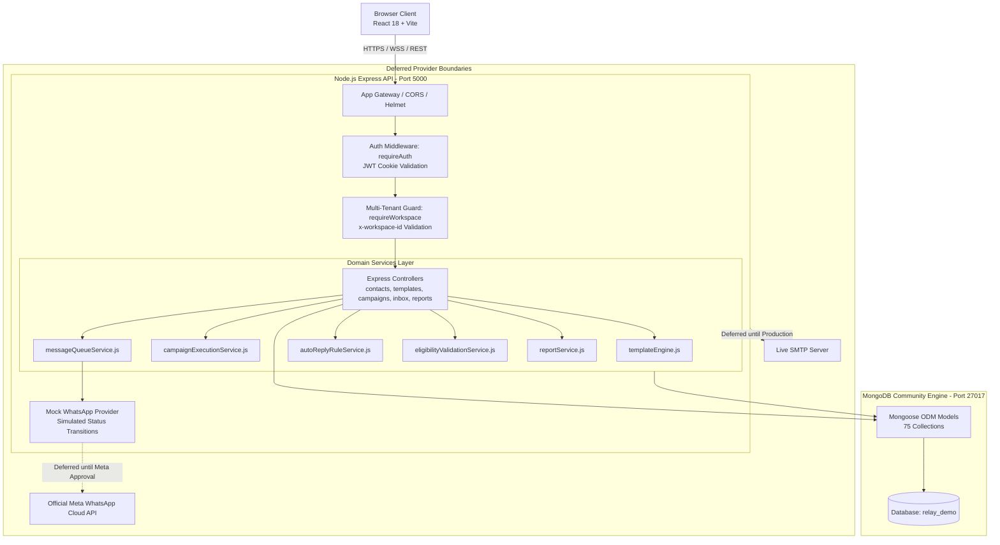
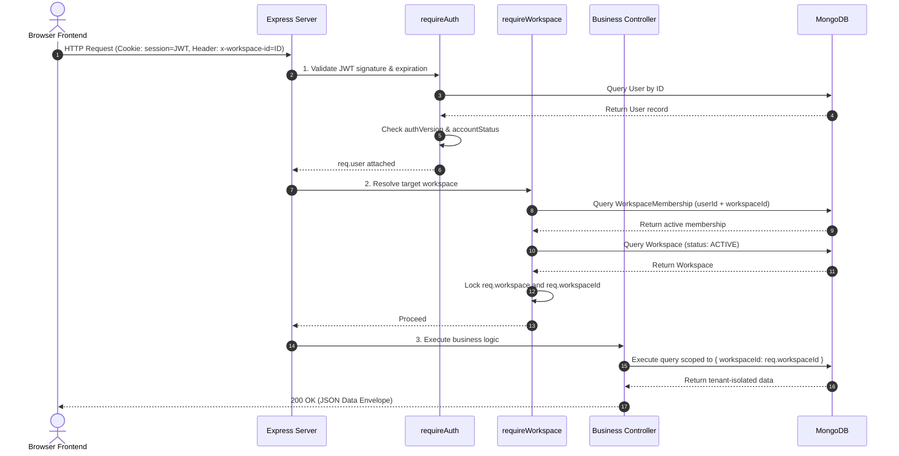

# RELAY — SYSTEM ARCHITECTURE DOCUMENT
## Technical Architecture, Multi-Tenant Boundary & Request Lifecycle

> **Document Version:** 1.0.0 (Master Architecture Specification)  
> **Status:** Active / Source of Truth  
> **Primary Business Scope:** M2W Realty Workspace (`6adaf2ccbaacf0587d451ae6`)  
> **Repository Root:** `/Users/sumitthakur/Desktop/Relay`  

---

## 1. System Topology Overview

Relay is built as a modular JavaScript monorepo comprising a modern **React 18 Single Page Application (SPA)** and a stateless **Node.js Express REST API**, backed by **MongoDB**.



---

## 2. Frontend Architecture

### 2.1 Technology Stack
- **Framework & Build:** React 18.3.1, Vite 6.0.5, ES Modules.
- **Routing:** React Router DOM v7 (configured with nested layouts and protected route wrappers).
- **Styling:** Vanilla CSS design tokens combined with Tailwind CSS v4 utilities. Centralized application shell tokens in [`frontend/src/layout/appShell.css`](file:///Users/sumitthakur/Desktop/Relay/frontend/src/layout/appShell.css).
- **Icons:** Lucide React (`lucide-react`).
- **Charts:** Recharts (`recharts`) for analytics and conversion visualizations.

### 2.2 Global State Management
Relay avoids heavy Redux/Zustand boilerplate by using structured **React Context Providers**:
1. [`AuthContext.jsx`](file:///Users/sumitthakur/Desktop/Relay/frontend/src/context/AuthContext.jsx): Tracks active session (`user`), authentication status (`loading`), login/logout lifecycle, and profile changes.
2. [`WorkspaceContext.jsx`](file:///Users/sumitthakur/Desktop/Relay/frontend/src/context/WorkspaceContext.jsx): Manages active business tenant (`currentWorkspace`), user membership permissions (`membership`), and workspace switching. Injects `x-workspace-id` into Axios HTTP requests via an interceptor.

### 2.3 Route Registry
The frontend defines four distinct route tiers in [`frontend/src/App.jsx`](file:///Users/sumitthakur/Desktop/Relay/frontend/src/App.jsx):
- **Public Marketing Tier:** `/`, `/features`, `/industries`, `/how-it-works`, `/pricing`, `/faq`, `/contact`, `/terms`, `/privacy`, `/signup`.
- **Authentication Tier:** `/login`, `/register`, `/verify-email`, `/forgot-password`, `/reset-password`, `/onboarding`, `/onboarding/handoff`.
- **Primary Authenticated Workspace Tier (Wrapped by `ProtectedRoute` & `AppLayout`):**
  - `/app` (or `/app/overview`) — Overview Dashboard
  - `/contacts` (or `/app/contacts`) — Contacts & Lead Directory
  - `/import` — Excel/CSV Staged Ingestion
  - `/templates` (or `/app/templates`) — Message Templates Studio
  - `/campaigns` (or `/app/campaigns`) — Campaigns Orchestration & Wizard
  - `/inbox` (or `/app/inbox`) — Two-Way Inbox & Auto-reply Rules
  - `/reports` (or `/app/reports`) — Delivery & Performance Reports
  - `/settings` (or `/app/settings`) — Account & Workspace Settings
- **Privileged Management Tier:** `/admin` (SuperAdmin Platform Console), `/agency` (Agency Management Portal).

---

## 3. Backend Architecture

### 3.1 Technology Stack
- **Runtime:** Node.js 20+ (ES Modules: `"type": "module"`).
- **Web Framework:** Express 4.21.2.
- **Database ODM:** Mongoose 8.9.5.
- **Security & Headers:** Helmet 8.0.0, CORS, Cookie-Parser, Express-Rate-Limit.
- **Phone Validation:** `libphonenumber-js` (E.164 normalization).
- **Excel/CSV Engine:** `exceljs` and `csv-parse`.

### 3.2 Modular Layer Pattern
The backend enforces a strict separation of concerns:
```
backend/src/
├── app.js               # Express application configuration, middleware, and route mounting
├── server.js            # Database bootstrap, worker initialization, and HTTP listener
├── config/              # MongoDB connection and environment configuration
├── middleware/          # requireAuth, requireWorkspace, adminAuth, error handling
├── models/              # Mongoose schemas with validation and compound indexes (75 models)
├── controllers/         # HTTP request parsing, status codes, and response formatting
├── services/            # Pure business logic, queue processing, template rendering, data export
└── routes/              # Route definitions mapping URI paths to controller methods
```

---

## 4. Security & Multi-Tenant Authorization Pipeline

### 4.1 End-to-End Request Pipeline
Every request to a workspace endpoint passes through the following security pipeline:



### 4.2 Multi-Tenant Invariants
1. **Mandatory Header Verification:** Requests carrying `x-workspace-id` must match a verified `WorkspaceMembership` where `userId === req.user._id` and `status === 'ACTIVE'`.
2. **Fail-Closed Principle:** If a user requests a workspace they do not belong to, the server immediately halts with `403 FORBIDDEN_WORKSPACE_ACCESS`.
3. **Database Query Scoping:** Every database operation in controllers and services must explicitly filter by `workspaceId: req.workspaceId` or `ownerId: req.user._id`.

---

## 5. Domain Services & Asynchronous Worker Engines

### 5.1 Message Queue & Delivery Simulator (`messageQueueService.js`)
- **Queue Initialization:** Automatically started in `server.js` (`startMessageWorker()`).
- **Simulated Transitions:** Messages transition through realistic lifecycle states:
  $$\text{Draft} \longrightarrow \text{QUEUED} \longrightarrow \text{PROCESSING} \longrightarrow \text{SENT} \longrightarrow \text{DELIVERED} \longrightarrow \text{READ}$$
- **Delivery Delays:** Incorporates randomized artificial delays (80ms to 240ms) to mirror realistic network conditions without relying on third-party APIs.
- **Receipt Updates:** Generates corresponding `ConversationMessage` updates and `MessageEvent` audit entries.

### 5.2 Campaign Execution Service (`campaignExecutionService.js`)
- **Batch Processing:** Processes recipient batches for scheduled campaigns.
- **Strict Eligibility Gating:** Evaluates each contact against affirmative consent requirements via `eligibilityValidationService.js`.
- **Deduplication:** Prevents duplicate messaging to the same phone number within a single broadcast.

### 5.3 Keyword Auto-Reply Engine (`autoReplyRuleService.js`)
- **Match Types:** Evaluates inbound messages against configured rules using `EXACT_MATCH`, `WHOLE_WORD`, or `CONTAINS`.
- **Actions Supported:**
  - `RUN_MOCK_REPLY`: Automatically dispatches a contextual response message.
  - `MARK_NEEDS_ATTENTION`: Sets conversation status to *Needs Attention* and flags human agents.
  - `CREATE_INTERNAL_NOTE`: Appends an automated audit note to the contact's timeline.
  - `RECORD_OPT_OUT`: Immediately suppresses the contact upon receiving compliance keywords (e.g. `STOP`, `UNSUBSCRIBE`).

---

## 6. External Integration Boundaries

| Provider Service | Current Status | Integration Strategy |
|---|---|---|
| **Meta WhatsApp Cloud API** | **DEFERRED (Mock Mode Active)** | The codebase isolates provider calls behind `mockWhatsAppProvider.js`. Live Graph API credentials (`PHONE_NUMBER_ID`, `WABA_ID`, `ACCESS_TOKEN`) will be plugged into the provider registry upon official Meta business verification. |
| **Email Dispatching (SMTP)** | **DEFERRED (Local Mailbox Active)** | Production SMTP is disabled. System verification emails are captured locally and viewable via the offline mailbox interface at `/dev/mailbox`. |
| **Payment Gateway (Razorpay)** | **DEFERRED (Mock Invoicing Active)** | Workspace subscription tiers and mock billing invoices are managed internally via `mockBillingService.js`. |
