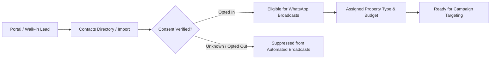
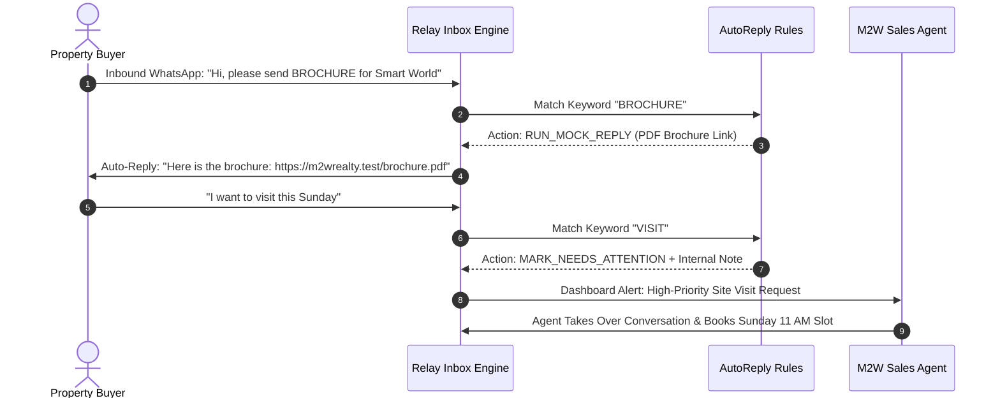

# RELAY — PRODUCT REQUIREMENTS DOCUMENT (PRD)
## Real Estate WhatsApp Automation CRM (M2W Realty First)

> **Document Version:** 1.0.0 (Master Product Specification)  
> **Status:** Active / Source of Truth  
> **Primary Business Priority:** **M2W Realty** (`slug: m2w-realty`, Workspace ID: `6adaf2ccbaacf0587d451ae6`)  
> **Repository Root:** `/Users/sumitthakur/Desktop/Relay`  

---

## 1. Executive Summary & Vision

### 1.1 What Relay Is
**Relay** is a specialized B2B SaaS WhatsApp Automation and CRM platform designed to empower real estate developers, sole-operator brokers, and property marketing teams to convert inbound inquiries into qualified site visits and closed sales.

Relay combines an affirmative-consent customer contact directory, high-conversion WhatsApp message template studio, segmented campaign broadcaster, two-way responsive live inbox with keyword-triggered automation, and delivery/conversion reporting into a single, cohesive dashboard.

### 1.2 Why M2W Realty Needs Relay
**M2W Realty** is a high-volume real estate advisory and property marketing firm operating in India. Real estate marketing in this sector suffers from critical operational friction:
1. **Lead Leakage & Response Latency:** Buyers inquiring on property portals (99acres, Magicbricks, Housing.com, Meta Ads) expect rapid communication. Manual follow-up takes hours, causing leads to go cold.
2. **Scattered Brochure Distribution:** Sharing PDF brochures, unit layouts, and floor plans via personal WhatsApp numbers lacks tracking, auditability, and standardization.
3. **WhatsApp Compliance & Account Ban Risks:** Mass-messaging without explicit affirmative consent triggers Meta spam flags and phone number bans.
4. **Disorganized Site Visit Scheduling:** Field agents lack unified timelines showing previous buyer inquiries, budgets, project interests, and conversation history.
5. **No Unified Marketing Analytics:** Marketing expenditure is decoupled from actual buyer engagement and site visit conversions.

Relay solves these problems by providing M2W Realty with a centralized, consent-driven WhatsApp outreach engine backed by authentic MongoDB persistence.

---

## 2. Strategic Development Priority: M2W Realty First

### 2.1 Current Mandate
* **Single Business Focus:** M2W Realty is the **sole active implementation priority**.
* **Database Stabilization:** All features, APIs, and interfaces must operate reliably against authentic MongoDB database collections (`contacts`, `messagetemplates`, `campaigns`, `conversations`, `conversationmessages`, `autoreplyrules`, `savedreports`).
* **Preservation of Multi-Tenant Foundation:** While development is 100% focused on M2W Realty, the underlying multi-tenant architecture (`Workspace`, `WorkspaceMembership`, tenant isolation middleware) must remain intact. Existing test workspaces (FitZone Gym, CarePlus Clinic, Agency portals) are preserved in a frozen/passive state and must not be deleted or regressed.
* **No Premature Multi-Industry Expansion:** Do not build gym, clinic, salon, or agency features until M2W Realty reaches complete operational stabilization.

---

## 3. Real CRM Data Requirements vs. Mock Messaging Limitations

To guarantee software reliability without incurring premature third-party costs or violating provider policies, Relay strictly separates **Internal CRM Data Operations** from **External Provider Messaging**.

### 3.1 Real MongoDB-Backed CRM Engine [VERIFIED]
Every internal CRM operation is 100% real, durable, and persisted in MongoDB:
- **Contacts & Inquiries:** Stored in the `contacts` collection with E.164 phone normalization, strict deduplication per workspace (`{ workspaceId: 1, phoneNumber: 1 }`), lead statuses, budget ranges, and affirmative consent history.
- **Message Templates:** Stored in `messagetemplates` and `templateversions` with full version snapshots, token extraction, media header attachments, and audit history.
- **Campaigns:** Stored in `campaigns`, `campaignaudiences`, and `campaignmessagejobs` with audience query criteria, recipient execution snapshots, and validation summaries.
- **Conversations & Inbound Simulator:** Stored in `conversations` and `conversationmessages` with bidirectional message timelines, internal agent notes, and unread counts.
- **Keyword Auto-Replies:** Stored in `autoreplyrules` with regex/exact matching, priority sorting, execution counters, and cooldown tracking.
- **Reports:** Stored in `savedreports` and `reportgenerations` with downloadable CSV/Excel export jobs.

### 3.2 Offline Mock WhatsApp Engine [VERIFIED & SAFEGUARDED]
- **Zero Real WhatsApp Egress:** The system currently operates in **Mock Mode** (`mockMode: true`). Messages are processed through an asynchronous background queue (`messageQueueService.js` and `campaignExecutionService.js`) that simulates realistic network latencies (50ms–250ms), queue statuses (`QUEUED`, `PROCESSING`, `SENT`, `DELIVERED`, `READ`), and delivery receipts.
- **Zero Meta API Charges:** No live Meta Cloud API calls are dispatched. No credit card is charged.
- **Truthful UI Labeling:** The UI explicitly displays badges such as `"Mock Mode"`, `"Meta Status: Not Submitted (Mock Mode)"`, and `"Provider: Disconnected"`. It never fabricates fake provider verification.

---

## 4. Existing M2W Realty Feature Inventory

The following 8 modules are implemented and accessible in the authenticated workspace application:

| # | Module | Route | Primary Responsibility | Status |
|---|---|---|---|---|
| 1 | **Overview Dashboard** | `/app`, `/app/overview` | Aggregated lead KPIs, active campaigns counter, recent audit timeline, and system health status. | **VERIFIED** |
| 2 | **Contacts & Directory** | `/contacts`, `/app/contacts` | Owner/tenant-scoped contact CRUD, real estate custom fields, WhatsApp consent capture, and CSV export. | **VERIFIED** |
| 3 | **Contact Import Wizard** | `/import` | Multi-step Excel/CSV staged ingestion (Upload → Mapping → Validate → Execute) with 10k row limit. | **VERIFIED** |
| 4 | **Templates Studio** | `/templates`, `/app/templates` | Three-panel template authoring studio, token variable toolbar, media headers, and live WhatsApp preview. | **VERIFIED** |
| 5 | **Campaign Orchestration** | `/campaigns`, `/campaigns/new` | 4-step broadcast wizard (Audience → Template → Personalization Pager → Launch/Schedule). | **VERIFIED** |
| 6 | **Two-Way Inbox & Auto-reply** | `/inbox`, `/app/inbox` | 3-tab communication center (Conversations, Keyword Rules, Quick Replies) with synthetic inbound simulator. | **VERIFIED** |
| 7 | **Reports & Analytics** | `/reports`, `/app/reports` | 5-tab performance suite (Overview, Campaigns, Message Analytics, Consent Audit, Data Exports). | **VERIFIED** |
| 8 | **Settings & System Health** | `/settings`, `/app/settings` | Account profile, password rotation, business profile, and developer testing diagnostic hub. | **VERIFIED** |

---

## 5. End-to-End M2W Realty User Journeys

### Journey 1: Inbound Lead Capture & Consent Audit


### Journey 2: Property Launch Broadcast Execution
```mermaid
flowchart TD
    Step1[Select Approved Template\ne.g. New Launch Announcement v2] --> Step2[Define Audience Criteria\ne.g. Property: 3 BHK, Budget: > 1 Cr]
    Step2 --> Step3[Live Eligibility Validation\nSuppresses Opted-Out, Archived & Duplicate Numbers]
    Step3 --> Step4[Review Paged Personalization\nVerify {{customer_name}}, {{project_name}}]
    Step4 --> Step5[Launch Mock Broadcast\nBackground Worker Queues & Dispatches Jobs]
    Step5 --> Step6[Monitor Delivery & Read Rates in Real-Time Dashboard]
```

### Journey 3: Inbound Keyword Inquiry & Site Visit Conversion


---

## 6. Out-of-Scope Features (Strict Boundaries)

To maintain stability and project scope, the following capabilities are **explicitly out-of-scope** for the current M2W phase:
1. **Live Meta WhatsApp Cloud API Payments & Credit Card Billing:** Live billing to Meta's Graph API is deferred.
2. **Third-Party Telephony (Twilio / Gupshup):** Relay is architected strictly for official Meta WhatsApp Cloud API direct integration.
3. **Complex Visual DAG Workflow Builders:** Visual drag-and-drop node graphs (n8n/Zapier clones) are out-of-scope. Broadcast scheduling and keyword auto-replies provide all required automation.
4. **General CRM Ticket Management:** Full ticketing, Zendesk-style support SLAs, and complex multi-stage deal pipelines are excluded in favor of focused WhatsApp lead follow-up.
5. **Real Email / SMS Dispatching:** Production SMTP dispatching is disabled; email verifications use local offline inspection via `/dev/mailbox`.

---

## 7. Acceptance Criteria for M2W Realty Milestone

- [x] All 7 core M2W workspace modules load without JavaScript console errors.
- [x] Template Studio maintains a responsive 3-panel layout without field overlapping or card clipping.
- [x] All 7 M2W demo templates persist safely in MongoDB across server restarts.
- [x] Contact phone numbers are validated and stored in E.164 format.
- [x] Campaign audience creation strictly enforces WhatsApp affirmative consent gating.
- [x] Synthetic inbound messages trigger matching auto-reply rules and appear in the conversation timeline.
- [x] Reports generate downloadable CSV files with authentic MongoDB records.
- [x] Multi-tenant isolation prevents non-M2W data leakage.
