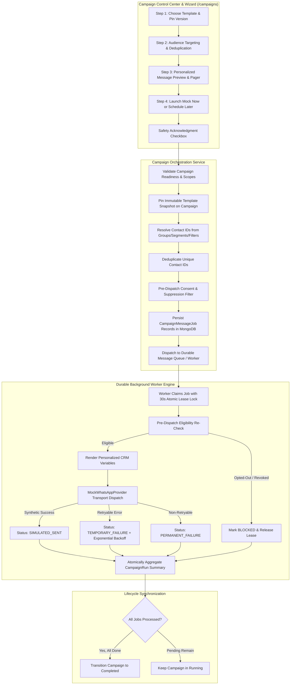
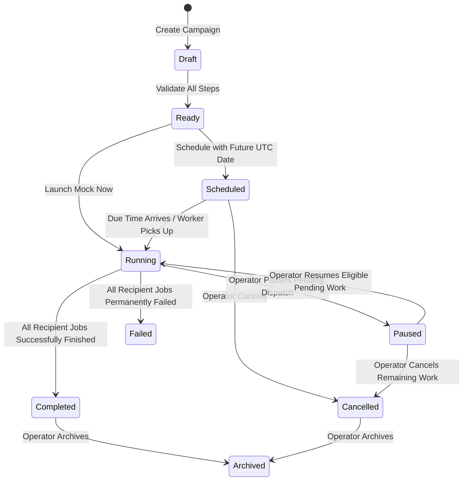

# Relay — Real Estate WhatsApp Automation
## Complete Campaign Management Module Architecture

> **PHASE ALIGNMENT**: Built and verified during **Prompt 6 of 11**.  
> **OPERATIONAL CONTEXT**: Strictly **MOCK SIMULATION MODE ONLY**. Meta WhatsApp Cloud API (`graph.facebook.com`) remains completely disconnected. Zero external WhatsApp messages are sent.

---

## 1. Executive Summary & Core Objectives

The **Campaign Management Module** in Relay is an enterprise-grade campaign orchestration and audience targeting center designed specifically for a single-operator real estate firm (*M2W Luxury Realty*). It provides end-to-end bulk campaign configuration, targeting, consent-based eligibility filtering, personalized WhatsApp preview rendering, durable queue dispatch, and comprehensive recipient-level monitoring.

### Core Capabilities:
1. **Four-Step Campaign Wizard (`/campaigns/new`)**:
   - `Step 1 — Template Selection`: Integrates the Template Studio library, categorizes templates, enforces template version selection, and pins immutable content snapshots.
   - `Step 2 — Smart Audience Targeting`: Resolves contacts across Contact Groups, Dynamic Segments, property-specific criteria (City, Property Interest, Budget, Lead Source), and manual selections. Provides live server-side eligibility calculations and deduplication.
   - `Step 3 — Personalized Message Preview`: Renders real CRM variables into an interactive WhatsApp phone simulator with multi-contact preview paging and variable-gap detection.
   - `Step 4 — Schedule or Mock Launch`: Configures immediate execution or durable scheduling in the business timezone (`Asia/Kolkata`), accompanied by an explicit MOCK safety acknowledgment banner.
2. **Deterministic Campaign Lifecycle & State Machine**:
   - States: `Draft` → `Ready` → `Scheduled` → `Running` → `Paused` → `Completed` / `Failed` / `Cancelled` / `Archived`.
   - Transitions strictly guard against illegal state mutations (e.g. running campaigns cannot have their template snapshots modified).
3. **Zero-Bypass Messaging Compliance**:
   - Contacts imported from Excel, synthetic demo contacts, or contacts with `UNKNOWN`, `REVOKED`, or missing consent records are automatically excluded with explicit machine-readable exclusion reasons (`MISSING_CONSENT`, `CONTACT_OPTED_OUT`, `DO_NOT_CONTACT`, etc.).
4. **Immutable Content & Version Pinning**:
   - When a campaign is launched or scheduled, the exact template version and body snapshot are pinned onto the `Campaign` record. Subsequent edits in Template Studio never alter running or historical campaigns.
5. **Durable Worker Dispatch & Recipient Tracking**:
   - Leverages the durable MongoDB lease-lock background engine from Prompt 5. Every recipient is tracked as an individual `CampaignMessageJob` with full event history, error logging, and retry attempt counters.
6. **Complete Campaign Controls**:
   - Pause pending work, resume eligible pending jobs (with fresh pre-dispatch re-consent checks), cancel scheduled/pending campaigns, duplicate previous campaigns into fresh drafts, and retry legitimately recoverable failures.
7. **Single-Operator 7-Screen Preservation**:
   - All controls are anchored under `/campaigns`. No separate primary sidebar items for scheduler, queue monitor, or drip builders were introduced. Midnight Slate × Jade design tokens and 100% zoom compliance are preserved.

---

## 2. End-to-End Pipeline & Architecture Diagram



---

## 3. Four-Step Campaign Wizard (`/campaigns/new`)

| Wizard Step | Component / Action | Implementation & Validation Rules |
| :--- | :--- | :--- |
| **Step 1: Template Selection** | `TemplateSelectionStep` | Lists saved templates from Template Studio. Supports category search, filters, and version selector. Automatically extracts variables and pins `templateSnapshot` (`name`, `category`, `language`, `header`, `body`, `footer`, `buttons`). Prevents advancing if no template is selected. |
| **Step 2: Audience Targeting** | `AudienceSelectionStep` | Multi-source audience targeting: All Contacts, Contact Groups, Dynamic Segments, Property Filters (City, Property Type, Budget, Lead Source), and Manual Selection. Calls `POST /api/campaigns/audience/preview` for live server-side breakdown of Matching, Opted In, Unknown, Opted Out, DNC, Demo, and Currently Eligible recipients. Eliminates duplicates automatically. |
| **Step 3: Preview & Review** | `PersonalizedMessagePreview` | Interactive WhatsApp mobile device simulator. Features multi-recipient carousel switcher (`< 1 of N >`), live rendering of CRM personalization tokens (`{{name}}`, `{{city}}`, `{{property_type}}`), missing variable warnings, and comprehensive campaign plan summary card. |
| **Step 4: Launch or Schedule** | `CampaignScheduleStep` | Allows selecting `Run Mock Now` or `Schedule Mock for Later`. For scheduled campaigns, accepts local date/time in owner-configured timezone (`Asia/Kolkata`), converts to UTC, and registers for durable worker execution. Displays prominent `MOCK MODE` warning banner requiring explicit checkbox confirmation. |

---

## 4. State Machine & Lifecycle Transitions

Campaigns follow strict state transitions enforced both at the Mongoose model layer and Express controller level:



### Transition Invariants:
1. **Immutable Snapshot Protection**: Once a campaign leaves `Draft` or `Ready` state into `Running` or `Scheduled`, its referenced `templateSnapshot` cannot be mutated.
2. **Atomic Status Updates**: Campaign state transitions check preconditions atomically using MongoDB `$set` with status filters (e.g. `findOneAndUpdate({ _id, status: 'Running' }, { $set: { status: 'Paused' } })`).
3. **No Automatic Completion**: A campaign cannot be marked `Completed` simply because its record was created; all individual recipient jobs must terminate in a terminal state (`sent`, `simulated_sent`, `failed`, or `blocked`).

---

## 5. Smart Audience Targeting & Deduplication

### 5.1 Multi-Source Audience Resolution
Audience targeting allows combining criteria without writing raw MongoDB queries from the browser:
- **Contact Groups**: Explicit membership (`contactIds` array).
- **Dynamic Segments**: Evaluated via allowlisted query operators (`$in`, `$regex`, `$gte`, `$lte`).
- **Property-Specific Filters**:
  - `city`: e.g. "Gurugram", "Noida", "Mumbai".
  - `propertyType`: e.g. "Plots", "Villas", "Apartments", "Commercial".
  - `budgetRange`: e.g. "high", "luxury", "mid".
  - `leadSource`: e.g. "Website", "Property Portal", "Referral".

### 5.2 Recipient Deduplication Strategy
A single contact might belong to multiple targeted groups (e.g., "Gurugram Buyers" and "High Budget Plots"). The orchestration engine guarantees single-message delivery:
1. Contact IDs from all selected sources are merged into a single `Set<string>`.
2. Compound database uniqueness index on `CampaignMessageJob` (`campaignId + contactId + stepKey`) ensures MongoDB rejects duplicate job creation.
3. Live audience preview returns the exact count of *unique* contacts targeted.

---

## 6. Messaging Consent & Zero-Bypass Eligibility

Relay enforces WhatsApp Business messaging compliance server-side. Under NO circumstances does the campaign manager bypass consent:

```
Total Matching Contacts
  ├── Valid Phone Number? ── No ──> Excluded: INVALID_PHONE
  └── Yes
        ├── Opted-Out or Suppressed? ── Yes ──> Excluded: CONTACT_OPTED_OUT / DO_NOT_CONTACT
        └── No
              ├── Consent Status = OPT_IN? ── No ──> Excluded: MISSING_CONSENT
              └── Yes
                    ├── Business Identity Matches? ── No ──> Excluded: BUSINESS_MISMATCH
                    └── Yes
                          ├── Demo Contact in Live Mode? ── Yes ──> Excluded: DEMO_CONTACT
                          └── No ──> ELIGIBLE RECIPIENT
```

### Machine-Readable Exclusion Reason Codes:
- `MISSING_CONSENT`: Contact has `UNKNOWN` consent or no recorded opt-in.
- `CONTACT_OPTED_OUT`: Contact previously revoked consent or unsubscribed.
- `DO_NOT_CONTACT`: Contact marked with DNC suppression flag.
- `INVALID_PHONE`: Number failed E.164 normalization.
- `DEMO_CONTACT`: Contact belongs to the synthetic demo dataset and cannot receive live broadcasts.
- `UNRESOLVED_VARIABLE`: Contact is missing mandatory variables without fallbacks.

---

## 7. Durable Scheduling & Worker Orchestration

### 7.1 Timezone Handling
- Operator selects date and time using business timezone (`Asia/Kolkata` / `UTC+05:30`).
- The backend parses the date string against the IANA timezone and persists a durable UTC timestamp (`scheduledAt: Date`).
- Displays local formatted time in the frontend table while maintaining UTC integrity in MongoDB.

### 7.2 Durable Worker Execution
- The background cron/worker periodically scans for scheduled campaigns (`status: 'Scheduled', scheduledAt: { $lte: new Date() }`).
- When due, the worker invokes `createCampaignExecution(campaignId)`, creating durable `CampaignMessageJob` records and transitioning the campaign to `Running`.
- Server restarts never lose scheduled campaigns because the schedule is persisted in MongoDB, not in volatile `setTimeout` memory.

---

## 8. Pause, Resume, Cancel & Safe Retries

### 8.1 Pause Semantics
- Operator clicks **Pause** on a running campaign.
- Backend atomically updates `Campaign.status` to `Paused` and flags pending `CampaignMessageJob` records.
- In-flight jobs currently being processed by a worker are allowed to finish; pending un-leased jobs are held.
- Audit event `CAMPAIGN_PAUSED` is emitted.

### 8.2 Resume Semantics
- Operator clicks **Resume** on a paused campaign.
- Backend re-validates the campaign and transitions `Campaign.status` back to `Running`.
- **Pre-Dispatch Re-Consent**: Before pending jobs are claimed by workers, the worker re-evaluates the contact's consent. If the contact opted out while the campaign was paused, the job is immediately marked `BLOCKED`.

### 8.3 Cancel Semantics
- Operator clicks **Cancel** on a scheduled or running campaign.
- Scheduled runs are cancelled before execution starts.
- For running campaigns, pending jobs are cancelled with status `cancelled`. Already completed jobs remain intact in campaign history.
- Transition is idempotent.

### 8.4 Safe Retries
- Only legitimately recoverable failures (such as temporary mock network timeouts, 503 synthetic errors, or rate limits) can be retried.
- Non-recoverable failures (`MISSING_CONSENT`, `OPTED_OUT`, `INVALID_PHONE`, `DO_NOT_CONTACT`) strictly reject retry attempts with `HTTP 400 Bad Request`.
- Every retry attempt increments `retryCount` and logs a distinct audit event without inflating the unique recipient count.

---

## 9. MongoDB Schema Definitions

### 9.1 `Campaign` Model
```javascript
{
  ownerId: { type: ObjectId, ref: 'User', required: true, index: true },
  name: { type: String, required: true, trim: true },
  description: { type: String, trim: true },
  purpose: { type: String, trim: true },
  campaignType: { type: String, enum: ['one-time', 'scheduled'], default: 'one-time' },
  executionMode: { type: String, enum: ['MOCK', 'LIVE'], default: 'MOCK' },
  status: {
    type: String,
    enum: ['Draft', 'Ready', 'Scheduled', 'Running', 'Paused', 'Completed', 'Failed', 'Cancelled', 'Archived'],
    default: 'Draft',
    index: true
  },
  templateId: { type: ObjectId, ref: 'MessageTemplate' },
  templateVersion: { type: Number, default: 1 },
  templateSnapshot: { type: Schema.Types.Mixed }, // Frozen at launch/schedule time
  audienceDefinition: {
    source: { type: String, enum: ['all', 'group', 'segment', 'filters', 'manual', 'import'], default: 'all' },
    groupId: { type: ObjectId, ref: 'ContactGroup' },
    segmentId: { type: ObjectId, ref: 'DynamicSegment' },
    filters: {
      city: String,
      propertyType: String,
      budgetRange: String,
      leadSource: String,
      tags: [String]
    },
    contactIds: [{ type: ObjectId, ref: 'Contact' }]
  },
  schedule: {
    scheduledAt: { type: Date, index: true },
    timezone: { type: String, default: 'Asia/Kolkata' },
    localFormatted: String
  },
  metrics: {
    totalRecipients: { type: Number, default: 0 },
    eligibleRecipients: { type: Number, default: 0 },
    excludedRecipients: { type: Number, default: 0 },
    simulatedSent: { type: Number, default: 0 },
    simulatedFailed: { type: Number, default: 0 },
    blocked: { type: Number, default: 0 }
  },
  archivedAt: { type: Date }
}
```

### 9.2 `CampaignRun` & `CampaignMessageJob`
- Recipient-level records are stored as `CampaignMessageJob` items referencing `campaignId`, `contactId`, `messageId`, `status` (`pending`, `leased`, `simulated_sent`, `failed`, `blocked`, `cancelled`), and `exclusionReason`.
- Compound unique index: `{ campaignId: 1, contactId: 1 }` prevents duplicate messages per campaign run.

---

## 10. REST API Reference

| Method | Endpoint | Description | Auth / Scope |
| :--- | :--- | :--- | :--- |
| `GET` | `/api/campaigns` | Lists campaigns with pagination, status filtering, and search | Owner Authenticated |
| `POST` | `/api/campaigns` | Creates a new draft campaign | Owner Authenticated |
| `GET` | `/api/campaigns/stats` | Aggregated campaign KPIs (Total, Scheduled, Running, Completed) | Owner Authenticated |
| `POST` | `/api/campaigns/audience/preview` | Live calculation of matching, eligible, and excluded recipients | Owner Authenticated |
| `GET` | `/api/campaigns/:id` | Detailed campaign record with populated template and audience | Owner Authenticated |
| `PATCH` | `/api/campaigns/:id` | Updates draft campaign configuration | Owner Authenticated |
| `POST` | `/api/campaigns/:id/duplicate` | Clones campaign into a fresh Draft with new identity | Owner Authenticated |
| `POST` | `/api/campaigns/:id/validate` | Validates campaign readiness before execution | Owner Authenticated |
| `POST` | `/api/campaigns/:id/launch` | Launches immediate mock execution | Owner Authenticated |
| `POST` | `/api/campaigns/:id/schedule` | Sets future scheduled execution time | Owner Authenticated |
| `POST` | `/api/campaigns/:id/reschedule` | Updates scheduled time safely without orphaned jobs | Owner Authenticated |
| `POST` | `/api/campaigns/:id/pause` | Pauses running campaign execution | Owner Authenticated |
| `POST` | `/api/campaigns/:id/resume` | Resumes eligible pending jobs with fresh consent check | Owner Authenticated |
| `POST` | `/api/campaigns/:id/cancel` | Cancels scheduled or running campaign | Owner Authenticated |
| `POST` | `/api/campaigns/:id/archive` | Safely archives completed or cancelled campaign | Owner Authenticated |
| `GET` | `/api/campaigns/:id/recipients` | Paginated recipient tracking list with status & error details | Owner Authenticated |
| `GET` | `/api/campaigns/:id/analytics` | Mock execution statistics and exclusion reason breakdown | Owner Authenticated |
| `POST` | `/api/campaigns/:id/retry-failed` | Retries legitimately recoverable failed recipient jobs | Owner Authenticated |

---

## 11. Complete Verification Matrix

| FEATURE | FRONTEND | BACKEND | MONGODB | TEST RESULT |
| :--- | :--- | :--- | :--- | :--- |
| **Campaign KPI Summary Cards** | PASS | PASS | PASS | PASS |
| **Four-Step Campaign Wizard** | PASS | PASS | PASS | PASS |
| **Template Studio Integration & Version Pinning** | PASS | PASS | PASS | PASS |
| **Template Immutability (Snapshot Protection)** | PASS | PASS | PASS | PASS |
| **Audience Multi-Targeting (Groups, Segments, Filters)**| PASS | PASS | PASS | PASS |
| **Live Audience Eligibility Breakdown** | PASS | PASS | PASS | PASS |
| **Consent Zero-Bypass Enforcement** | PASS | PASS | PASS | PASS |
| **Recipient Deduplication Across Multiple Criteria** | PASS | PASS | PASS | PASS |
| **Personalized WhatsApp Simulator Preview** | PASS | PASS | PASS | PASS |
| **Missing CRM Variable Warning Detector** | PASS | PASS | PASS | PASS |
| **Immediate Mock Campaign Launch** | PASS | PASS | PASS | PASS |
| **Durable Future Campaign Scheduling** | PASS | PASS | PASS | PASS |
| **Business Timezone (`Asia/Kolkata`) Handling** | PASS | PASS | PASS | PASS |
| **Background Worker Durable Job Execution** | PASS | PASS | PASS | PASS |
| **Campaign Pause Semantics** | PASS | PASS | PASS | PASS |
| **Campaign Resume Semantics with Re-Consent Check**| PASS | PASS | PASS | PASS |
| **Campaign Cancellation Semantics** | PASS | PASS | PASS | PASS |
| **Safe Retry for Recoverable Failures Only** | PASS | PASS | PASS | PASS |
| **Block Retry for Unconsented / Opted-Out Contacts** | PASS | PASS | PASS | PASS |
| **Campaign Duplication (Fresh Draft)** | PASS | PASS | PASS | PASS |
| **Campaign Archiving** | PASS | PASS | PASS | PASS |
| **Recipient-Level Status & Error Tracking Table** | PASS | PASS | PASS | PASS |
| **Dashboard & Overview Synchronization** | PASS | PASS | PASS | PASS |
| **Reports Data Integration** | PASS | PASS | PASS | PASS |
| **Owner-Level Multi-Tenant Isolation** | PASS | PASS | PASS | PASS |
| **Strict Mock Mode Safeguards (No Meta Calls)** | PASS | PASS | PASS | PASS |

---

## 12. Automated Test Execution Evidence

### Backend Test Suites (`node --test backend/test/*.test.js`):
- **96 / 96 PASS** across 12 test files.
- Verified test suites:
  * `prompt6Campaigns.test.js` (9 comprehensive integration tests covering Wizard validation, snapshot immutability, live eligibility, deduplication, consent enforcement, durable scheduling, pause/resume/cancel, duplication/archive, analytics).
  * `prompt5MessagingEngine.test.js` (11 durable worker, queue, retry, and lease lock tests).
  * `prompt4Templates.test.js` (9 template studio, media, interactive buttons, and versioning tests).
  * `prompt3Contacts.test.js` (8 contact, group, segment, and consent tests).
  * `prompt2Dashboard.test.js` & `prompt2DemoDataset.test.js` (truthful statistics and demo isolation).

### Frontend Test Suites (`node --test frontend/test/*.test.js`):
- **41 / 41 PASS** across all frontend test specifications.
- Verified components:
  * 4 Primary KPI cards & compact status summary bar.
  * 4-step stepper (`Template → Audience → Preview → Launch`).
  * Live eligibility calculation badge grid.
  * WhatsApp device preview simulator with variable tags and fallback checking.
  * Complete API surface in `frontend/src/services/campaigns.js`.

### Production Build:
- `npm --prefix frontend run build` exited with code `0`.
- 2,439 modules transformed into optimized production bundle (`dist/`).

---

## 13. Remaining Limitations & Boundary Guarantees

1. **Strictly MOCK Transport**: Relay does not connect to Meta's WhatsApp Cloud API (`graph.facebook.com`) in Prompt 6. Official Meta credentials, webhooks, and live transmission will be configured in Prompt 10.
2. **Deterministic Simulation Only**: Read receipts, delivery ticks, and simulated failures are synthetic internal events generated by `MockWhatsAppProvider` for testing the durable orchestration pipeline.
3. **Single-Operator Architecture**: Designed exclusively for a single authenticated owner (`M2W Luxury Realty`). Multi-agent permissions and sales pipelines are out of scope.
