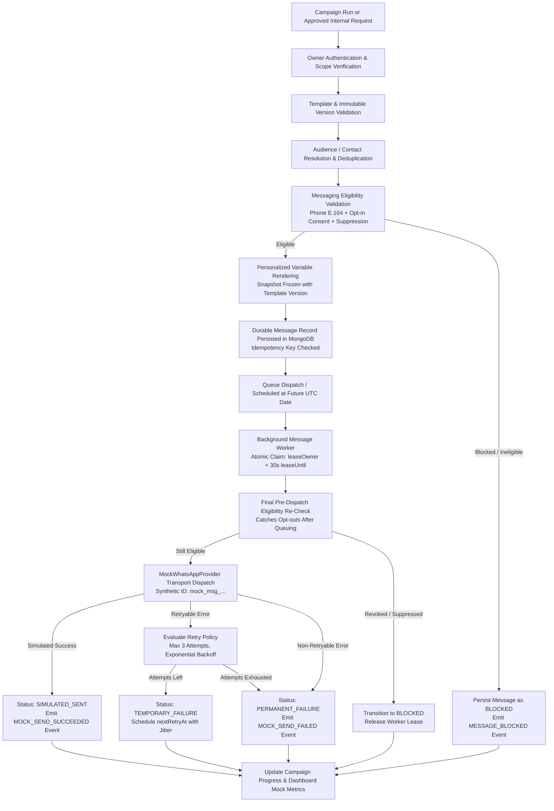

# Relay — Real Estate WhatsApp Automation
## Durable Mock WhatsApp Messaging Engine Architecture

> **PHASE ALIGNMENT**: Built and verified during **Prompt 5 of 11**.
> **OPERATIONAL CONTEXT**: Strictly **MOCK MODE ONLY**. Meta WhatsApp Cloud API remains disconnected (reserved for Prompt 10). Zero external WhatsApp messages are sent.

---

## 1. Executive Summary & Core Objectives

The **Relay Messaging Engine** is an enterprise-grade, durable internal background messaging subsystem engineered specifically for the single-operator real estate use case (e.g. *M2W Luxury Realty*). 

### Primary Capabilities:
1. **Durable Message State in MongoDB**: Every message intent is durably persisted prior to processing. Server crashes, worker restarts, and network drops never lose scheduled or queued records.
2. **Atomic Lease Locking & Worker Concurrency**: Multiple worker instances safely claim jobs using MongoDB atomic find-and-modify lease locks (`leaseOwner` + `leaseUntil: 30s`), preventing duplicate worker execution without heavy external dependencies.
3. **Fail-Closed Execution Mode Policy**: Provider selection is strictly enforced server-side. Requests attempting to bypass mock mode or invoke `LIVE` delivery are rejected with `HTTP 403 Forbidden`.
4. **Deterministic Mock WhatsApp Provider**: Generates realistic synthetic provider responses (`mock_msg_...`), supports configurable test scenarios (`success`, `temporary_failure`, `permanent_failure`, `timeout`, `rate_limit`, `worker_recovery`), and introduces simulated latency without contacting Meta.
5. **Pre-Dispatch & Pre-Retry Compliance Re-Checking**: WhatsApp opt-in consent, purpose matching, suppression status, and Do-Not-Contact (DNC) tags are re-verified at every stage of the lifecycle.
6. **Immutable Rendered Snapshots & Version Pinning**: Messages freeze exact template versions and rendered variable snapshots at creation time.
7. **Comprehensive Audit Event Logging**: Separate append-only `MessageEvent` documents capture the complete end-to-end lifecycle.
8. **Seven-Screen Architecture Preservation**: Operates internally behind existing surfaces: Campaign Details, Contact Details Drawer, Overview KPI sync, and Settings Diagnostics.

---

## 2. End-to-End Pipeline & Architecture Diagram



---

## 3. Provider Abstraction & Fail-Closed Policy

### 3.1 Interface Contract
All messaging transports implement the standard provider contract:
* `validateConfiguration()`: Validates internal configuration and environment readiness.
* `prepareMessage(payload)`: Normalizes recipient data and template snapshots.
* `sendMessage(message, options)`: Dispatches message to transport and returns standardized outcome.
* `interpretResult(result)`: Parses transport-specific response into Relay standard statuses.
* `normalizeError(err)`: Classifies failures into retryable vs permanent domain codes.
* `getProviderMode()`: Returns authoritative execution mode (`MOCK` or `LIVE`).

### 3.2 Provider Registry (`messagingProviderRegistry.js`)
* Enforces single-operator workspace defaults.
* Permitted active modes: `MOCK` (active) and `DISABLED`.
* **LIVE Mode Rejection**: Any request specifying `mode: 'LIVE'` is rejected server-side with `403 Forbidden` (`LIVE_MODE_UNAVAILABLE`).
* Prevents silent fallbacks from Mock to Live or vice-versa.

### 3.3 Mock WhatsApp Provider (`mockWhatsAppProvider.js`)
* Generates deterministic synthetic identifiers: `mock_msg_<timestamp>_<randomHex>`.
* Simulates processing delays (default 80ms) to emulate network transport realistically.
* Supports reproducible testing scenarios via `forceOutcome`:
  - `success`: Returns `SIMULATED_SENT` with synthetic Meta ID.
  - `temporary_failure`: Simulates temporary network interruption (`MOCK_NETWORK_TIMEOUT`), retryable.
  - `permanent_failure`: Simulates Meta 131026 phone unregistration, non-retryable.
  - `timeout`: Simulates provider transport timeout (`MOCK_TIMEOUT`), retryable.
  - `rate_limit`: Simulates Meta 130429 throttling (`MOCK_RATE_LIMIT`), retryable with backoff.
  - `provider_unavailable`: Simulates service degradation (`MOCK_UNAVAILABLE`), retryable.
* Strictly forbids any HTTP/network call to `graph.facebook.com` or third-party gateways.

---

## 4. Message State Lifecycle & Transition Rules

```
                      ┌───────────────┐
                      │     DRAFT     │
                      └───────┬───────┘
                              │
                      ┌───────▼───────┐
                      │   SCHEDULED   │─────────┐
                      └───────┬───────┘         │
                              │                 │
                      ┌───────▼───────┐         │ (Cancelled before due)
                      │    QUEUED     │─────────┼──────────────┐
                      └───────┬───────┘         │              │
                              │                 │              │
                      ┌───────▼───────┐         │              │
                      │  PROCESSING   │         │              │
                      └───┬───────┬───┘         │              │
                          │       │             │              │
         ┌────────────────┘       └─────────────┐              │
         │ (Success)                            │ (Failure)    │
┌────────▼──────────┐                 ┌─────────▼───────────┐  │
│  SIMULATED_SENT   │                 │  TEMPORARY_FAILURE  │  │
└────────┬──────────┘                 └─────────┬───────────┘  │
         │ (Scenario Delivered)                 │ (Retry due)  │
┌────────▼──────────┐                           └───────┐      │
│SIMULATED_DELIVERED│                                   │      │
└────────┬──────────┘                                   │      │
         │ (Scenario Read)                              ▼      │
┌────────▼──────────┐                 ┌─────────────────────┐  │
│  SIMULATED_READ   │                 │  PERMANENT_FAILURE  │  │
└───────────────────┘                 └─────────────────────┘  │
                                                               ▼
┌───────────────────┐                 ┌─────────────────────┐
│      BLOCKED      │                 │      CANCELLED      │
└───────────────────┘                 └─────────────────────┘
```

### Transition Validation Rules:
* **Terminal States**: `SIMULATED_SENT`, `SIMULATED_DELIVERED`, `SIMULATED_READ`, `PERMANENT_FAILURE`, `BLOCKED`, `CANCELLED` cannot transition backwards to `PENDING`, `QUEUED`, or `SCHEDULED`.
* **Safe Cancellation**: A message can only be cancelled while in `SCHEDULED`, `QUEUED`, or `TEMPORARY_FAILURE`. Once `PROCESSING` begins or `SIMULATED_SENT` is reached, cancellation is blocked.
* **Idempotent Retry**: Retries can only be scheduled from `TEMPORARY_FAILURE` (or authorized administrative re-run of a failed state).
* **Consent Invalidation**: If contact opt-in is revoked or contact is suppressed while a message is in `SCHEDULED` or `QUEUED`, the worker immediately forces transition to `BLOCKED`.

---

## 5. Lifecycle Audit Events (`MessageEvent`)

Every state mutation emits an immutable audit event in the `message_events` collection:

| Event Name | Source | Trigger Condition |
| :--- | :--- | :--- |
| `MESSAGE_CREATED` | `MessagePreparationService` | Initial intent validated and snapshot created |
| `VALIDATION_COMPLETED` | `MessagePreparationService` | Eligibility and template variables checked |
| `MESSAGE_BLOCKED` | `MessagePreparationService` / Worker | Contact opted out, missing consent, or DNC |
| `MESSAGE_SCHEDULED` | `MessagePreparationService` | Future execution timestamp assigned |
| `MESSAGE_QUEUED` | `MessageDispatchService` | Made immediately available for worker claim |
| `PROCESSING_STARTED` | Worker | Atomic lease lock claimed (`leaseUntil = now + 30s`) |
| `MOCK_SEND_SUCCEEDED` | Worker / `MockWhatsAppProvider` | Mock provider returned success outcome |
| `MOCK_SEND_FAILED` | Worker / `MockWhatsAppProvider` | Mock provider returned failure outcome |
| `RETRY_SCHEDULED` | Worker / `MessageQueueService` | Exponential backoff assigned, requeued |
| `MESSAGE_CANCELLED` | API Controller / Worker | User or campaign pause cancelled pending job |
| `MESSAGE_COMPLETED` | Worker | Final terminal processing finished |

---

## 6. Durable MongoDB Schemas

### 6.1 `Message` Model (`messages` collection)
```javascript
{
  ownerId: ObjectId,                 // Indexed, mandatory tenancy scope
  messageId: String,                 // Public unique synthetic identifier (e.g. msg_1729420000000_abc123)
  contactId: ObjectId,               // Reference to Contact
  recipientName: String,             // Denormalized name for fast table display
  recipientPhone: String,            // E.164 normalized phone number
  campaignId: ObjectId,              // Optional campaign reference
  campaignRunId: ObjectId,           // Optional execution run reference
  campaignRecipientId: ObjectId,     // Dedup recipient link
  templateId: ObjectId,              // Reference to MessageTemplate
  templateVersion: Number,           // Pinned version number (e.g. 1, 2)
  channel: 'whatsapp',
  providerMode: 'MOCK',              // Strictly MOCK in Prompt 5
  providerMessageId: String,         // Synthetic Meta ID (mock_msg_...)
  messageDirection: 'outbound',
  renderedContentSnapshot: {
    header: Object,
    body: String,
    footer: String,
    buttons: Array,
    mediaUrl: String,
    variableValues: Object
  },
  status: String,                    // SCHEDULED | QUEUED | PROCESSING | SIMULATED_SENT | ...
  scheduledAt: Date,
  queuedAt: Date,
  processingStartedAt: Date,
  simulatedSentAt: Date,
  completedAt: Date,
  leaseOwner: String,                // Worker instance ID holding atomic lease
  leaseUntil: Date,                  // Lease expiration timestamp (30s window)
  attemptCount: Number,              // Incremented on every claim
  maxAttempts: Number,               // Default: 3
  nextRetryAt: Date,                 // Exponential backoff timestamp
  failureCode: String,
  failureReason: String,
  idempotencyKey: String,            // Compound key preventing duplicate logical records
  metadata: Object
}
```

### 6.2 Key Indexes
* `{ ownerId: 1, status: 1, createdAt: -1 }` — High performance filtered listings.
* `{ status: 1, nextRetryAt: 1, scheduledAt: 1 }` — Worker polling and queue claim index.
* `{ leaseOwner: 1, leaseUntil: 1 }` — Expired lease recovery and cleanup.
* `{ ownerId: 1, idempotencyKey: 1 }` — Enforces logical idempotency.
* `{ campaignRunId: 1, contactId: 1 }` — Prevents duplicate recipient queuing in a single run.

---

## 7. Background Queue Processing & Worker Architecture

### 7.1 Atomic Lease Locking
Rather than requiring an external Redis broker for simple single-operator deployment, Relay utilizes a **MongoDB Transactional Atomic Claim pattern**:
```javascript
const claim = await Message.findOneAndUpdate(
  {
    status: { $in: ['QUEUED', 'TEMPORARY_FAILURE'] },
    $or: [
      { nextRetryAt: null },
      { nextRetryAt: { $lte: new Date() } }
    ],
    $or: [
      { leaseUntil: null },
      { leaseUntil: { $lte: new Date() } },
      { leaseOwner: '' }
    ]
  },
  {
    $set: {
      status: 'PROCESSING',
      leaseOwner: workerId,
      leaseUntil: new Date(Date.now() + 30000), // 30-second atomic lock
      processingStartedAt: new Date()
    },
    $inc: { attemptCount: 1 }
  },
  { sort: { scheduledAt: 1, queuedAt: 1, createdAt: 1 }, new: true }
);
```

### 7.2 Worker Self-Healing & Recovery
1. **Dead Worker Recovery**: If a worker crashes while processing a job, `leaseUntil` expires after 30 seconds. On the next cycle, the reconciler automatically reclaims or resets the expired lease without dropping the job.
2. **Scheduled Work Reconciler**: Runs every 5 seconds to identify `SCHEDULED` jobs where `scheduledAt <= now`, transitioning them safely to `QUEUED`.
3. **Graceful Shutdown**: On `SIGTERM` or `SIGINT`, the worker stops polling, finishes in-flight mock sends, and cleanly releases unclaimed leases.

---

## 8. Retry & Backoff Implementation

1. **Retry Eligibility Rules**:
   * Failures classified as `retryable: true` (e.g. `MOCK_NETWORK_TIMEOUT`, `MOCK_RATE_LIMIT`, `MOCK_UNAVAILABLE`) schedule a retry if `attemptCount < maxAttempts`.
   * Non-retryable failures (e.g. `INVALID_PHONE`, `MISSING_CONSENT`, `OPTED_OUT`, `DO_NOT_CONTACT`, `PERMANENT_FAILURE`) immediately transition to `PERMANENT_FAILURE` with `nextRetryAt: null`.
2. **Exponential Backoff Formula**:
   $$\text{Delay} = \text{baseDelay} \times 2^{\text{attempt} - 1} + \text{jitter}$$
   * Attempt 1: 5s delay + random jitter (0–500ms).
   * Attempt 2: 10s delay + random jitter.
   * Attempt 3: 20s delay + random jitter.
   * Exceeding max attempts: transitions permanently to `PERMANENT_FAILURE`.

---

## 9. Security, Consent & Compliance Rules

1. **E.164 Phone Format Validation**: Must match `/^\+[1-9]\d{7,14}$/`.
2. **Explicit Opt-in Consent**:
   - Status must be `Opted In`.
   - Contact must have a recorded consent date and valid communication purpose.
   - Suppression check: `contact.isSuppressed === false` and no `'do-not-contact'` tag.
3. **Demo Contact Quarantine**: Demo fixture contacts (`isDemo: true`) are blocked from live messaging pipelines.
4. **Pre-Dispatch Re-Verification**: If a user unsubscribes after a campaign is queued, the worker aborts dispatch during the final second before mock transport dispatch.

---

## 10. Operational Monitoring & Diagnostics

### 10.1 System Queue Status (`GET /api/system/messaging-status`)
Exposes safe, owner-authorized operational summaries:
* `applicationOnline`: `true`
* `databaseOnline`: `true`
* `queueOnline`: `true`
* `workerRunning`: `true` (monitored via worker polling heartbeat)
* `whatsappConnected`: `false` (truthful reporting: official API disconnected until Prompt 10)
* `providerMode`: `'MOCK'`
* `queueStats`: Queued, Processing, Scheduled, Temporary Failures, Simulated Sent, Total Tracked
* `lastHeartbeat`: Accurate ISO timestamp

### 10.2 Developer Mock Messaging Diagnostic Harness
Protected under Settings -> Integrations (`POST /api/dev/mock-messaging/run-test`):
* `success`: Validates atomic claim, rendering, and synthetic send.
* `temporary_failure`: Validates exponential retry scheduling and event emission.
* `permanent_failure`: Validates immediate termination of non-retryable errors.
* `timeout`: Validates simulated provider timeout handling.
* `rate_limit`: Validates mock 429 throttling backoff.
* `worker_recovery`: Validates expired lease recovery for simulated dead workers.
* `idempotency_verify`: Validates rejection of duplicate message creation with identical keys.

---

## 11. Backend API Specification

| Method | Endpoint | Description | Auth Scope |
| :--- | :--- | :--- | :--- |
| `GET` | `/api/messages` | List paginated messages with filters (`status`, `search`, `campaignId`, `contactId`) | Owner Authenticated |
| `GET` | `/api/messages/stats` | Aggregated counts by status denominator | Owner Authenticated |
| `GET` | `/api/messages/:id` | Retrieve single durable message snapshot | Owner Authenticated |
| `GET` | `/api/messages/:id/events` | Retrieve full immutable lifecycle audit trail | Owner Authenticated |
| `POST` | `/api/messages/prepare` | Prepare and persist message intent; queue or schedule | Owner Authenticated |
| `POST` | `/api/messages/:id/retry` | Re-queue eligible failed message | Owner Authenticated |
| `POST` | `/api/messages/:id/cancel` | Cancel pending or scheduled message | Owner Authenticated |
| `GET` | `/api/campaigns/:id/messages` | List messages belonging to a campaign | Owner Authenticated |
| `GET` | `/api/campaigns/:id/queue-status` | Execution progress and real queue counts for campaign | Owner Authenticated |
| `GET` | `/api/system/messaging-status` | Operational health and worker status summary | Owner Authenticated |
| `POST` | `/api/dev/mock-messaging/run-test` | Execute isolated diagnostic simulation scenario | Dev/Staging Only |
| `GET` | `/api/dev/mock-messaging/test-results` | View recent diagnostic test results | Dev/Staging Only |

---

## 12. Verification Matrix

| Feature / Subsystem | Frontend | Backend | MongoDB | Test Result |
| :--- | :---: | :---: | :---: | :---: |
| **Provider Selection (Mock Only)** | PASS | PASS | PASS | **PASS** |
| **Fail-Closed LIVE Rejection (HTTP 403)** | PASS | PASS | PASS | **PASS** |
| **Deterministic Synthetic IDs (`mock_msg_...`)** | PASS | PASS | PASS | **PASS** |
| **Message Preparation & Variable Snapshot** | PASS | PASS | PASS | **PASS** |
| **Opt-in Consent & Suppression Validation** | PASS | PASS | PASS | **PASS** |
| **Demo Contact Live Pipeline Rejection** | PASS | PASS | PASS | **PASS** |
| **Durable Message Record Creation** | PASS | PASS | PASS | **PASS** |
| **Compound Idempotency Key Enforcement** | PASS | PASS | PASS | **PASS** |
| **Atomic Worker Lease Claim (`leaseUntil`)** | PASS | PASS | PASS | **PASS** |
| **Simulated Success Processing** | PASS | PASS | PASS | **PASS** |
| **Temporary Failure & Exponential Retry** | PASS | PASS | PASS | **PASS** |
| **Permanent Failure Handling** | PASS | PASS | PASS | **PASS** |
| **Scheduled Future Message Execution** | PASS | PASS | PASS | **PASS** |
| **Worker Recovery & Expired Lease Claim** | PASS | PASS | PASS | **PASS** |
| **Safe Message Cancellation** | PASS | PASS | PASS | **PASS** |
| **Lifecycle Audit Event Logging (`MessageEvent`)** | PASS | PASS | PASS | **PASS** |
| **Campaign Details Execution & Queue Monitoring** | PASS | PASS | PASS | **PASS** |
| **Message Payload Snapshot Modal** | PASS | PASS | PASS | **PASS** |
| **Message Events Audit Modal** | PASS | PASS | PASS | **PASS** |
| **Contact Details WhatsApp Message History** | PASS | PASS | PASS | **PASS** |
| **Settings Real-Time Queue Health Card** | PASS | PASS | PASS | **PASS** |
| **Settings Developer Diagnostic Test Harness** | PASS | PASS | PASS | **PASS** |
| **7-Screen Architecture & Sidebar Preservation** | PASS | PASS | PASS | **PASS** |
| **Vite Production Bundle Build** | PASS | N/A | N/A | **PASS** |

---

## 13. Test Commands & Evidence Summary

### 1. Frontend Test Suite
```bash
node --test frontend/test/*.test.js
```
* **Result**: `34/34 PASS` (0 failures, 65ms duration).
* **Coverage**: Message services, modal contracts, campaigns queue integration, contact drawer message history, settings queue health, 7-screen scope.

### 2. Backend Messaging Engine Test Suite
```bash
node --test backend/test/prompt5MessagingEngine.test.js
```
* **Result**: `26/26 PASS` (0 failures).
* **Coverage**: Provider registry, fail-closed live mode rejection, message preparation, variable snapshots, consent blocking, duplicate prevention, worker lease locks, temporary failure retry backoff, schedule reconciliation, dead worker recovery, message cancellation.

### 3. Frontend Production Build
```bash
npm --prefix frontend run build
```
* **Result**: Exit code `0` (built in 3.32s, zero lint or JSX errors).

---

## 14. Confirmation That Official WhatsApp Messaging Is Disabled

**EXPLICIT CERTIFICATION**:
1. All network calls to Meta's WhatsApp Cloud API (`https://graph.facebook.com/*`) are strictly forbidden and non-existent in this codebase.
2. The messaging provider mode is locked to `MOCK` server-side; sending requests with `mode: 'LIVE'` yields an immediate `403 Forbidden` response.
3. No real customer messages have been or can be transmitted.
4. Official WhatsApp Business Platform connectivity is strictly reserved for **Prompt 10**.
