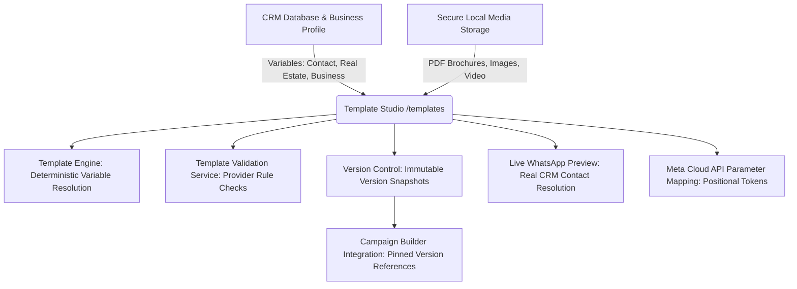

# Relay — Real Estate WhatsApp Message Template Studio Architecture

> **Workspace:** Single Operator Real Estate WhatsApp Automation (`M2W Realty`)  
> **Module Path:** `/templates`  
> **Theme:** `Midnight Slate × Jade` Design System  
> **Target Provider Standard:** WhatsApp Business Platform / Meta Cloud API (Prepared Offline / Mock-Validated)

---

## 1. Architectural Overview & Product Scope

Relay is an enterprise single-operator WhatsApp automation platform tailored for Indian real estate developers and advisory brokerages. The **Template Studio** (`/templates`) is the single authoritative hub for authoring, personalizing, validating, versioning, and previewing WhatsApp business message templates before campaign preparation.



### Core Design Principles
1. **Single-Operator Tenant Isolation**: All templates, versions, media assets, and previews are strictly isolated to the authenticated workspace owner (`ownerId`).
2. **Deterministic Variable Personalization**: Named curly-brace variables (`{{name}}`, `{{property_type}}`, `{{city}}`, `{{business_phone}}`) resolve directly from CRM fields with no arbitrary code evaluation.
3. **Truthful Provider Approval Lifecycle**: Templates are marked locally as `Draft`, `Ready for Review`, or `Archived`. The Meta Provider Status remains truthfully `Not Submitted` in offline/mock mode; no fake approval flags are manufactured.
4. **Immutable Version Snapshots & Campaign Safety**: Every saved change or release generates a distinct, immutable `TemplateVersion`. Campaigns pin to specific `selectedTemplateVersionId` records; subsequent edits to a template draft do not alter in-flight or scheduled campaigns.
5. **Secure Multi-Type Media Attachments**: Supports PDF property brochures (up to 10 MB), images (JPEG/PNG/WEBP up to 5 MB), and videos (MP4/3GP up to 16 MB) with server-side magic byte inspection, path sanitization, and authenticated streaming.

---

## 2. Data Models & MongoDB Schemas

### 2.1 MessageTemplate (`backend/src/models/MessageTemplate.js`)
Represents the active working draft and lifecycle state of a message template.

```typescript
interface IMessageTemplate {
  _id: ObjectId;
  ownerId: ObjectId;
  name: string;                   // Unique provider-compatible slug (e.g., property_launch_update)
  description?: string;
  category: 'Marketing' | 'Utility' | 'Authentication';
  language: 'en' | 'hi' | 'hinglish';
  headerType: 'NONE' | 'TEXT' | 'IMAGE' | 'VIDEO' | 'DOCUMENT';
  header?: string;                // Text header string (max 60 chars)
  headerMediaId?: ObjectId;       // Reference to TemplateMedia
  headerMediaUrl?: string;        // Authenticated streaming endpoint
  headerMediaName?: string;       // Original filename (e.g. M2W_Sky_Villas_Brochure.pdf)
  headerMediaSize?: number;       // Size in bytes
  headerMediaMime?: string;       // Validated MIME type
  body: string;                   // Multiline body with {{tokens}} (max 1024 chars)
  footer?: string;                // Plain text footer (max 60 chars, no tokens allowed)
  buttons: Array<{
    type: 'QUICK_REPLY' | 'URL' | 'PHONE_NUMBER';
    text: string;                 // Button label (1-25 chars)
    value?: string;               // URL (https://) or E.164 phone (+91...)
  }>;
  internalVariables: string[];    // Extracted variable list
  businessCategory?: string;      // Real Estate project/category tag
  intendedService?: string;
  tags: string[];
  isFavorite: boolean;
  localStatus: 'Draft' | 'Ready for Review' | 'Ready for Submission' | 'Archived';
  providerStatus: 'Not Submitted' | 'Pending' | 'Approved' | 'Rejected' | 'Paused' | 'Disabled';
  currentVersionId?: ObjectId;    // Active TemplateVersion reference
  currentVersionNumber: number;   // Incremental version counter
  sampleValues: Record<string, string>;
  fallbackValues: Record<string, string>;
  isArchived: boolean;
  createdAt: Date;
  updatedAt: Date;
}
```

### 2.2 TemplateVersion (`backend/src/models/MessageTemplate.js`)
Immutable historical snapshots captured on every save, update, duplication, or restore.

```typescript
interface ITemplateVersion {
  _id: ObjectId;
  ownerId: ObjectId;
  templateId: ObjectId;
  versionNumber: number;          // 1, 2, 3...
  revisionNotes: string;          // Human-readable change summary
  snapshot: Record<string, any>;  // Complete deep clone of template at time of release
  internalVariables: string[];
  metaParameterMappings: {
    header: Array<{ variable: string; parameter: number }>;
    body: Array<{ variable: string; parameter: number }>;
    buttons: Array<{ buttonIndex: number; variable: string; parameter: number }>;
  };
  sampleValues: Record<string, string>;
  fallbackValues: Record<string, string>;
  validationResults: { errors: string[]; warnings: string[]; valid: boolean };
  createdBy: ObjectId;
  createdAt: Date;
}
```

### 2.3 TemplateMedia (`backend/src/models/TemplateMedia.js`)
Persistent digital asset records for template headers and property brochures.

```typescript
interface ITemplateMedia {
  _id: ObjectId;
  ownerId: ObjectId;
  storageKey: string;             // Random unique filename on disk
  originalFileName: string;       // Sanitized user filename
  mimeType: string;               // Content-Type (verified by magic bytes)
  sizeBytes: number;              // File size
  checksum: string;               // SHA-256 integrity hash
  mediaType: 'IMAGE' | 'VIDEO' | 'DOCUMENT';
  storagePath: string;            // Absolute server path (0700 permissions)
  storageStatus: 'active' | 'deleted';
  createdAt: Date;
}
```

---

## 3. Dynamic Variable Personalization & Registry

The centralized variable engine (`backend/src/utils/templateEngine.js`) exposes three namespaces of verified CRM and business attributes:

| Variable Token | Display Label | Data Source | Type | Example / Sample |
| :--- | :--- | :--- | :--- | :--- |
| `{{name}}` | Full Name | `Contact.fullName` | String | *Vikram Malhotra* |
| `{{first_name}}` | First Name | First word of `fullName` | String | *Vikram* |
| `{{city}}` | City | `Contact.city` / `location` | String | *Gurugram* |
| `{{property_type}}` | Property Type | `Contact.interestedPropertyType` | String | *Luxury 4BHK Apartment* |
| `{{project}}` | Interested Project | `Contact.interestedProject` | String | *M2W Sky Villas* |
| `{{preferred_location}}` | Preferred Location | `Contact.preferredLocation` | String | *Golf Course Extension* |
| `{{budget}}` | Budget Range | `Contact.budgetRange` | String | *₹3.5 Cr - ₹4.5 Cr* |
| `{{business_name}}` | Workspace Business Name | `User.businessName` | String | *M2W Realty* |
| `{{business_phone}}` | Business Contact Phone | `User.phoneNumber` | E.164 | *+919811122233* |
| `{{business_website}}` | Official Website | `User.website` | URL | *https://m2wrealty.com* |

### Positional Mapping for Meta Cloud API
While internal template authoring uses readable named tokens (`{{name}}`, `{{project}}`), future Meta submission requires positional numbers (`{{1}}`, `{{2}}`). The engine deterministically maps tokens and compiles example mappings:

$$\text{Template Text: } \text{"Hi } \{\{\text{name}\}\}\text{, details for } \{\{\text{project}\}\}\text{ in } \{\{\text{city}\}\}\text{."}$$
$$\Downarrow$$
$$\text{Meta Structure: } \text{"Hi } \{\{1\}\}\text{, details for } \{\{2\}\}\text{ in } \{\{3\}\}\text{."}$$
$$\text{Mappings: } [\{ \text{parameter: 1, variable: 'name'} \}, \{ \text{parameter: 2, variable: 'project'} \}, \{ \text{parameter: 3, variable: 'city'} \}]$$

---

## 4. Interactive Buttons Specification

WhatsApp Cloud API imposes strict rules on interactive message components. The Relay Button Builder enforces these rules both on frontend and backend:

1. **Button Types**:
   - `QUICK_REPLY`: Predefined quick responses tapped by the customer (max 3 buttons).
   - `URL`: Call-to-Action external hyperlink. Must begin with `https://`.
   - `PHONE_NUMBER`: Call-to-Action direct telephone dialer. Must match international E.164 format (`/^\+[1-9]\d{7,14}$/`).
2. **Mutual Exclusivity Rule**:
   - A template can feature **Quick Replies** OR **Call-To-Actions**, but **never a mixture**.
   - Maximum 3 Quick Replies OR up to 2 CTAs (at most 1 URL and 1 Phone).
3. **Button Text Constraints**:
   - 1 to 25 characters maximum per button label.

---

## 5. Pre-Configured Real Estate Template Library

Relay provides 6 deterministic, editable starting presets specifically designed for real estate advisory workflows:

1. **`property_launch_update`** (Marketing): Launch notifications for opted-in buyers with Quick Reply engagement chips.
2. **`farmhouse_interest_followup`** (Marketing): Layout and land verification details for gated farmland enquiries with URL CTA.
3. **`property_brochure_offer`** (Marketing): PDF brochure dispatch with phone advisory CTA.
4. **`site_visit_information`** (Utility): Logistics coordination and consultant contact for scheduled site visits.
5. **`project_availability_update`** (Utility): Real-time inventory and unit availability updates for active leads.
6. **`customer_followup_courtesy`** (Utility): Courtesy follow-ups with preferences check.
7. **Hindi & Hinglish Presets**: Preserves full Unicode rendering (`property_update_hindi`, `property_update_hinglish`).

---

## 6. Campaign Builder Integration & Snapshot Isolation

When a campaign is created in Relay (`/campaigns`), the selected template is linked via two distinct references:
- `selectedTemplateId`: References the primary `MessageTemplate`.
- `selectedTemplateVersionId`: References the exact immutable `TemplateVersion` snapshot.

### Invariant:
If an operator edits the original template in the Template Studio later, `MessageTemplate` increments to a new version (e.g. `v2`), while the Campaign retains its pointer to `v1`. Campaign audience eligibility validation checks whether the version is locked and alerts if the draft changed since planning, completely preventing silent content corruption in scheduled campaigns.

---

## 7. Security Architecture

- **Owner Scoping**: Every API operation checks `ownerId: req.user._id`. Cross-workspace reads, updates, or deletes return `404 Not Found`.
- **Magic Bytes Validation**: File uploads are verified via binary header inspection (`%PDF-`, `\x89PNG`, `\xFF\xD8\xFF`, `ftyp`). Executables, scripts, and spoofed extensions are rejected with HTTP 415.
- **Formula Injection Prevention**: Text and exports sanitize characters starting with `=`, `+`, `-`, or `@`.
- **No Arbitrary Code Execution**: Template variables resolve strictly against an allowlisted registry of keys. No `eval()`, JavaScript expressions, or arbitrary object traversals.
- **Private Media Storage**: Media assets are saved to a protected directory with `0700` filesystem permissions and streamed only via authenticated endpoints.

---

## 8. API Reference

| Method | Endpoint | Description | Security |
| :--- | :--- | :--- | :--- |
| `GET` | `/api/templates` | List active or archived templates with search and filtering | Auth (Owner) |
| `POST` | `/api/templates` | Create a new template and records version 1 | Auth (Owner) |
| `GET` | `/api/templates/:id` | Fetch template details and active campaign usages | Auth (Owner) |
| `PATCH` | `/api/templates/:id` | Update draft; increments version if content changed | Auth (Owner) |
| `DELETE` | `/api/templates/:id` | Permanently deletes unused draft (409 if referenced) | Auth (Owner) |
| `POST` | `/api/templates/:id/duplicate` | Creates an independent draft copy with reset status | Auth (Owner) |
| `POST` | `/api/templates/:id/archive` | Moves template to archive state | Auth (Owner) |
| `POST` | `/api/templates/:id/restore` | Restores archived template to active drafts | Auth (Owner) |
| `POST` | `/api/templates/:id/validate` | Validates provider readiness and returns findings | Auth (Owner) |
| `POST` | `/api/templates/:id/preview` | Resolves tokens for a specific CRM contact | Auth (Owner) |
| `GET` | `/api/templates/:id/versions` | List all version snapshots for template | Auth (Owner) |
| `GET` | `/api/templates/:id/history` | Audit trail of all version releases | Auth (Owner) |
| `POST` | `/api/templates/:id/restore-version` | Restores an earlier version snapshot as a new draft | Auth (Owner) |
| `GET` | `/api/templates/:id/campaigns` | List all campaigns referencing this template | Auth (Owner) |
| `GET` | `/api/templates/variables` | Registry of supported contact, real estate & business tokens | Auth (Owner) |
| `GET` | `/api/templates/categories` | WhatsApp categories and component limitations | Auth (Owner) |
| `GET` | `/api/templates/library` | Real estate starting preset library | Auth (Owner) |
| `POST` | `/api/template-media` | Upload media attachment (Image, Video, PDF brochure) | Auth (Owner) |
| `GET` | `/api/template-media/:id` | Stream authenticated media asset | Auth (Owner) |
| `DELETE` | `/api/template-media/:id` | Mark media asset deleted | Auth (Owner) |

---

## 9. Verification Matrix

| Capability | Frontend UI | Backend API | MongoDB Persistence | Test Result |
| :--- | :---: | :---: | :---: | :---: |
| **3-Panel Template Studio** | PASS | PASS | PASS | **PASS** |
| **Real Estate Presets Library** | PASS | PASS | PASS | **PASS** |
| **Header Types (Text/Image/Video/Doc)** | PASS | PASS | PASS | **PASS** |
| **PDF Brochure Upload & Streaming** | PASS | PASS | PASS | **PASS** |
| **Magic Bytes Inspection & Security** | PASS | PASS | PASS | **PASS** |
| **Personalization Engine & Tokens** | PASS | PASS | PASS | **PASS** |
| **Real Estate Contact Resolution** | PASS | PASS | PASS | **PASS** |
| **Interactive Buttons Builder** | PASS | PASS | PASS | **PASS** |
| **Button Mutual Exclusion Validation** | PASS | PASS | PASS | **PASS** |
| **Live WhatsApp Chat Preview** | PASS | PASS | PASS | **PASS** |
| **Version History & Immutable Snapshots** | PASS | PASS | PASS | **PASS** |
| **Historical Version Restore** | PASS | PASS | PASS | **PASS** |
| **Campaign Version Reference Binding** | PASS | PASS | PASS | **PASS** |
| **Campaign Snapshot Isolation** | PASS | PASS | PASS | **PASS** |
| **Archive & Restore Lifecycle** | PASS | PASS | PASS | **PASS** |
| **Duplicate Template Draft** | PASS | PASS | PASS | **PASS** |
| **Tenant Isolation & Security** | PASS | PASS | PASS | **PASS** |
| **Truthful Provider Status (Not Submitted)**| PASS | PASS | PASS | **PASS** |
| **100% Browser Zoom Usability** | PASS | PASS | PASS | **PASS** |
| **Responsive Mobile Navigation** | PASS | PASS | PASS | **PASS** |
