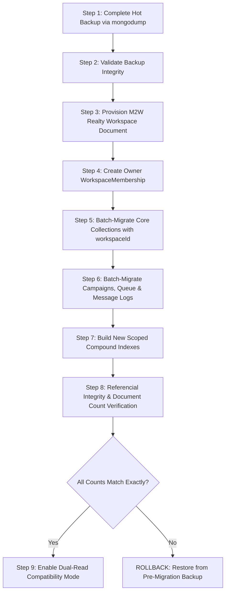

# RELAY SAAS — M2W REALTY SAFE MIGRATION STRATEGY
## Zero-Data-Loss Tenant Provisioning, Referential Integrity Preservation & Rollback Plan

> **Document Version:** 1.0.0 (Execution Blueprint)  
> **Phase:** SAAS PROMPT 0 (Audit & Planning Only — DO NOT EXECUTE IN PROMPT 0)  
> **Target Migration Phase:** SAAS PROMPT 2 (M2W Real Estate Data Migration)  
> **Protected Subject:** M2W Luxury Realty (Existing Single-Operator Tenant Reference)  

---

## 1. Absolute Data Protection Mandate

M2W Luxury Realty represents our authentic, functional reference business. Under no circumstances may M2W's data be erased, reset, corrupted, overwritten, or exposed to cross-tenant leakage.

### Non-Negotiable Operational Constraints
1. **NO DESTRUCTIVE DATABASE OPERATIONS:** Commands such as `db.dropDatabase()`, `db.collection.drop()`, or unrestricted `deleteMany({})` are strictly prohibited.
2. **NO MODIFICATION OF ORIGINAL IDENTIFIERS:** All existing MongoDB `_id` values for Users, Contacts, Templates, Campaigns, Messages, Conversations, and Events MUST be preserved identically.
3. **NO ARTIFICIAL SYNTHETIC SEEDING OVER AUTHENTIC RECORDS:** Genuine customer records and authentic consent evidence must never be mixed with or replaced by synthetic demo data.
4. **NO PROMPT 0 EXECUTION:** This document defines the migration plan and validation queries. **The migration script itself will NOT be run until SAAS PROMPT 2**, after the multi-tenant schema models and test harnesses are established in SAAS PROMPT 1.

---

## 2. Pre-Migration Data Inventory & Referencing

### 2.1 M2W Owner Identification
- **Existing User Document:** Identified in `users` collection by `role: 'owner'`.
- **Primary Owner Email:** Currently configured owner account (e.g. `owner@relayrealestate.example` or administrator email).
- **Business Profile:** Linked 1:1 via `BusinessProfile.findOne({ ownerId: owner._id })`.

### 2.2 Complete Model Inventory to be Migrated

| Collection / Model | Scope to Migrate | Preserved Keys | Critical Relationships |
| :--- | :--- | :--- | :--- |
| `users` | 1 Owner Document | `_id`, `email`, `passwordHash` | Links to `businessprofiles`, `userpreferences` |
| `businessprofiles` | 1 Profile Document | `_id`, `ownerId`, `displayName` | Migrates into primary `Workspace` record |
| `userpreferences` | 1 Preference Record | `_id`, `ownerId`, `timezone` | Re-scoped to `workspaceId` |
| `contacts` | All Contacts | `_id`, `phoneNumber`, `customFields` | References `contactgroups`, `importjobs` |
| `contactgroups` | All Groups | `_id`, `name`, `color` | Referenced by `contacts.groups` |
| `audiencesegments` | All Dynamic Segments | `_id`, `filterRules` | Referenced by `campaigns.selectedSegmentId` |
| `messagetemplates` | All Templates | `_id`, `name`, `body`, `buttons` | Referenced by `campaigns.selectedTemplateId` |
| `templateversions` | All Version Snapshots | `_id`, `templateId`, `snapshot` | Pinned to `campaigns.selectedTemplateVersionId` |
| `templatemedia` | All Media Attachments | `_id`, `storagePath`, `checksum` | Referenced by `messagetemplates.headerMediaId` |
| `campaigns` | All Campaigns | `_id`, `status`, `templateSnapshot` | References `campaignexecutions` |
| `campaignexecutions` | All Execution Runs | `_id`, `campaignId`, `metrics` | References `campaignmessagejobs` |
| `campaignmessagejobs`| All Worker Jobs | `_id`, `executionId`, `contactId` | Links campaign runs to contact recipients |
| `campaignaudiences` | All Audience Snapshots| `_id`, `campaignId`, `contactId` | Preserves frozen audience eligibility audits |
| `messages` | All Queue & Sent Msgs | `_id`, `status`, `scheduledAt` | Durable outbox and sent history |
| `messageevents` | All Message Logs | `_id`, `messageId`, `eventType` | Audit trail of message status transitions |
| `conversations` | All Inbox Threads | `_id`, `contactId`, `status` | Links contacts to conversation messages |
| `conversationmessages`| All Chat Messages | `_id`, `conversationId`, `body` | Inbound and outbound message thread items |
| `autoreplyrules` | All Auto-Reply Rules | `_id`, `triggerKeyword`, `action` | Pipeline match rules |
| `consentrecords` | All Consent Evidences | `_id`, `contactId`, `source` | Regulatory proof of WhatsApp opt-in |
| `internalnotes` | All Staff Notes | `_id`, `contactId`, `content` | Private notes on contacts and threads |
| `importjobs` | All Import Histories | `_id`, `batchName`, `progress` | Spreadsheet import audit logs |

---

## 3. Step-by-Step Migration Execution Plan (SAAS PROMPT 2)



### Step 1: Pre-Migration Hot Backup
Before executing any script, a full binary dump is taken:
```bash
# Executed in safe staging/production shell
mongodump --uri="$MONGODB_URI" --out="./backup/pre-saas-m2w-$(date +%Y%m%d%H%M%S)"
```
The backup archive size and document counts are recorded.

### Step 2: Provision M2W Realty Workspace
Create the authoritative `Workspace` document using data from `BusinessProfile` and `User`:
```javascript
const m2wWorkspace = await Workspace.create({
  _id: new mongoose.Types.ObjectId(), // deterministic or freshly allocated
  name: businessProfile.displayName || user.businessName || 'M2W Luxury Realty',
  slug: 'm2w-realty',
  industryKey: 'real_estate',
  logoUrl: businessProfile.logoUrl || '/logo.png',
  businessEmail: businessProfile.email || user.email,
  businessPhone: businessProfile.phone || '+919811223344',
  country: businessProfile.country || 'India',
  city: businessProfile.city || 'Gurugram',
  timezone: userPreferences?.timezone || 'Asia/Kolkata',
  currency: 'INR',
  status: 'active',
  onboardingStatus: 'completed',
  planKey: 'solo',
  createdBy: user._id,
});
```

### Step 3: Create WorkspaceMembership
Establish the primary owner relationship:
```javascript
await WorkspaceMembership.create({
  workspaceId: m2wWorkspace._id,
  userId: user._id,
  role: 'owner',
  status: 'active',
  isDefaultWorkspace: true,
  joinedAt: user.createdAt || new Date(),
});

// Update User default workspace
await User.updateOne(
  { _id: user._id },
  { $set: { defaultWorkspaceId: m2wWorkspace._id, isEmailVerified: true } }
);
```

### Step 4: Idempotent Batch Tagging with `workspaceId`
For each collection, run an idempotent update query that assigns `workspaceId` where `ownerId === user._id` and `workspaceId` is missing:
```javascript
const collectionsToMigrate = [
  Contact,
  ContactGroup,
  ContactCategory,
  AudienceSegment,
  MessageTemplate,
  TemplateMedia,
  Campaign,
  CampaignExecution,
  CampaignAudience,
  CampaignMessageJob,
  Message,
  MessageEvent,
  Conversation,
  ConversationMessage,
  AutoReplyRule,
  QuickReply,
  ConsentRecord,
  InternalNote,
  ImportJob,
  ReportGeneration,
  UserPreferences,
];

for (const Model of collectionsToMigrate) {
  const result = await Model.updateMany(
    { ownerId: user._id, workspaceId: { $exists: false } },
    { $set: { workspaceId: m2wWorkspace._id } }
  );
  console.log(`Migrated ${Model.modelName}: ${result.modifiedCount} records assigned to workspace.`);
}
```

### Step 5: Compound Index Transition
Once all documents possess `workspaceId`:
1. Build the new workspace-scoped index:
   ```javascript
   await Contact.collection.createIndex(
     { workspaceId: 1, phoneNumber: 1 },
     { unique: true, name: 'workspace_phone_unique' }
   );
   ```
2. Verify query performance and uniqueness enforcement.
3. Drop the legacy `owner_phone_unique` index only after the migration validation passes.

---

## 4. Verification & Validation Queries

To certify 100% data preservation and referential integrity, the migration script executes automated reconciliation checks:

```javascript
export async function verifyM2WMigrationIntegrity(ownerId, workspaceId) {
  const checks = [];

  // Check 1: Contacts count reconciliation
  const contactsByOwner = await Contact.countDocuments({ ownerId });
  const contactsByWorkspace = await Contact.countDocuments({ workspaceId });
  checks.push({
    name: 'Contacts Count Check',
    passed: contactsByOwner === contactsByWorkspace && contactsByOwner > 0,
    ownerCount: contactsByOwner,
    workspaceCount: contactsByWorkspace,
  });

  // Check 2: Campaigns count reconciliation
  const campaignsByOwner = await Campaign.countDocuments({ ownerId });
  const campaignsByWorkspace = await Campaign.countDocuments({ workspaceId });
  checks.push({
    name: 'Campaigns Count Check',
    passed: campaignsByOwner === campaignsByWorkspace,
    ownerCount: campaignsByOwner,
    workspaceCount: campaignsByWorkspace,
  });

  // Check 3: Consent Records check (Zero Loss)
  const consentByOwner = await ConsentRecord.countDocuments({ ownerId });
  const consentByWorkspace = await ConsentRecord.countDocuments({ workspaceId });
  checks.push({
    name: 'Consent Records Check',
    passed: consentByOwner === consentByWorkspace,
    ownerCount: consentByOwner,
    workspaceCount: consentByWorkspace,
  });

  // Check 4: Templates and Versions
  const templatesByOwner = await MessageTemplate.countDocuments({ ownerId });
  const templatesByWorkspace = await MessageTemplate.countDocuments({ workspaceId });
  checks.push({
    name: 'Templates Count Check',
    passed: templatesByOwner === templatesByWorkspace,
    ownerCount: templatesByOwner,
    workspaceCount: templatesByWorkspace,
  });

  // Check 5: Orphan Check (No documents left with ownerId but missing workspaceId)
  const orphanedContacts = await Contact.countDocuments({ ownerId, workspaceId: { $exists: false } });
  checks.push({
    name: 'Orphan Record Check',
    passed: orphanedContacts === 0,
    orphanedCount: orphanedContacts,
  });

  const allPassed = checks.every((c) => c.passed);
  return { allPassed, checks };
}
```

---

## 5. Rollback & Disaster Recovery Strategy

If any verification assertion fails during the migration run:

### Immediate Automatic Rollback
1. **Script Halt:** The migration transaction aborts and records the exact failure error in an audit log.
2. **Field Reversion:** If executed on a live database, uncommitted operations are undone. Because the migration script only adds `workspaceId` and does NOT delete any existing fields, a quick software rollback is possible by removing the `workspaceId` field:
   ```javascript
   await Contact.updateMany({ workspaceId: m2wWorkspace._id }, { $unset: { workspaceId: '' } });
   await WorkspaceMembership.deleteMany({ workspaceId: m2wWorkspace._id });
   await Workspace.deleteOne({ _id: m2wWorkspace._id });
   ```
3. **Full Binary Restoration:** If unexpected corruption occurs:
   ```bash
   mongorestore --uri="$MONGODB_URI" --drop ./backup/pre-saas-m2w-[timestamp]/
   ```

---

## 6. Acceptance Criteria for Migration Completion (Prompt 2 Sign-off)

1. M2W Luxury Realty owner logs into Relay using their existing email and password.
2. The dashboard displays all 4 primary KPIs matching pre-migration counts exactly.
3. Contacts, tags, segments, templates, campaigns, inbox conversations, and auto-reply rules render identically.
4. Generating a report export produces matching CSV and XLSX files with identical row counts.
5. All 237 automated tests continue to pass without regression.
6. A newly created second workspace (e.g. FitZone Gym) cannot view, query, or modify any M2W records.
