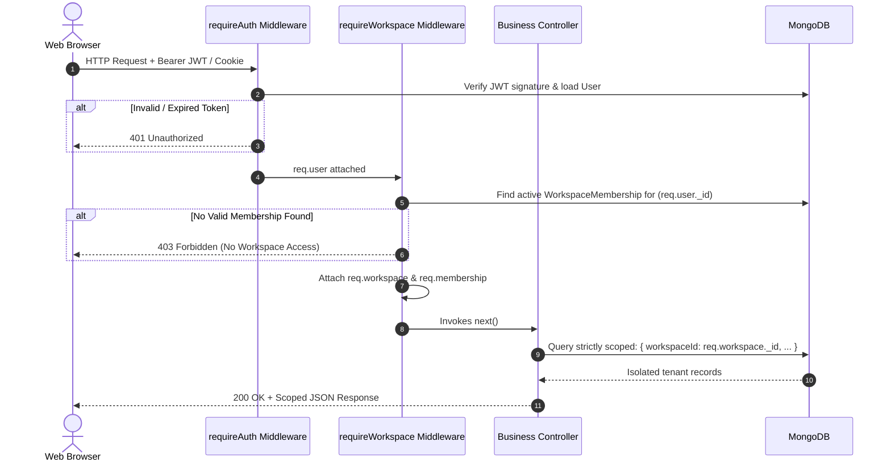

# RELAY SAAS — MULTI-TENANT SAAS ARCHITECTURE BLUEPRINT
## Complete Multi-Tenant Security, Logical Isolation, Workspace Schemas & Authorization Engine

> **Document Version:** 1.0.0 (Master Blueprint)  
> **Phase:** SAAS PROMPT 0 (Architecture & Foundation Planning)  
> **Author:** Principal SaaS Software Architect & Multi-Tenant Security Specialist  

---

## 1. Architectural Philosophy & Isolation Strategy

Relay is evolving from a single-business tool (M2W Luxury Realty) into a commercial, multi-tenant B2B SaaS platform. A single shared instance of the Node/Express backend and MongoDB database will securely serve hundreds of independent businesses across multiple industries.

### Fundamental Tenancy Principles
1. **Logical Tenant Isolation via Scoped Document Identifiers:** Every business entity resides in a logical **Workspace**. All database documents belonging to a tenant MUST contain a trusted `workspaceId: ObjectId`.
2. **Never Trust Client Tenant Identifiers:** The browser/client is NEVER permitted to specify or override tenant identity via unvalidated request bodies or query parameters. Tenant resolution is strictly computed by the server based on authenticated cryptographic JWT session claims cross-referenced with database `WorkspaceMembership` records.
3. **No Cross-Tenant Data Leakage (Strict Query Scoping):** Every Mongoose query, update, aggregation pipeline, and deletion for tenant-owned collections MUST include `{ workspaceId: req.workspace._id }` in its filter.
4. **Scoping User-Controlled Uniqueness:** Unique indexes for user-created entities (such as contact phone numbers, campaign names, contact groups, and custom tags) MUST be compound-indexed with `workspaceId`. A contact phone number is unique *within a business*, not globally across the entire platform. A customer can legitimately be a lead for M2W Realty and a member of FitZone Gym simultaneously.
5. **Separate Platform Admin from Tenant Roles:** Super Admin platform management privileges are strictly segregated from tenant workspace permissions. Super admins do not implicitly view customer private contacts or conversations without an audited escalation session.

---

## 2. Workspace Identity & Membership Models

### 2.1 Workspace Model (`backend/src/models/Workspace.js`)

```javascript
import mongoose from 'mongoose';

const workspaceSchema = new mongoose.Schema(
  {
    name: {
      type: String,
      required: true,
      trim: true,
      minlength: 2,
      maxlength: 120,
    },
    slug: {
      type: String,
      required: true,
      unique: true,
      lowercase: true,
      trim: true,
      match: /^[a-z0-9-]+$/,
      minlength: 3,
      maxlength: 60,
    },
    industryKey: {
      type: String,
      required: true,
      enum: [
        'real_estate',
        'gym_fitness',
        'clinic_healthcare',
        'education_coaching',
        'salon_beauty',
        'automobile',
        'other_business',
      ],
      default: 'other_business',
    },
    logoUrl: {
      type: String,
      trim: true,
      default: '',
      maxlength: 500,
    },
    businessEmail: {
      type: String,
      required: true,
      trim: true,
      lowercase: true,
      maxlength: 120,
    },
    businessPhone: {
      type: String,
      required: true,
      trim: true,
      match: /^\+[1-9]\d{7,14}$/,
    },
    country: {
      type: String,
      default: 'India',
      maxlength: 80,
    },
    city: {
      type: String,
      trim: true,
      default: '',
      maxlength: 80,
    },
    timezone: {
      type: String,
      default: 'Asia/Kolkata',
      maxlength: 60,
    },
    currency: {
      type: String,
      default: 'INR',
      uppercase: true,
      match: /^[A-Z]{3}$/,
    },
    status: {
      type: String,
      enum: ['trialing', 'active', 'past_due', 'suspended', 'archived'],
      default: 'trialing',
      index: true,
    },
    onboardingStatus: {
      type: String,
      enum: ['pending_profile', 'pending_industry', 'completed'],
      default: 'pending_profile',
    },
    subscriptionId: {
      type: mongoose.Schema.Types.ObjectId,
      ref: 'Subscription',
      default: null,
    },
    planKey: {
      type: String,
      enum: ['trial', 'solo', 'growth', 'enterprise'],
      default: 'trial',
    },
    trialEndsAt: {
      type: Date,
      default: () => new Date(Date.now() + 14 * 24 * 60 * 60 * 1000), // 14-day trial
    },
    industryConfigOverrides: {
      type: mongoose.Schema.Types.Mixed,
      default: {},
    },
    createdBy: {
      type: mongoose.Schema.Types.ObjectId,
      ref: 'User',
      required: true,
    },
    archivedAt: {
      type: Date,
      default: null,
    },
  },
  { timestamps: true }
);

workspaceSchema.index({ slug: 1 }, { unique: true });
workspaceSchema.index({ status: 1, trialEndsAt: 1 });
workspaceSchema.index({ createdBy: 1 });

export default mongoose.model('Workspace', workspaceSchema);
```

### 2.2 WorkspaceMembership Model (`backend/src/models/WorkspaceMembership.js`)

```javascript
import mongoose from 'mongoose';

const workspaceMembershipSchema = new mongoose.Schema(
  {
    workspaceId: {
      type: mongoose.Schema.Types.ObjectId,
      ref: 'Workspace',
      required: true,
      index: true,
    },
    userId: {
      type: mongoose.Schema.Types.ObjectId,
      ref: 'User',
      required: true,
      index: true,
    },
    role: {
      type: String,
      enum: ['owner', 'admin', 'member'],
      default: 'owner',
    },
    status: {
      type: String,
      enum: ['active', 'invited', 'suspended'],
      default: 'active',
      index: true,
    },
    isDefaultWorkspace: {
      type: Boolean,
      default: true,
    },
    joinedAt: {
      type: Date,
      default: Date.now,
    },
  },
  { timestamps: true }
);

// Enforce unique user membership per workspace
workspaceMembershipSchema.index({ workspaceId: 1, userId: 1 }, { unique: true });
workspaceMembershipSchema.index({ userId: 1, status: 1 });

export default mongoose.model('WorkspaceMembership', workspaceMembershipSchema);
```

### 2.3 User Model Updates (`backend/src/models/User.js`)
The `User` model represents a human account (global across workspaces). The following fields will be added:
- `isEmailVerified`: Boolean (default `false` for new signups; set to `true` for migrated M2W account).
- `emailVerificationToken`: String (hashed sha256).
- `emailVerificationExpires`: Date.
- `passwordResetToken`: String (hashed sha256).
- `passwordResetExpires`: Date.
- `defaultWorkspaceId`: ObjectId (ref `Workspace`).
- `isPlatformAdmin`: Boolean (default `false` — Super Admin privilege).

---

## 3. Server Authorization Flow & Middleware

### 3.1 Two-Tier Authentication & Tenancy Middleware



### 3.2 Implementation Specification: `requireWorkspace.js`

```javascript
import WorkspaceMembership from '../models/WorkspaceMembership.js';
import Workspace from '../models/Workspace.js';

export async function requireWorkspace(req, res, next) {
  try {
    if (!req.user) {
      return res.status(401).json({ message: 'Authentication required before resolving workspace.' });
    }

    // Determine target workspace: client header OR user default workspace
    let requestedWorkspaceId = req.get('x-workspace-id');

    let membership;
    if (requestedWorkspaceId) {
      membership = await WorkspaceMembership.findOne({
        workspaceId: requestedWorkspaceId,
        userId: req.user._id,
        status: 'active',
      }).populate('workspaceId');
    } else {
      membership = await WorkspaceMembership.findOne({
        userId: req.user._id,
        status: 'active',
      }).sort({ isDefaultWorkspace: -1, createdAt: 1 }).populate('workspaceId');
    }

    if (!membership || !membership.workspaceId) {
      return res.status(403).json({
        code: 'FORBIDDEN_WORKSPACE_ACCESS',
        message: 'You do not have active access to this business workspace.',
      });
    }

    const workspace = membership.workspaceId;
    if (workspace.status === 'suspended' || workspace.status === 'archived') {
      return res.status(403).json({
        code: 'WORKSPACE_SUSPENDED',
        message: 'This workspace is currently suspended or archived.',
      });
    }

    // Attach verified tenant context to request
    req.workspace = workspace;
    req.membership = membership;
    req.workspaceId = workspace._id;

    next();
  } catch (err) {
    next(err);
  }
}
```

---

## 4. Database Tenant Isolation Audit & Migration Mapping

Every existing collection that stores business data must receive `workspaceId: ObjectId`. To ensure zero data loss and safe backward compatibility, existing records retain `ownerId`, while gaining `workspaceId`.

| Model Name | Current Scoping Key | Proposed Scoping Key | Index Transition | Risk Level |
| :--- | :--- | :--- | :--- | :--- |
| `Contact` | `ownerId` | `workspaceId` (primary), `ownerId` (creator) | Drop `{ownerId, phoneNumber}` unique. Create `{workspaceId, phoneNumber}` unique. | Medium |
| `ContactGroup` | `ownerId` | `workspaceId` | Unique on `{workspaceId, normalizedName}`. | Low |
| `AudienceSegment` | `ownerId` | `workspaceId` | Index on `{workspaceId, segmentType, updatedAt}`. | Low |
| `MessageTemplate` | `ownerId` | `workspaceId` | Index on `{workspaceId, isArchived, updatedAt}`. | Low |
| `TemplateMedia` | `ownerId` | `workspaceId` | Index on `{workspaceId, storageStatus}`. | Low |
| `Campaign` | `ownerId` | `workspaceId` | Index on `{workspaceId, status, updatedAt}`. | Low |
| `CampaignExecution` | `ownerId` | `workspaceId` | Index on `{workspaceId, status}`. | Low |
| `CampaignAudience` | `ownerId` | `workspaceId` | Unique on `{workspaceId, campaignId, snapshotVersion, contactId}`. | Medium |
| `CampaignMessageJob` | `ownerId` | `workspaceId` | Unique on `{workspaceId, executionId, contactId}`. | Medium |
| `Message` | `ownerId` | `workspaceId` | Index on `{workspaceId, status, scheduledAt}`. | Medium |
| `Conversation` | `ownerId` | `workspaceId` | Index on `{workspaceId, lastActivityAt}`. | Low |
| `ConversationMessage` | `ownerId` | `workspaceId` | Index on `{workspaceId, conversationId, createdAt}`. | Low |
| `AutoReplyRule` | `ownerId` | `workspaceId` | Index on `{workspaceId, enabled, priority}`. | Low |
| `ConsentRecord` | `ownerId` | `workspaceId` | Index on `{workspaceId, contactId, createdAt}`. | Low |
| `ImportJob` | `ownerId` | `workspaceId` | Index on `{workspaceId, createdAt}`. | Low |
| `QuickReply` | `ownerId` | `workspaceId` | Index on `{workspaceId, name}`. | Low |
| `ReportGeneration` | `ownerId` | `workspaceId` | Index on `{workspaceId, createdAt}`. | Low |
| `UserPreferences` | `ownerId` | `workspaceId` | Unique on `{workspaceId}`. | Low |
| `BusinessProfile` | `ownerId` | Migrated to `Workspace` | Deprecate in favor of `Workspace`. | Low |

---

## 5. Tenant-Aware Queue Worker Architecture

### 5.1 The Multi-Tenant Queue Problem
In a single-operator environment, a simple FIFO queue works because all messages belong to one business. In a SaaS platform with multiple businesses:
- **Tenant Starvation:** If Business A enqueues 25,000 campaign messages, Business B's urgent auto-reply would wait hours in a global queue.
- **Provider Connection Mismatch:** A worker must use Business A's authorized WhatsApp connection for Business A's messages, never Business B's.
- **Subscription Quotas:** A worker must not dispatch messages if a tenant has exceeded their monthly plan quota or if their subscription is past due.

### 5.2 Fair-Share Multi-Tenant Dispatch Engine
```
                  ┌─────────────────────────────────────┐
                  │    Global Message Outbox Queue      │
                  │        (MongoDB Messages)           │
                  └──────────────────┬──────────────────┘
                                     │
                                     ▼
                  ┌─────────────────────────────────────┐
                  │   Fair-Share Multi-Tenant Worker    │
                  │   - Identifies active workspaces    │
                  │   - Claims up to 10 jobs/tenant/tick│
                  │   - Enforces per-tenant rate limits │
                  └──────────────────┬──────────────────┘
                                     │
             ┌───────────────────────┴───────────────────────┐
             ▼                                               ▼
┌─────────────────────────┐                     ┌─────────────────────────┐
│  Workspace A (M2W)      │                     │  Workspace B (FitZone)  │
│  - Active Subscription  │                     │  - Active Subscription  │
│  - Meta WABA Connection │                     │  - Mock Sandbox Mode    │
│  - Rate Limit: 20 msg/s │                     │  - Rate Limit: 10 msg/s │
└─────────────────────────┘                     └─────────────────────────┘
```

### 5.3 Queue Worker Tenant Safety Invariants
1. Worker ticks claim jobs in round-robin batches grouped by `workspaceId`.
2. Before dispatching any message, the worker checks:
   - Is `workspace.status === 'active'` or `workspace.status === 'trialing'`?
   - Is `workspace.subscription.entitlements.canSendMessages === true`?
   - Is the recipient phone number currently suppressed or opted-out in `ConsentRecord` for that specific `workspaceId`?
3. The queue payload stores only references (`workspaceId`, `messageId`, `campaignId`), NEVER raw access tokens or sensitive API secrets.
4. Provider credentials are dynamically resolved at execution time via `WhatsAppConnection.findOne({ workspaceId })`.

---

## 6. Tenant-Aware File Storage & Media Architecture

### 6.1 Partitioned Storage Layout
Local or object storage is partitioned hierarchically by `workspaceId`:
```
uploads/
└── workspaces/
    ├── [workspaceId_A]/
    │   ├── branding/
    │   │   └── logo-[timestamp].png
    │   ├── template-media/
    │   │   ├── brochure-[hash].pdf
    │   │   └── floorplan-[hash].jpg
    │   └── exports/
    │       └── campaign-report-[timestamp].csv
    └── [workspaceId_B]/
        ├── branding/
        └── template-media/
```

### 6.2 Media Access Security Invariants
1. All file download endpoints (`GET /api/template-media/:id`, `GET /api/reports/download/:id`) require authentication and verify that the requested file's document in MongoDB has `workspaceId === req.workspace._id`.
2. Static serving of `/uploads` without authentication is strictly prohibited.
3. Path traversal attacks (`../`) are eliminated by validating file IDs against database records and using `path.basename()` on disk filenames.

---

## 7. Platform Super Admin Segregation

### 7.1 Separation of Concerns
Relay maintains an absolute wall between:
- **Business Users / Workspace Members:** Can only manage their own workspace.
- **Platform Super Admins (`isPlatformAdmin: true`):** Platform engineers and operators who monitor system health, subscription billing, provider uptime, and queue performance.

### 7.2 Privacy Protection Rules
1. Platform Super Admins do NOT have default visibility into private customer contacts, conversation transcripts, or message contents.
2. The Platform Admin API namespace (`/api/platform-admin/*`) is gated by dedicated `requirePlatformAdmin` middleware.
3. Any sensitive administrative action (such as resetting a workspace, adjusting quotas, or viewing operational audit trails) generates an immutable entry in `SecurityAuditLog`.

---

## 8. White-Label Agency Architecture (Extensibility Blueprint)

Relay will eventually enable marketing agencies to white-label the software for their own clients. The multi-tenant architecture is designed to support this natively:

1. **Agency Reseller Model:** An Agency is an organization that owns an `AgencyAccount` record and can provision child `Workspace` documents for their clients.
2. **Branding Customization:** The `Workspace` schema includes `brandingOverrides: { productName, brandColor, customLogoUrl, supportEmail }`.
3. **Custom Domain Resolution:** Future white-label domains (e.g. `crm.clientagency.com`) will resolve to the agency's configuration via a secure domain-to-agency lookup table with TLS termination, without altering core business logic.
4. **Data Isolation Guaranteed:** Even within an agency, each client workspace remains strictly isolated from all other client workspaces. An agency operator cannot accidentally leak contacts between clients.

---

## 9. Comprehensive Threat Model & Security Controls

| Threat Scenario | Potential Impact | Architectural Mitigation & Security Invariant |
| :--- | :--- | :--- |
| **Cross-Tenant Data Leakage (BOLA)** | Attendant A accesses Contact B via URL ID tampering. | `requireWorkspace` resolves `req.workspaceId`. All database queries strictly enforce `{ _id: id, workspaceId: req.workspaceId }`. |
| **Forged `x-workspace-id` Header** | User tampers with header to claim another business workspace. | Server queries `WorkspaceMembership` matching both `userId` and `workspaceId`. If no active membership exists, returns 403. |
| **Queue Cross-Tenant Dispatch** | Worker dispatches Business A's message using Business B's WhatsApp sender. | Message job includes `workspaceId`. Worker resolves provider connection exclusively matching that `workspaceId`. |
| **Customer Contact Conflict** | Two businesses enter the same customer phone number. | Scoped compound unique index `{ workspaceId: 1, phoneNumber: 1 }`. Eliminates cross-tenant collisions. |
| **CSV/XLSX Formula Injection** | Attacker imports malicious spreadsheet containing `=cmd|...`. | `sanitizeSpreadsheetCell()` prefixes all cell values starting with `=, +, -, @` with a single quote (`'`). |
| **Synthetic Test Mode Spoofing** | Attacker triggers synthetic events to suppress authentic client contacts. | Cooldown bypass and synthetic mode are hard-blocked in production (`NODE_ENV === 'production'`). STOP auto-reply only suppresses demo contacts. |
| **Accidental Live Provider Send** | Mock campaign inadvertently attempts to dispatch via live Meta API. | Server-side fail-closed guard in `messagingProviderRegistry.js` rejects LIVE mode with HTTP 403 `LIVE_MODE_DISABLED`. |

---

## 10. Design Decisions & Rejected Alternatives

1. **Rejected: Multi-Database / Database-Per-Tenant Architecture**
   - *Rationale:* Running a separate MongoDB database per customer creates unsustainable operational overhead, connection pool exhaustion, complex database migration pipelines, and high cloud hosting costs (minimum $60/month per tenant).
   - *Chosen Approach:* Shared database with logical document-level tenant isolation (`workspaceId`) and compound unique indexing. Proven at scale by Slack, Notion, and HubSpot.
2. **Rejected: Untrusted Subdomain-Based Tenant Routing for MVP**
   - *Rationale:* Relying on wildcard DNS and subdomains (`tenant.relaycrm.io`) complicates mobile access, local development, SSL certificate management, and session cookies.
   - *Chosen Approach:* Single unified SaaS application domain with authenticated JWT session-derived workspace membership resolution, supporting optional multi-workspace switching.
3. **Rejected: Immediate Multi-Agent Team Management in Prompt 1**
   - *Rationale:* The business requirement specifies keeping a clean, focused single-operator experience for the business owner initially, while structuring the database (`WorkspaceMembership`) so team invitations can be unlocked later without schema rewrites.
