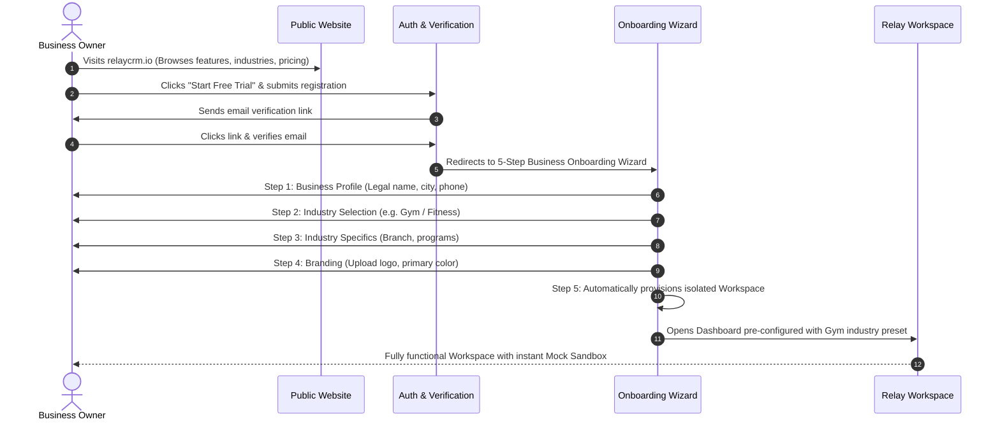

# RELAY SAAS — PRODUCT REQUIREMENTS DOCUMENT (PRD)
## Multi-Business WhatsApp Automation Platform, Industry Engine, Customer-Direct Billing & Commercial Architecture

> **Document Version:** 1.0.0 (Master Product Specification)  
> **Phase:** SAAS PROMPT 0 (Planning & Architecture)  
> **Product Positioning:** *RELAY — One Platform. Every Business.*  

---

## 1. Product Vision & Value Proposition

Relay is a B2B SaaS WhatsApp automation platform. It empowers small-to-medium businesses, solo operators, and growing agencies to automate WhatsApp customer inquiries, run personalized marketing campaigns, manage two-way customer conversations, and analyze message conversions through a single, polished dashboard.

### Core Value Drivers
1. **Multi-Industry Out of the Box:** The same unified application automatically adapts to Real Estate, Gym/Fitness, Clinics, Education, Salons, Automobile, and general businesses without code duplication.
2. **Customer-Direct Meta Billing Safeguard:** Customers connect their own WhatsApp Business Account and pay Meta directly for conversation fees. Relay charges exclusively for the software platform subscription. Relay never subsidizes or accidentally absorbs client messaging costs.
3. **Frictionless Mock-Mode Sandbox:** Every new customer can explore 100% of the platform (templates, audience filtering, simulated campaigns, two-way inbox, auto-reply rules, and report exports) immediately upon registration without waiting for Meta business verification.
4. **Seamless Transition to Official WhatsApp:** When ready, customers link their live WhatsApp Business number via official Meta Embedded Signup.

---

## 2. Target User Personas & User Journeys

### 2.1 Primary User Personas
- **The Solo Business Operator (e.g. Real Estate Consultant, Independent Clinic Owner):** Needs instant, professional WhatsApp marketing without technical complexity or hiring developers.
- **The Operations Manager (e.g. Gym Manager, Coaching Institute Coordinator):** Manages inbound lead inquiries, follow-up reminders, batch announcements, and membership campaigns.
- **The Digital Marketing Reseller / Agency Owner:** Needs a white-labeled automation tool to deliver WhatsApp marketing campaigns to multiple business clients.

### 2.2 Complete Customer Onboarding Journey


---

## 3. Public SaaS Website Architecture

The public website serves as the top-of-funnel marketing showcase for Relay.

### 3.1 Public Page Sitemaps & Route Placement
- `/` — **Homepage:** Hero with interactive dashboard teaser, value props, live metric counters, industry carousel, social proof, call-to-action.
- `/features` — **Feature Deep Dive:** Detailed breakdown of Template Studio, Smart Import Wizard, 4-Step Campaign Orchestration, Two-Way Inbox, Auto-Reply Engine, and Analytics.
- `/industries` — **Supported Industries:** Dedicated interactive tabs showcasing how Relay customizes terminology, templates, and automations for each of the 7 supported industries.
- `/how-it-works` — **How It Works & Meta Integration:** Transparent visual explanation of Meta WhatsApp Cloud API vs Mock Sandbox, customer-direct billing, and coexistence with WhatsApp Business App.
- `/pricing` — **Transparent Pricing:** Clear breakdown between Relay Software Subscription (₹799/mo) and Meta messaging fees (paid direct to Meta). FAQ addressing zero markup on Meta fees.
- `/faq` — **Frequently Asked Questions:** Data privacy, opt-in compliance, numbers, sender migration, cancellation.
- `/contact` — **Contact & Sales Inquiries:** Lead capture form for enterprise and agency inquiries.
- `/login` — **User Authentication:** Clean Midnight Slate login screen.
- `/signup` — **User Registration:** 3-field rapid signup (Name, Business Email, Password).
- `/terms` & `/privacy` — **Legal & Compliance:** Explicit WhatsApp business policy alignment, data retention, and privacy terms.

### 3.2 Design Standards & Anti-Deception Policies
- **No Fake Testimonials:** Real client case studies only.
- **No Claims of "Unlimited Free WhatsApp Messages":** Truthful explanation that Meta charges per conversation category (Marketing, Utility, Authentication, Service).
- **No Unsupported Badges:** Only verified certifications and truthful partnership references.

---

## 4. Industry Configuration Engine & Presets

Relay solves the multi-industry challenge through a **Versioned Configuration Engine** that controls terminology, custom form fields, search filters, template suggestions, and auto-reply defaults without duplicating UI or backend code.

### 4.1 Industry Configuration Schema (`industryPresets.js`)
```javascript
export const INDUSTRY_PRESETS = {
  real_estate: {
    key: 'real_estate',
    name: 'Real Estate & Property',
    contactLabel: 'Buyer / Investor Lead',
    customFields: [
      { key: 'interestedPropertyType', label: 'Property Type', type: 'select', options: ['2 BHK', '3 BHK', 'Villa', 'Plots', 'Commercial'] },
      { key: 'interestedProject', label: 'Project Interest', type: 'text' },
      { key: 'budgetRange', label: 'Budget Range', type: 'select', options: ['₹50L - ₹1 Cr', '₹1 Cr - ₹2.5 Cr', '₹2.5 Cr+'] },
      { key: 'preferredLocation', label: 'Preferred Location', type: 'text' },
    ],
    defaultLeadSources: ['Website', '99acres', 'Magicbricks', 'Housing.com', 'Walk-in', 'Referral'],
    defaultKeywords: [
      { keyword: 'BROCHURE', action: 'SEND_BROCHURE', description: 'Shares master plan and brochure link' },
      { keyword: 'PRICE', action: 'INQUIRE_CONFIG', description: 'Inquires unit configuration for quotation' },
      { keyword: 'VISIT', action: 'FLAG_ATTENTION', description: 'Flags site visit inquiry for manual follow-up' },
      { keyword: 'STOP', action: 'OPT_OUT', description: 'Standard compliance opt-out' },
    ],
  },
  gym_fitness: {
    key: 'gym_fitness',
    name: 'Gym & Fitness Clubs',
    contactLabel: 'Member / Prospect',
    customFields: [
      { key: 'membershipType', label: 'Membership Interest', type: 'select', options: ['Monthly', 'Quarterly', 'Annual Gold', 'Personal Training'] },
      { key: 'fitnessGoal', label: 'Fitness Goal', type: 'select', options: ['Weight Loss', 'Muscle Gain', 'Endurance', 'Flexibility/Yoga'] },
      { key: 'preferredTiming', label: 'Preferred Timing', type: 'select', options: ['Morning (6 AM - 10 AM)', 'Afternoon', 'Evening (5 PM - 10 PM)'] },
      { key: 'trialStatus', label: 'Trial Session Status', type: 'select', options: ['Not Booked', 'Scheduled', 'Attended', 'No Show'] },
    ],
    defaultLeadSources: ['Walk-in', 'Instagram / Facebook Ad', 'Google Maps', 'Referral', 'Flyer'],
    defaultKeywords: [
      { keyword: 'TRIAL', action: 'SEND_TRIAL_INVITE', description: 'Sends complimentary 1-day workout pass' },
      { keyword: 'FEES', action: 'SEND_MEMBERSHIP_PLANS', description: 'Shares current membership pricing & offers' },
      { keyword: 'TIMING', action: 'SEND_GYM_HOURS', description: 'Sends club hours and trainer schedule' },
      { keyword: 'STOP', action: 'OPT_OUT', description: 'Standard compliance opt-out' },
    ],
  },
  clinic_healthcare: {
    key: 'clinic_healthcare',
    name: 'Clinics & Healthcare Services',
    contactLabel: 'Patient / Consultation Lead',
    customFields: [
      { key: 'serviceInterest', label: 'Consultation Service', type: 'select', options: ['General Physician', 'Dental Care', 'Dermatology', 'Pediatrics', 'Physiotherapy'] },
      { key: 'preferredTimeSlot', label: 'Preferred Time Slot', type: 'select', options: ['Morning', 'Evening'] },
      { key: 'patientType', label: 'Patient Classification', type: 'select', options: ['New Consultation', 'Follow-up Checkup'] },
    ],
    defaultLeadSources: ['Practo', 'Google Business', 'Walk-in', 'Doctor Referral', 'Website'],
    defaultKeywords: [
      { keyword: 'APPOINTMENT', action: 'BOOKING_LINK', description: 'Shares online clinic slot booking link' },
      { keyword: 'HOURS', action: 'CLINIC_HOURS', description: 'Sends clinic consultation hours' },
      { keyword: 'LOCATION', action: 'CLINIC_DIRECTIONS', description: 'Sends Google Maps location and landmark' },
      { keyword: 'STOP', action: 'OPT_OUT', description: 'Standard compliance opt-out' },
    ],
    safetyRules: ['No collection of sensitive medical records or diagnosis in generic contact schemas.'],
  },
  education_coaching: {
    key: 'education_coaching',
    name: 'Education & Coaching Institutes',
    contactLabel: 'Student / Parent Lead',
    customFields: [
      { key: 'courseInterest', label: 'Target Course / Exam', type: 'select', options: ['JEE / NEET', 'Class 11-12 Foundation', 'IELTS / TOEFL', 'Coding / Tech Skills', 'Competitive Exams'] },
      { key: 'currentGrade', label: 'Current Grade / Class', type: 'text' },
      { key: 'preferredBatch', label: 'Preferred Batch', type: 'select', options: ['Weekday Morning', 'Weekday Evening', 'Weekend Intensive'] },
    ],
    defaultLeadSources: ['Education Fair', 'School Seminar', 'Website', 'Instagram', 'Referral'],
    defaultKeywords: [
      { keyword: 'SYLLABUS', action: 'SEND_CURRICULUM', description: 'Sends course brochure and fee structure' },
      { keyword: 'DEMO', action: 'BOOK_DEMO_CLASS', description: 'Invites student to attend a free trial class' },
      { keyword: 'SCHOLARSHIP', action: 'SEND_TEST_DETAILS', description: 'Sends scholarship entrance test details' },
      { keyword: 'STOP', action: 'OPT_OUT', description: 'Standard compliance opt-out' },
    ],
  },
  salon_beauty: {
    key: 'salon_beauty',
    name: 'Salon, Spa & Beauty Care',
    contactLabel: 'Client / Booking Enquiry',
    customFields: [
      { key: 'serviceInterest', label: 'Service Category', type: 'select', options: ['Hair Styling & Color', 'Skin Care & Facial', 'Bridal Makeover', 'Nail Art', 'Massage & Spa'] },
      { key: 'preferredStylist', label: 'Preferred Stylist', type: 'text' },
      { key: 'preferredDay', label: 'Preferred Day', type: 'select', options: ['Weekday', 'Weekend'] },
    ],
    defaultLeadSources: ['Instagram', 'Google Maps', 'Walk-in', 'Referral', 'Influencer Promo'],
    defaultKeywords: [
      { keyword: 'MENU', action: 'SEND_SERVICE_MENU', description: 'Sends digital service menu with rates' },
      { keyword: 'BOOK', action: 'APPOINTMENT_REQUEST', description: 'Takes customer appointment request' },
      { keyword: 'OFFERS', action: 'SEND_MONTHLY_DEALS', description: 'Sends current package promotions' },
      { keyword: 'STOP', action: 'OPT_OUT', description: 'Standard compliance opt-out' },
    ],
  },
  automobile: {
    key: 'automobile',
    name: 'Automobile Dealers & Service',
    contactLabel: 'Buyer / Service Customer',
    customFields: [
      { key: 'vehicleModel', label: 'Vehicle Model of Interest', type: 'text' },
      { key: 'purchaseTimeline', label: 'Purchase Timeline', type: 'select', options: ['Immediate (Within 15 days)', 'Within 1 Month', 'Exploring'] },
      { key: 'exchangeInterest', label: 'Old Car Exchange', type: 'select', options: ['Yes', 'No'] },
      { key: 'testDriveStatus', label: 'Test Drive Preference', type: 'select', options: ['Showroom Visit', 'Home Test Drive', 'Not Interested'] },
    ],
    defaultLeadSources: ['Showroom Walk-in', 'CarDekho / CarWale', 'Facebook Ad', 'Service Center Visit'],
    defaultKeywords: [
      { keyword: 'TESTDRIVE', action: 'BOOK_TEST_DRIVE', description: 'Books test drive slot for requested model' },
      { keyword: 'EXCHANGE', action: 'EVALUATION_REQUEST', description: 'Initiates free doorstep car evaluation' },
      { keyword: 'BROCHURE', action: 'SEND_CAR_SPECS', description: 'Sends model brochure and on-road pricing' },
      { keyword: 'STOP', action: 'OPT_OUT', description: 'Standard compliance opt-out' },
    ],
  },
  other_business: {
    key: 'other_business',
    name: 'General Business & Professional Services',
    contactLabel: 'Client / Prospect',
    customFields: [
      { key: 'serviceInterest', label: 'Service of Interest', type: 'text' },
      { key: 'requirementDetails', label: 'Project Scope', type: 'text' },
    ],
    defaultLeadSources: ['Website', 'Referral', 'Direct WhatsApp', 'LinkedIn', 'Other'],
    defaultKeywords: [
      { keyword: 'INFO', action: 'SEND_COMPANY_PROFILE', description: 'Sends company overview and portfolio' },
      { keyword: 'STOP', action: 'OPT_OUT', description: 'Standard compliance opt-out' },
    ],
  },
};
```

---

## 5. Customer WhatsApp Connection Architecture

Relay supports two official Meta connection methods without using unofficial QR scraping:

### 5.1 Connection Options
- **Option A: Eligible WhatsApp Business App Coexistence**
  - Allows small businesses to keep using their existing WhatsApp Business App on their mobile phone while connecting it to the Cloud API for automated campaigns.
- **Option B: Dedicated WhatsApp Cloud API Number**
  - A new or ported dedicated virtual phone number provisioned exclusively on the WhatsApp Business Platform.

### 5.2 The WhatsAppConnection Data Model (`backend/src/models/WhatsAppConnection.js`)
```javascript
const whatsAppConnectionSchema = new mongoose.Schema(
  {
    workspaceId: { type: mongoose.Schema.Types.ObjectId, ref: 'Workspace', required: true, unique: true },
    connectionMode: { type: String, enum: ['MOCK_SANDBOX', 'META_CLOUD_API'], default: 'MOCK_SANDBOX' },
    connectionStatus: {
      type: String,
      enum: ['SANDBOX_ACTIVE', 'PENDING_EMBEDDED_SIGNUP', 'CONNECTED', 'DEGRADED', 'DISCONNECTED', 'REVOKED'],
      default: 'SANDBOX_ACTIVE'
    },
    metaWabaId: { type: String, default: '' },
    metaPhoneNumberId: { type: String, default: '' },
    displayPhoneNumber: { type: String, default: '' },
    verifiedBusinessName: { type: String, default: '' },
    billingModel: {
      type: String,
      enum: ['CUSTOMER_DIRECT', 'UNVERIFIED', 'PROHIBITED_RELAY_MANAGED'],
      default: 'CUSTOMER_DIRECT'
    },
    billingStatus: { type: String, enum: ['ACTIVE_CARD_ON_FILE', 'PENDING_CUSTOMER_SETUP', 'NOT_APPLICABLE_MOCK'], default: 'NOT_APPLICABLE_MOCK' },
    encryptedAccessToken: { type: String, select: false },
    webhookSecret: { type: String, select: false },
    lastHealthCheckAt: { type: Date, default: Date.now },
  },
  { timestamps: true }
);
```

---

## 6. Customer-Direct Meta Billing Safeguards

### 6.1 Strict Architectural Separation of Costs
- **Relay Subscription:** Paid by the customer to Relay via Razorpay (software license).
- **Meta Conversation Charges:** Incurred directly by the customer's own Meta Business Account via a payment method attached directly to Meta.

### 6.2 Billing Guard Invariants
1. Relay NEVER binds its own line of credit or payment credentials to any customer's WABA.
2. In live mode, before launching any campaign or sending session messages, Relay checks `billingStatus === 'ACTIVE_CARD_ON_FILE'`.
3. If Meta returns that a customer has no valid payment method configured on their WABA, Relay blocks the campaign execution with an explicit, actionable error: `META_BILLING_SETUP_REQUIRED: Please add a payment method in your Meta Business Suite to enable live messaging.`
4. Live messaging is NEVER enabled based on a frontend flag alone.

---

## 7. Relay SaaS Subscription Plans

### 7.1 Proposed Commercial Tiers
- **Free Sandbox Exploration (14-Day Trial):**
  - Full Mock Mode functionality.
  - Unlimited simulated campaigns, template creations, inbox simulator, and analytics exports.
  - 0 live sends.
- **Relay Solo (₹799 / month):**
  - 1 Business Workspace.
  - 1 WhatsApp Sender connection.
  - Full access to all 7 primary modules.
  - Up to 5,000 managed contacts.
  - Customer pays Meta directly for message delivery.
- **Relay Growth (₹1,999 / month - Future Tier):**
  - Up to 25,000 managed contacts.
  - Up to 3 team member seats.
  - Advanced lead scoring and automated webhook integrations.

---

## 8. In-Scope vs. Out-of-Scope Roster

### In-Scope for the SaaS Transformation
- Logical multi-tenant workspace architecture with data isolation.
- Zero-data-loss migration of M2W Luxury Realty into Workspace 1.
- Public responsive SaaS website (Home, Features, Industries, Pricing, Login, Signup).
- Email verification and self-serve onboarding wizard.
- Industry preset configuration engine across 7 industries.
- Adaptation of all 7 dashboard screens to reflect active workspace branding and industry terminology.
- WhatsApp Connection Manager (Mock Sandbox + Meta Integration readiness).
- Razorpay subscription management with webhook-driven entitlement gates.
- Super Admin platform health console.

### Out-of-Scope (Reserved for Later Phases)
- Mobile native application (iOS/Android). Responsive web is 100% prioritized.
- Unofficial WhatsApp Web QR scraping (strictly prohibited).
- Live payment integration in Prompt 0.
- Live Meta Cloud API calls in Prompt 0.
