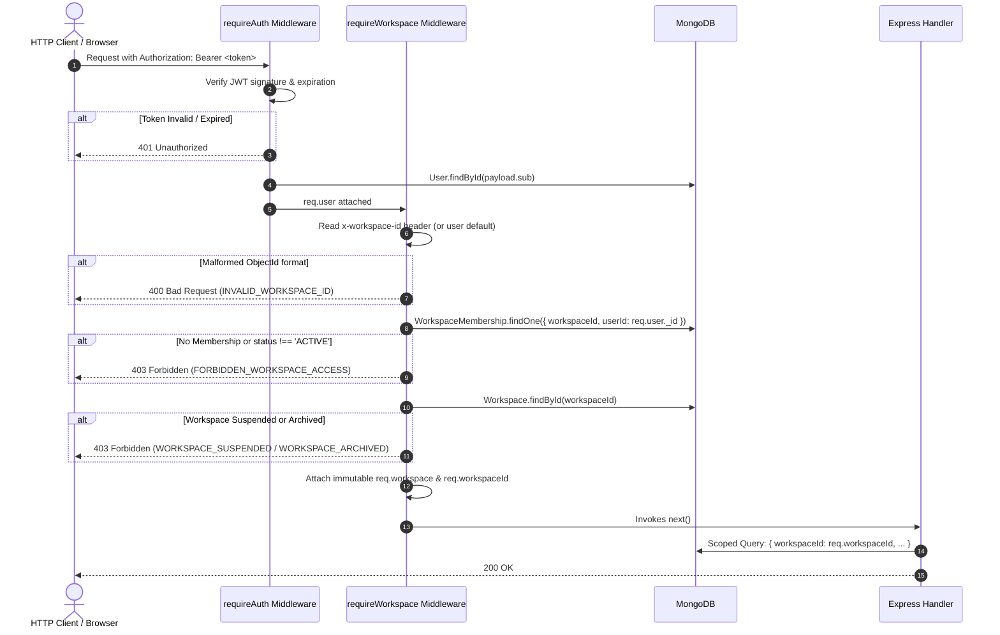

# RELAY SAAS — MULTI-TENANT AUTHORIZATION & SECURITY ARCHITECTURE
## Context Contracts, Middleware Pipeline, Threat Model & Anti-Tampering Safeguards

> **Document Version:** 1.0.0  
> **Phase:** SAAS PROMPT 1 OF 15  
> **Security Baseline:** Fail-Closed, Zero-Trust Client Context, Scoped Queries  

---

## 1. Authentication vs. Tenancy Authorization Boundary

Relay establishes an explicit architectural segregation between Authentication and Tenancy Authorization:

| Dimension | Tier 1: Authentication (`requireAuth`) | Tier 2: Tenancy Authorization (`requireWorkspace`) |
| :--- | :--- | :--- |
| **Question Answered** | *Who is this human user?* | *Which business workspace may this user access?* |
| **Validation Mechanism** | Cryptographic verification of JWT session cookie / Bearer header | Authoritative MongoDB query against `WorkspaceMembership` |
| **Identity Entity** | `User` document | `Workspace` and `WorkspaceMembership` documents |
| **Revocation Control** | `authVersion` mismatch revokes JWT sessions immediately | `status: 'REVOKED' \| 'SUSPENDED'` stops workspace access instantly |
| **Output Context** | `req.user` attached | `req.workspace`, `req.workspaceId`, `req.workspaceMembership` |

---

## 2. Request Context Contract

Downstream Express handlers on workspace-scoped routes operate under strict contract invariants:

```javascript
req.user                // Authenticated User instance (from requireAuth)
req.workspace           // Authoritative Workspace instance (from requireWorkspace)
req.workspaceId         // MongoDB ObjectId of active Workspace (immutable)
req.workspaceMembership // Authoritative WorkspaceMembership document (immutable)
```

### Anti-Tampering Protection:
`requireWorkspace` defines `req.workspace`, `req.workspaceId`, and `req.workspaceMembership` with `writable: false`. Malicious client input in `req.body`, `req.query`, or `req.params` CANNOT overwrite or pollute the server-derived tenant boundary.

---

## 3. Middleware Pipeline Execution Flow



---

## 4. Multi-Tenant Query Helpers (`workspaceContextService.js`)

To prevent inconsistent authorization checks across controllers, Relay provides centralized helper functions:

1. `getAuthorizedWorkspaceContext(req)`:
   - Validates that `req.user` and `req.workspaceId` are present. Fails closed with 401 or 403 if called on unshielded routes.
2. `buildWorkspaceScope(workspaceId)`:
   - Constructs a strict MongoDB query `{ workspaceId: new ObjectId(workspaceId) }`.
   - Rejects `undefined`, `null`, or empty inputs with `MISSING_TENANT_BOUNDARY` to prevent accidental global queries.
3. `assertWorkspaceMembership(userId, workspaceId, requiredRole)`:
   - Validates active database membership and optionally enforces role requirements (`OWNER`, `ADMIN`, `MEMBER`).
4. `assertResourceWorkspaceOwnership(resource, workspaceId, resourceName)`:
   - Asserts `resource.workspaceId.toString() === workspaceId.toString()`.
   - **Crucial Anti-Enumeration Rule:** If mismatched, returns HTTP 404 rather than 403, preventing an attacker from determining whether a resource ID exists in another tenant's workspace.

---

## 5. Comprehensive Security Threat Analysis & Verification Evidence

| Threat Vector | Attack Scenario | Mitigation in Prompt 1 | Verified Test Case |
| :--- | :--- | :--- | :--- |
| **BOLA (Broken Object-Level Authorization)** | Attacker replaces `x-workspace-id` with another business's ID. | Server verifies `WorkspaceMembership` matching both `userId` and `workspaceId`. Returns 403. | `saasPrompt1Workspace.test.js` Test 18 & 19 |
| **NoSQL / BSON Injection** | Attacker passes object or regex in `x-workspace-id`. | `mongoose.isObjectIdOrHexString` validation fails closed with HTTP 400. | `saasPrompt1Workspace.test.js` Test 20 |
| **Role Escalation via Payload** | Attacker passes `{ role: "OWNER" }` in request body. | Middleware loads role exclusively from persisted `WorkspaceMembership`. Client body cannot alter role. | `saasPrompt1Workspace.test.js` Test 13 & 17 |
| **Stale / Revoked Membership Abuse** | Attacker continues sending requests after membership revoked. | Query verifies `membership.status === 'ACTIVE'`. If `REVOKED`, returns 403 immediately. | `saasPrompt1Workspace.test.js` Test 21 |
| **Suspended Tenant Leak** | Suspended business continues API calls. | Middleware inspects `workspace.status`. Returns 403 `WORKSPACE_SUSPENDED`. | `saasPrompt1Workspace.test.js` Test 22 |
| **Resource Enumeration** | Attacker probes arbitrary IDs to map other tenants' data. | `assertResourceWorkspaceOwnership` returns 404 `RESOURCE_NOT_FOUND` on tenant mismatch. | `saasPrompt1Workspace.test.js` Test 25 |
| **Live WhatsApp Provider Leak** | Request attempts to trigger live Meta Cloud API send. | Server-side guard in `messagingProviderRegistry.js` throws HTTP 403 `LIVE_MODE_DISABLED`. | `saasPrompt1Workspace.test.js` Test 30 |

---

## 6. Performance & Index Optimization Review

- **Membership Lookup Latency:** Every workspace-authorized request performs a single query against `WorkspaceMembership`. The collection is indexed by `{ workspaceId: 1, userId: 1 }` (compound unique) and `{ userId: 1, status: 1 }`, ensuring sub-millisecond execution.
- **Slug Resolution:** The `workspaces` collection is indexed uniquely by `{ slug: 1 }`.
- **Zero Cache Confusion:** In-memory caching of memberships was rejected for Prompt 1 to prevent stale privilege windows when an owner revokes access. The fast indexed query against MongoDB provides immediate, authoritative consistency.
