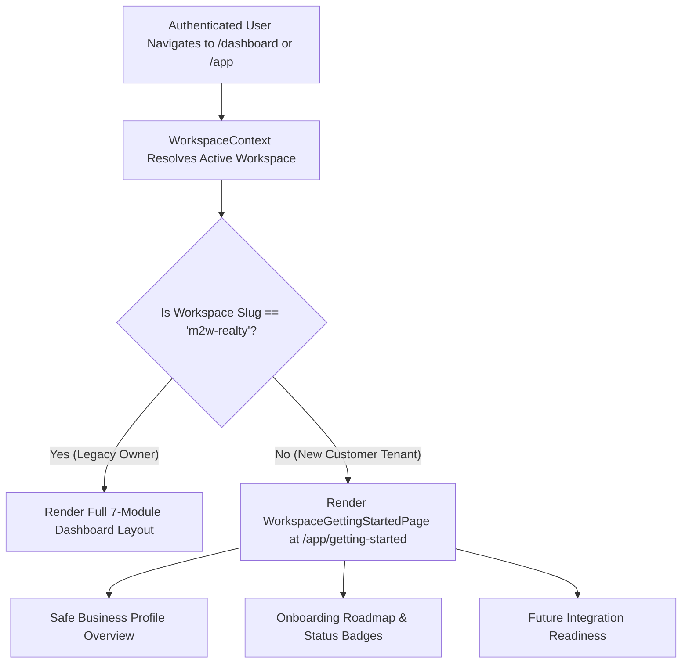

# RELAY SAAS 05 — DASHBOARD HANDOFF & TENANT ISOLATION GATES

## 1. Context & Architectural Rationale

Prior to SaaS transformation, Relay functioned as a single-operator CRM engineered exclusively for **M2W Realty**. Several controllers and data stores in the 7 business modules (`Contacts`, `Templates`, `Campaigns`, `Inbox`, `Reports`, `Sales`, `Settings`) historically relied on single-operator assumptions.

Full multi-tenant database scoping across all 7 legacy modules is scheduled for **SaaS Prompt 7**. 

Therefore, a critical architectural rule was mandated for Prompt 5:
> **DO NOT automatically grant newly provisioned customers unrestricted access to legacy dashboard modules. New workspaces must land in a safe, dedicated Workspace Setup area (`/app/getting-started`), while the legacy M2W Realty owner retains full access to all 7 modules.**

---

## 2. Dynamic Routing & Access Gates



### Route-Level Enforcement in `Dashboard.jsx`:
```jsx
// Gating check: non-legacy workspaces land on WorkspaceGettingStartedPage
if (currentWorkspace && currentWorkspace.slug !== 'm2w-realty') {
  return <WorkspaceGettingStartedPage />;
}
```

---

## 3. The `WorkspaceGettingStartedPage` Experience

The Getting Started screen (`/app/getting-started`) provides a polished, professional workspace hub tailored to the customer's business:

1. **Header & Visual Identity**:
   - Live business name and industry badge.
   - Brand logo preview (or fallback avatar initials).
   - Operational location and timezone summary.
2. **Transparent Setup Status**:
   - **Workspace Created**: Active & Isolated (`OWNER` role confirmed).
   - **Industry Vertical**: Configured (`real_estate`, `gym`, `clinic`, etc.).
   - **Industry Presets**: Pending initialization in Prompt 6.
   - **Business Modules**: Safe progressive enablement roadmap.
   - **WhatsApp Connection**: Disconnected (Mock provider active; live Meta Cloud API 403-blocked).
   - **Billing & Subscription**: Introductory ₹799/month tier scheduled for Prompt 10.
3. **Zero Fabricated Records**:
   - Contacts: 0.
   - Campaigns: 0.
   - Message activity: 0.
   - No synthetic graphs or mock data masquerading as genuine business analytics.

---

## 4. Preservation of M2W Realty Functionality

The legacy M2W Realty owner account continues operating without disruption:
- **Authentication**: Seamless login via password or session cookie.
- **Workspace Resolution**: Automatically resolves to the migrated `m2w-realty` workspace.
- **Full Navigation**: Full access to all 7 core modules:
  1. Overview KPI cards & charts
  2. Contacts & Audience segmentation
  3. Template Studio & Brochure attachments
  4. Campaign Builder & Scheduling
  5. Inbox, Auto-Replies & Simulator
  6. Reports & Audit Exports
  7. Settings & Developer Testing Center

---

## 5. Roadmap to Subsequent SaaS Prompts

- **Prompt 6 (Industry Configuration Engine)**:
  - Dynamic contact fields per vertical.
  - Industry-specific dashboard labels and terminology.
  - Pre-approved WhatsApp template suggestions.
  - Keyword automation presets.
- **Prompt 7 (Full 7-Module Multi-Tenant Conversion)**:
  - Comprehensive workspace-scoping across all controllers and MongoDB queries.
  - Multi-tenant data migration and query filtering.
  - Gradual unlocking of the full 7-module dashboard for all non-M2W tenants.
