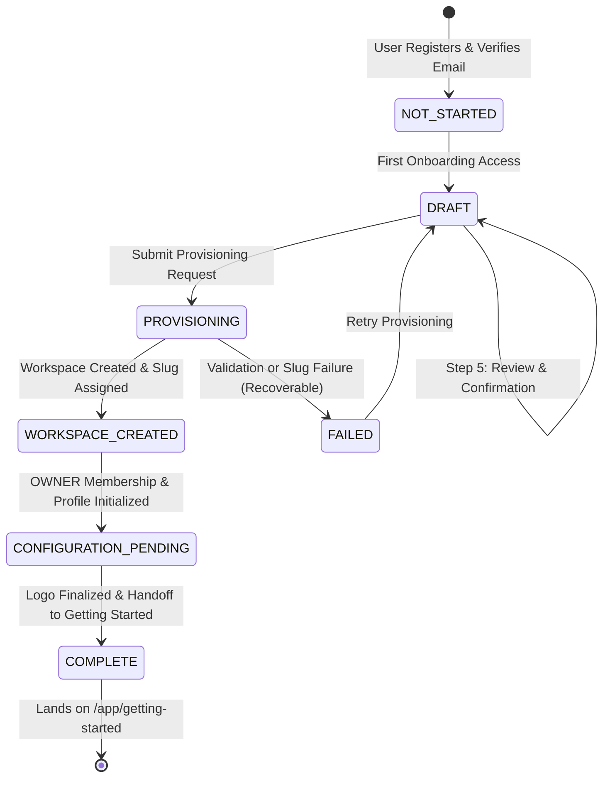

# RELAY SAAS 05 — BUSINESS ONBOARDING ARCHITECTURE

## 1. Executive Summary & Objective

In **SaaS Phase 5**, Relay introduces a fully automated, production-grade business onboarding wizard and workspace provisioning system. When authenticated, email-verified customers sign up, they are guided through a structured 6-step setup wizard that captures their business identity, industry vertical, operational details, and visual branding. 

On submission, the system automatically provisions an isolated tenant workspace, creates an immutable `OWNER` membership, initializes the `BusinessProfile`, attaches the business logo, and routes the user into a safe, dedicated **Getting Started** screen.

---

## 2. Complete Route Architecture

### 2.1 Frontend Navigation Routes

| Route | Protection Level | Component | Purpose |
|---|---|---|---|
| `/onboarding` | Authenticated + Verified | `BusinessOnboardingPage` | Interactive 6-step onboarding wizard with live preview and draft recovery |
| `/onboarding/handoff` | Authenticated + Verified | `OnboardingHandoffPage` | Transitional handoff gate verifying account eligibility |
| `/app/getting-started` | Authenticated + Tenant Scoped | `WorkspaceGettingStartedPage` | Safe post-onboarding workspace hub; isolates new tenants from unmigrated legacy modules |
| `/dashboard` | Authenticated + Tenant Scoped | `Dashboard` | Gated root: renders `WorkspaceGettingStartedPage` for new tenants, full dashboard for M2W |

### 2.2 Backend API Surface (`/api/onboarding`)

| Method | Endpoint | Auth Required | Verified Required | Description |
|---|---|---|---|---|
| `GET` | `/api/onboarding/status` | Yes (`Bearer`) | Yes (`403` if unverified) | Returns onboarding status, active workspace membership, and draft summary |
| `GET` | `/api/onboarding/draft` | Yes (`Bearer`) | Yes (`403` if unverified) | Retrieves or initializes user's isolated onboarding draft |
| `PUT` | `/api/onboarding/draft` | Yes (`Bearer`) | Yes (`403` if unverified) | Updates draft fields, sanitizes metadata, and persists step progress |
| `POST` | `/api/onboarding/logo` | Yes (`Bearer`) | Yes (`403` if unverified) | Validates MIME, size, magic bytes; saves secure temp logo |
| `GET` | `/api/onboarding/logo/:filename` | Public | No | Serves approved logo image with `X-Content-Type-Options: nosniff` |
| `DELETE` | `/api/onboarding/logo` | Yes (`Bearer`) | Yes (`403` if unverified) | Cleans up draft logo and removes branding reference |
| `POST` | `/api/onboarding/complete` | Yes (`Bearer`) | Yes (`403` if unverified) | Atomic idempotent workspace provisioning and profile initialization |

---

## 3. Onboarding Lifecycle & State Machine

### State Definitions:
1. **`NOT_STARTED`**: User has registered and verified their email address, but has not yet opened the onboarding wizard.
2. **`DRAFT`**: Onboarding draft document exists in MongoDB, tracking step progress (1-5) and validated form fields.
3. **`PROVISIONING`**: Server-side provisioning in progress under concurrency locks.
4. **`WORKSPACE_CREATED`**: Tenant `Workspace` document persisted with unique slug and active status.
5. **`CONFIGURATION_PENDING`**: Workspace exists; awaiting industry presets (to be initialized in SaaS Prompt 6).
6. **`COMPLETED`**: Workspace, `WorkspaceMembership` (`OWNER`), and `BusinessProfile` fully committed.
7. **`FAILED`**: Operation failed gracefully with error details logged; draft preserved for user retry.

---

## 4. Frontend Design System (Midnight Slate × Jade)

The onboarding experience adheres strictly to Relay's curated modern palette:
- **Background**: `#F5F7FA` (Clean, subtle cool gray)
- **Surfaces**: `#FFFFFF` (Elevated card containers)
- **Primary / Jade Accent**: `#0D9488` (Teal-600) / Hover: `#0F766E` (Teal-700)
- **Soft Accent / Glow**: `#E6F6F3` (Teal-50 tint for badges and highlights)
- **Dark Elements / Sidebar**: `#111827` (Midnight Slate)
- **Typography**: Inter / Outfit via modern system font stacks
- **Layout Architecture**: Split responsive layout featuring:
  - **Top Navigation**: Relay brand mark, 6-step circular progress tracker, active account indicator.
  - **Left Form Canvas**: Focused step form with accessible inputs, field hints, and inline validation.
  - **Right Live Preview**: Dynamic SaaS business card reflecting live business name, industry badge, operational city, and uploaded logo in real-time.
  - **Bottom Action Bar**: Previous, Save Draft, and Continue / Create Workspace CTA.

---

## 5. Security & Isolation Invariants

1. **Authentication Gate**: All onboarding endpoints enforce `requireAuth` JWT validation (`Bearer` or HTTP-only cookie).
2. **Verification Gate**: Accounts in `PENDING_EMAIL_VERIFICATION` status are blocked (`403 EMAIL_VERIFICATION_REQUIRED`).
3. **Tenant Ownership Isolation**: Onboarding drafts are strictly scoped to `req.user._id`. Users cannot query, modify, or overwrite another tenant's draft.
4. **Idempotent Workspace Provisioning**: Submitting the completion request multiple times returns the existing workspace and prevents duplicate records.
5. **Legacy M2W Protection**: Existing M2W Realty data, memberships, contacts, and campaigns remain completely untouched.
