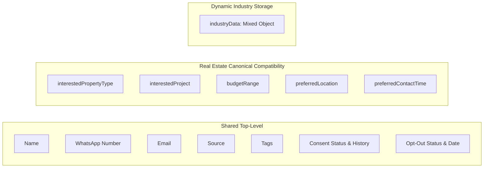

# RELAY SAAS — SAAS 06: CONTACT SCHEMA COMPATIBILITY & M2W REALTY PRESERVATION

## 1. Storage Strategy: Shared vs. Vertical-Specific

The Relay multi-tenant architecture uses a **hybrid compatibility schema** for `Contact`:



### Shared Universal Fields (All Industries)
- `ownerId`: Historical single-operator owner reference.
- `workspaceId`: Tenant workspace scoping reference.
- `name`: Cleaned contact full name.
- `phoneNumber`: E.164 normalized mobile number.
- `email`: Validated email address (optional).
- `source`: Attribution (`MANUAL`, `CSV_IMPORT`, `WEBHOOK`, etc.).
- `tags`: Indexed lowercase keyword tags.
- `consentStatus`: Mandatory compliance state (`EXPLICIT_OPT_IN`, `IMPLICIT_TRANSACTIONAL`, `OPTED_OUT`, `REVOKED`).
- `optOut`: Boolean flag preventing marketing dispatches.
- `notes`: Operational internal notes.

---

## 2. Real Estate Legacy Compatibility (M2W Realty Guarantee)

M2W Realty operates with historical real-estate contacts stored at top-level schema fields:
- `interestedPropertyType` (e.g., `'Apartment'`, `'2 BHK'`, `'Villa'`)
- `interestedProject` (e.g., `'Sobha City'`, `'DLF Cybercity'`)
- `budgetRange` (e.g., `'₹1Cr - ₹2.5Cr'`)
- `preferredLocation` (e.g., `'Sector 109, Gurugram'`)
- `preferredContactTime` (e.g., `'Evening'`)

### Compatibility Adapter (`industryCompatibilityAdapter.js`)
To prevent two conflicting writable sources of truth or breaking legacy queries:
1. **Hydration**: When contacts are retrieved, `adaptContactForPresentation()` mirrors top-level real-estate fields into `contact.industryData`. If `contact.industryData` is empty, it populates it transparently from the canonical top-level fields.
2. **Persistence**: When a real-estate contact is saved, `syncIndustryDataToCanonicalFields()` mirrors `industryData` values back to top-level canonical fields so legacy reports, filters, and exports continue reading them without change.
3. **Non-Real-Estate Isolation**: For all other verticals (`gym`, `clinic`, `salon`, etc.), fields are stored exclusively inside `industryData` and never pollute or mutate real-estate top-level properties.

---

## 3. Contact Schema Update in `Contact.js`

`Contact.js` uses `{ strict: 'throw' }` in Mongoose. To support dynamic fields safely:
1. Added `industryData`:
   ```javascript
   industryData: {
     type: mongoose.Schema.Types.Mixed,
     default: {}
   }
   ```
2. Added missing real-estate compatibility keys:
   ```javascript
   siteVisitInterest: { type: Boolean, default: false },
   preferredVisitDate: { type: Date, default: null }
   ```
3. Sanitized in `cleanContactInput()` in `backend/src/utils/contactValidation.js` to ensure incoming payloads strip operator injection or prototype poisoning.

All existing M2W contacts retain 100% data integrity with zero data loss or forced schema rewrite.
