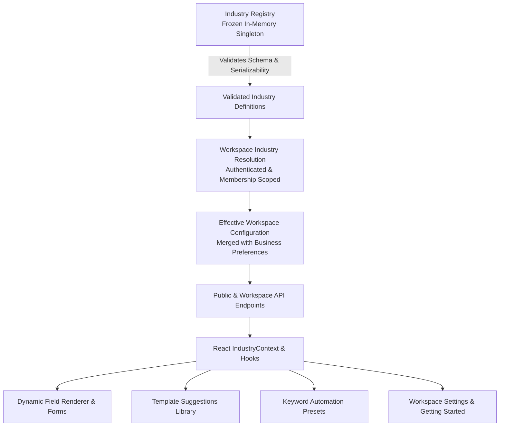

# RELAY SAAS — SAAS 06: MULTI-INDUSTRY CONFIGURATION ENGINE ARCHITECTURE

## 1. Architectural Overview & Design Philosophy

The primary mission of SaaS Prompt 6 is transforming Relay into a **configuration-driven multi-industry platform** without duplicating models, controllers, or frontend dashboards.

Every business—whether a real estate developer, fitness center, dental clinic, tutoring academy, luxury salon, car dealership, or generic service provider—operates within the **exact same shared React application, Express backend, and MongoDB database models**, while resolving industry-relevant labels, validated dynamic contact fields, filter criteria, message template suggestions, and keyword automation presets.



### Core Tenet: Zero Vertical Duplication
- **No duplicated models**: There is NO `GymContact.js`, `SalonContact.js`, or `RealEstateContact.js`. Dynamic fields are stored in `industryData` (with canonical real-estate fields preserved for M2W backwards compatibility).
- **No duplicated controllers**: There is NO `gymContactController.js` or `salonController.js`. All operations flow through unified, tenant-scoped services.
- **No duplicated dashboards**: There is NO `/gym-dashboard` or `/salon-dashboard`. The 7-module navigation remains intact (`/app/overview`, `/app/contacts`, `/app/templates`, `/app/campaigns`, `/app/inbox`, `/app/reports`, `/app/settings`).

---

## 2. Directory Structure & Key Components

```
backend/
├── src/
│   ├── config/
│   │   └── industries/
│   │       ├── definitions/
│   │       │   ├── realEstate.js      # Flagship M2W real estate vertical
│   │       │   ├── gym.js             # Gym & fitness center vertical
│   │       │   ├── clinic.js          # Healthcare & clinic vertical (non-sensitive)
│   │       │   ├── education.js       # Education & coaching vertical (no minors data)
│   │       │   ├── salon.js           # Salon & beauty services vertical
│   │       │   ├── automobile.js      # Automobile dealerships & showrooms
│   │       │   ├── other.js           # Generic services fallback
│   │       │   └── index.js           # Barrel export of all 7 definitions
│   │       ├── industrySchema.js      # Validation engine & JSON-serializability check
│   │       └── industryRegistry.js    # Immutable registry singleton & public sanitization
│   ├── controllers/
│   │   └── industryConfigurationController.js # Public & protected config endpoints
│   ├── routes/
│   │   ├── industryRoutes.js          # Mounted at /api/industries
│   │   └── workspaceRoutes.js         # Config endpoints mounted under /current/*
│   └── services/
│       └── industry/
│           ├── industryValidationService.js    # Field validation, variable allowlists, keyword protection
│           ├── industryCompatibilityAdapter.js # Real estate legacy top-level & industryData mirror
│           └── industryConfigurationService.js  # Resolution, terminology merging, draft creation

frontend/
├── src/
│   ├── context/
│   │   └── IndustryContext.jsx        # React context & useIndustryConfig() hook
│   ├── services/
│   │   └── industries.js              # Client API wrapper
│   └── components/
│       └── industry/
│           ├── DynamicFieldRenderer.jsx          # Accessible polymorphic form control
│           ├── DynamicContactFields.jsx          # Form grouping & field renderer
│           ├── IndustryBadge.jsx                 # Styled vertical badge
│           ├── IndustryLabel.jsx                 # Dynamic terminology display
│           ├── IndustryEmptyState.jsx            # Contextual empty state card
│           ├── IndustryTemplateSuggestions.jsx   # Interactive template browser with 1-click draft
│           ├── IndustryAutomationSuggestions.jsx # Keyword presets with opt-out compliance
│           ├── IndustryConfigHub.jsx             # 4-panel unified configuration tab hub
│           └── index.js                          # Barrel export
```

---

## 3. Server-Side Registry Lifecycle

1. **Boot Validation**: On server boot, `industryRegistry.js` imports definitions for all 7 verticals and runs `validateIndustryDefinition()` from `industrySchema.js`.
2. **Immutability Guarantee**: Once validated, each definition object is deep-frozen with `Object.freeze()`. Tenant preferences never mutate the global definitions.
3. **Public vs. Protected Separation**:
   - `getPublicIndustriesMetadata()` exposes sanitized cards (key, name, description, icon, version) for marketing and onboarding without leaking internal structures.
   - `resolveWorkspaceConfiguration({ workspace, user })` fetches effective configuration for authenticated, authorized workspaces, merging workspace-level custom terminology or column selections.

---

## 4. Prompt 5 Hand-Off & Prompt 7 Readiness Gate

- **Prompt 5 Regression Intact**: Business onboarding wizard, logo uploads, and workspace provisioning retain 100% test coverage.
- **Readiness Gate Preserved**: Non-legacy workspaces land on `/app/getting-started` where the `IndustryConfigHub` is mounted, providing full interactive configuration, template drafting, and automation inspection.
- **Legacy M2W Workspace Unchanged**: Sumit Thakur (`owner@m2wrealty.com`) retains full access to the operational 7-module dashboard with zero regressions.
- **Zero Live Meta WhatsApp Sends & Zero Fake Approvals**: All template drafts persist with `providerStatus: 'Not Submitted'` and `localStatus: 'Draft'`. All auto-reply rules persist with `enabled: false`.
