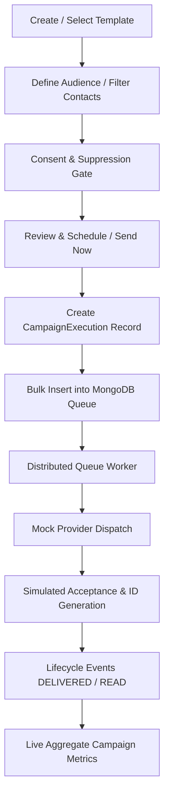

# Relay SaaS — Campaign Simulation Engine (Phase 8 of 15)

## 1. Full Campaign Pipeline

Relay executes simulated campaigns through the identical operational pipeline used for production messaging, replacing only the final outbound network call with the `MockWhatsAppProvider`.

---

## 2. Campaign State Machine

Supported states and invariants implemented in [`backend/src/models/CampaignExecution.js`](file:///c:/Users/Admin/Desktop/Relay-main/backend/src/models/CampaignExecution.js) and [`backend/src/services/campaignExecutionService.js`](file:///c:/Users/Admin/Desktop/Relay-main/backend/src/services/campaignExecutionService.js):

| Transition | Permitted? | Condition / Behavior |
|---|---|---|
| `DRAFT` -> `QUEUED` / `RUNNING` | Yes | Immediate start; jobs enqueued with `workspaceId`. |
| `DRAFT` -> `SCHEDULED` | Yes | Valid future timestamp stored in UTC. |
| `SCHEDULED` -> `QUEUED` | Yes | Scheduler cron ticks at or past `scheduledAt`. |
| `RUNNING` -> `PAUSED` | Yes | Pauses campaign; queue skips pending jobs for this execution. |
| `PAUSED` -> `RUNNING` | Yes | Resumes queue dispatch without duplicating already sent jobs. |
| `RUNNING` -> `COMPLETED` | Yes | Automatic when all queue jobs reach terminal states. |
| `*` -> `CANCELLED` | Yes | Cancels pending unsent jobs; preserves already dispatched jobs. |
| `COMPLETED` -> `RUNNING` | **Rejected** | Cannot restart completed campaign; must clone or create new execution. |
| `CANCELLED` -> `RUNNING` | **Rejected** | Cannot resume a cancelled execution. |

---

## 3. Audience Consent & Suppression Invariants

1. **Standard Contacts:** Only contacts with `whatsappConsentStatus: 'Opted In'` or `consentStatus: 'OPTED_IN'` are eligible.
2. **Demo / Synthetic Contacts:** Contacts tagged `isDemo: true` have `SIMULATED_TEST_ELIGIBILITY` allowing safe mock testing without polluting genuine customer opt-in ledgers.
3. **Suppression Enforcement:** Any contact with `whatsappConsentStatus: 'Opted Out'` is automatically excluded during audience resolution, ensuring 0 jobs are generated for suppressed numbers.

---

## 4. Truthful Metrics Persistence

Campaign analytics are strictly computed from database aggregations:
- `totalRecipients`: Actual count of audience members resolved.
- `sentCount`: Count of jobs accepted by mock provider (`status: 'SENT'`).
- `deliveredCount`: Incremented only upon persisted `DELIVERED` event.
- `readCount`: Incremented only upon persisted `READ` event.
- `failedCount`: Incremented on transient exhaustion or permanent error.

No client-side simulation counters or random number generators are permitted.
