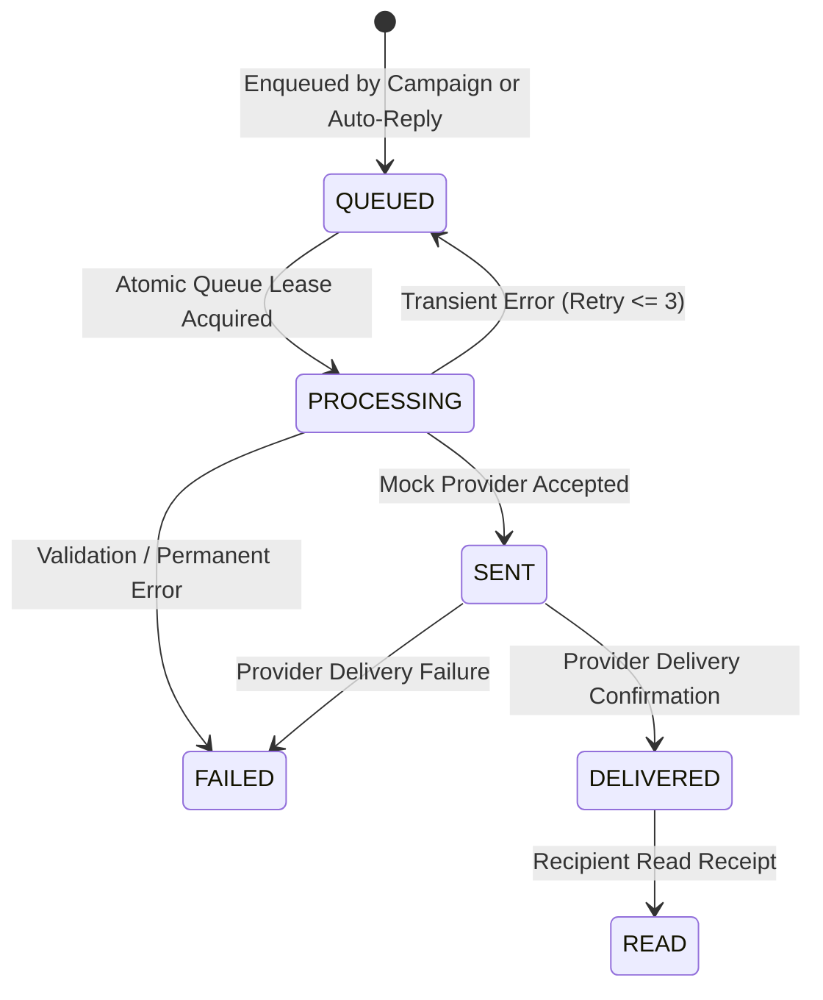

# Relay SaaS — Message Lifecycle Simulation (Phase 8 of 15)

## 1. Lifecycle Progression Overview

Every message dispatched through Relay navigates a formal state machine persisted in MongoDB across `Message`, `ConversationMessage`, and `MessageEvent` collections.



---

## 2. Status Definitions & Invariants

| State | Collection | Semantics |
|---|---|---|
| `QUEUED` | `QueueJob`, `Message` | Message intent persisted; waiting for queue worker lease acquisition. |
| `PROCESSING` | `QueueJob`, `Message` | Active lease claimed by worker (`lockedAt`, `lockedBy`); dispatched to provider. |
| `SENT` | `Message`, `ConversationMessage` | Simulated provider accepted dispatch; synthetic ID assigned (`mock_msg_*`). |
| `DELIVERED` | `Message`, `ConversationMessage` | Simulated carrier delivery confirmed; timestamp recorded in `deliveredAt`. |
| `READ` | `Message`, `ConversationMessage` | Simulated recipient opened message; timestamp recorded in `readAt`. |
| `FAILED` | `Message`, `QueueJob` | Dispatch failed permanently or retries exhausted (`errorCode`, `errorMessage`). |

---

## 3. Deterministic Simulation Scenarios

The simulator supports 7 scripted scenarios implemented in [`backend/src/services/workspaceMockService.js`](file:///c:/Users/Admin/Desktop/Relay-main/backend/src/services/workspaceMockService.js):

### A. Normal Delivery (`normal_delivery`)
1. Transitions `SENT` -> `DELIVERED`.
2. Sets `deliveredAt = new Date()`.
3. Appends `MessageEvent` with `status: 'DELIVERED'` and `isSimulated: true`.

### B. Read Receipt (`read_receipt`)
1. Transitions `DELIVERED` -> `READ`.
2. Sets `readAt = new Date()`.
3. Appends `MessageEvent` with `status: 'READ'`.

### C. Delayed Delivery (`delayed_delivery`)
1. Queues event with simulated delay timestamp (`occurredAt` offset by 15–60 seconds).
2. Simulates realistic mobile network propagation latency.

### D. Temporary Failure (`temporary_failure`)
1. Provider returns code `SIMULATED_TRANSIENT_FAILURE` (`retryable: true`).
2. Queue worker schedules backoff retry without marking message permanently failed.
3. Once retry limit (3) is exceeded, transitions to `FAILED`.

### E. Permanent Failure (`permanent_failure`)
1. Provider returns code `SIMULATED_PERMANENT_FAILURE` (`retryable: false`).
2. Message immediately marked `FAILED` with non-retryable error code.

### F. Duplicate Event Protection
- Events carry a unique `idempotencyKey` formatted as `<workspaceId>_<messageId>_<status>`.
- Repeated callback ingestion deduplicates silently without inflating report metrics.

### G. Out-of-Order Callback Handling
- If a `DELIVERED` event arrives after a message is already marked `READ`, the sequencer preserves `READ` as the terminal positive state while recording the event record.

---

## 4. Message Event Audit Schema

Persisted in `MessageEvent` collection:
```json
{
  "_id": "ObjectId(...)",
  "workspaceId": "ObjectId(\"...\")",
  "messageId": "mock_msg_1729500000_abc123",
  "status": "DELIVERED",
  "provider": "MOCK",
  "isSimulated": true,
  "idempotencyKey": "ws_123_mock_msg_abc_DELIVERED",
  "occurredAt": "2026-10-21T07:15:00.000Z",
  "createdAt": "2026-10-21T07:15:00.000Z"
}
```
All event records require `workspaceId` to guarantee strict multi-tenant boundary compliance.
