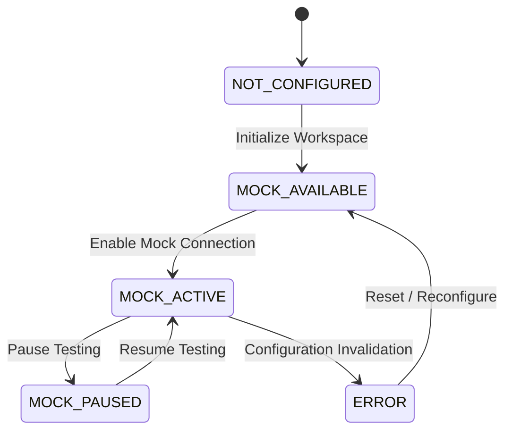

# Relay SaaS — Mock Provider Architecture (Phase 8 of 15)

## 1. Architectural Mission & Boundary

The Relay Mock Provider Architecture establishes an authoritative simulation environment allowing multi-tenant businesses to test end-to-end messaging, campaign lifecycles, and auto-reply workflows without connecting real Meta WhatsApp Business Accounts.

### Key Tenets
1. **Zero External Calls:** No outbound HTTP requests to `graph.facebook.com`.
2. **Strict Server-Side Boundary:** Frontend cannot toggle to `LIVE` via headers, query params, localStorage, or request body. Any request to initiate live Meta sending is rejected at the API gateway with HTTP 403 Forbidden.
3. **Multi-Tenant Isolation:** Every workspace possesses an independent mock context and synthetic sender identity (`mock_sender_<workspaceId>`).
4. **Provider-Neutral Contract:** The service layer consumes a standard provider interface that accommodates future live Meta adapters without altering campaign, inbox, queue, or reporting services.

---

## 2. Standard WhatsApp Provider Contract

The `MockWhatsAppProvider` adheres to the formal provider interface implemented in [`backend/src/services/mockWhatsAppProvider.js`](file:///c:/Users/Admin/Desktop/Relay-main/backend/src/services/mockWhatsAppProvider.js):

| Method | Parameters | Return Schema | Purpose |
|---|---|---|---|
| `validateConfiguration(config)` | `{ apiKey, phoneNumberId, ... }` | `{ valid: Boolean, errors: Array }` | Verifies workspace connection credentials or mock parameters. |
| `getConnectionStatus(workspaceId)` | `workspaceId` | `{ status: String, provider: 'MOCK', senderId: String }` | Evaluates whether the mock provider is active or paused. |
| `prepareTemplatePayload(template, vars, recipient)` | `(template, variables, recipientPhone)` | `{ messaging_product: 'whatsapp', to: String, type: 'template', ... }` | Normalizes template message payloads. |
| `sendTemplateMessage(payload, context)` | `(payload, { workspaceId, scenario })` | `{ success: Boolean, providerMessageId: String, status: 'ACCEPTED', ... }` | Simulates template dispatch with synthetic message ID. |
| `sendSessionMessage(payload, context)` | `(payload, { workspaceId, text })` | `{ success: Boolean, providerMessageId: String, status: 'ACCEPTED', ... }` | Simulates two-way conversational dispatch. |
| `normalizeInboundMessage(rawWebhookPayload)` | `rawWebhookPayload` | `{ messageId: String, from: String, text: String, timestamp: Date }` | Translates incoming events into standard Relay message format. |
| `normalizeStatusEvent(rawEvent)` | `rawEvent` | `{ messageId: String, status: 'SENT'\|'DELIVERED'\|'READ'\|'FAILED', timestamp: Date }` | Normalizes lifecycle status receipts. |
| `normalizeProviderError(error)` | `error` | `{ code: String, message: String, retryable: Boolean }` | Classifies provider errors into transient vs. permanent. |

---

## 3. Synthetic Sender Identity & Provenance

Mock messages must never claim to be verified Meta Business numbers:
- **Synthetic Sender ID:** Formatted deterministically as `mock_sender_<workspaceId>`.
- **Synthetic Message IDs:** Formatted as `mock_msg_<timestamp>_<randomHex>`.
- **Event Provenance:** Explicitly tagged as `provider: 'MOCK'`, `simulatorVersion: 'relay_mock_v1'`, and `isSimulated: true`.
- **Consent Decoupling:** Mock deliveries record `SIMULATED_TEST_ELIGIBILITY` and never create or forge legal WhatsApp opt-in records.

---

## 4. Connection State Machine

Workspaces navigate five defined connection states:



- **`NOT_CONFIGURED`**: No messaging connection established.
- **`MOCK_AVAILABLE`**: Simulation engine available for immediate testing.
- **`MOCK_ACTIVE`**: Active simulation context capable of processing queue jobs and inbound simulations.
- **`MOCK_PAUSED`**: Queue dispatches halted for this workspace; inbound simulations rejected with HTTP 400.
- **`ERROR`**: Workspace suspended or mock configuration corrupt.

---

## 5. Live Attempt Guard Implementation

In [`backend/src/services/workspaceMockService.js`](file:///c:/Users/Admin/Desktop/Relay-main/backend/src/services/workspaceMockService.js):

```javascript
attemptLiveConnection: async (workspaceId, user) => {
  // Hard server-side security boundary
  const error = new Error('LIVE Meta WhatsApp Cloud API connection is disabled in Phase 8. Scheduled for future phase.');
  error.statusCode = 403;
  error.code = 'LIVE_PROVIDER_DISABLED';
  throw error;
}
```

The frontend [`frontend/src/services/mockAutomation.js`](file:///c:/Users/Admin/Desktop/Relay-main/frontend/src/services/mockAutomation.js) similarly surfaces clear, immutable guidance that live connections require subsequent rollout phases.
