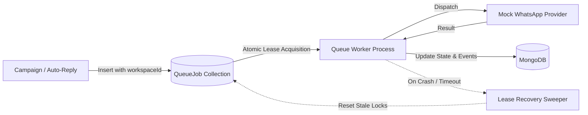

# Relay SaaS — Queue Reliability & Multi-Tenant Fairness (Phase 8 of 15)

## 1. MongoDB-Backed Queue Architecture

Relay uses a durable, transactional MongoDB-backed message queue (`QueueJob` collection) designed for multi-tenant SaaS environments without requiring external Redis/RabbitMQ infrastructure during initial phases.



---

## 2. Atomic Lease Claims & Concurrency Control

Jobs are claimed atomically to guarantee that concurrent worker instances or async event loops never process the same message simultaneously:

```javascript
const job = await QueueJob.findOneAndUpdate(
  {
    status: 'QUEUED',
    $or: [
      { nextRunAt: { $lte: now } },
      { nextRunAt: null }
    ],
    $or: [
      { lockedAt: null },
      { lockedAt: { $lt: leaseCutoff } } // Stale lease recovery
    ]
  },
  {
    $set: {
      status: 'PROCESSING',
      lockedAt: now,
      lockedBy: workerId
    }
  },
  { sort: { priority: -1, createdAt: 1 }, new: true }
);
```

---

## 3. Worker Crash Recovery & Lease Heartbeats

- **Lease Timeout:** Set to 5 minutes (`300,000 ms`).
- **Orphan Recovery:** If a worker crashes mid-dispatch, its lock expires. The subsequent sweep detects `lockedAt < leaseCutoff` with `status: 'PROCESSING'` and returns the job to `QUEUED` for immediate processing.
- **Restart Resilience:** Server restarts do not forfeit queued jobs; state remains durable in MongoDB.

---

## 4. Multi-Tenant Fairness & Anti-Starvation

To prevent a high-volume workspace (e.g., M2W Realty sending 10,000 property alerts) from starving a low-volume workspace (e.g., FitZone Gym sending a single trial confirmation):
1. **Workspace Chunk Bounding:** Worker sweeps claim at most `MAX_BATCH_PER_TENANT = 20` jobs per workspace iteration.
2. **Compound Indexing:** Optimized indexing on `{ workspaceId: 1, status: 1, nextRunAt: 1 }` enables low-latency tenant filtering.
3. **Round-Robin Fair Scheduling:** Unclaimed jobs from other active workspaces are prioritized in round-robin sequence across scheduler ticks.

---

## 5. Retry Handling & Exponential Backoff

| Attempt | Backoff Delay | Action |
|---|---|---|
| 1st Failure | +30 seconds | `retryCount: 1`, reschedule with `nextRunAt` |
| 2nd Failure | +120 seconds | `retryCount: 2`, reschedule with `nextRunAt` |
| 3rd Failure | +300 seconds | `retryCount: 3`, reschedule with `nextRunAt` |
| 4th Failure | None | Terminal transition to `FAILED`; record error metadata |

Permanent errors (e.g. `INVALID_RECIPIENT_NUMBER`) bypass retries and transition directly to `FAILED`.
