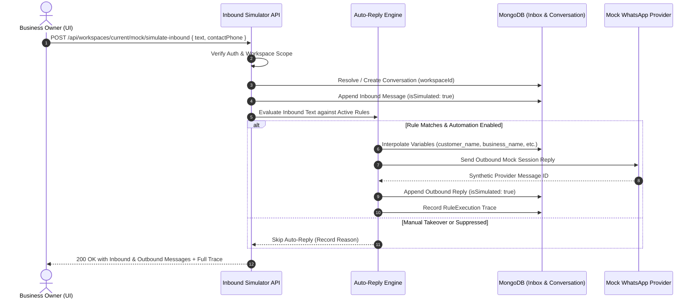

# Relay SaaS — Two-Way Inbox Simulation (Phase 8 of 15)

## 1. Overview & Operational Flow

The Two-Way Inbox Simulation enables business owners to experience real-time conversational WhatsApp interactions within their own workspace without sending messages over Meta's live network.

---

## 2. Inbound Security Invariants

1. **Strict Tenant Scope:** Endpoint `/api/workspaces/current/mock/simulate-inbound` enforces `requireAuth` and `requireWorkspace`. A user cannot inject inbound messages into another workspace's conversation.
2. **Payload Validation:** Message text is limited to 1,000 characters; phone numbers must conform to E.164 formatting or synthetic test fixtures (`+15550000001` through `+15550000999`).
3. **No Fake Provider Spoofing:** Simulated inbound events cannot be submitted to the public Meta webhook endpoint `/api/webhooks/whatsapp`.

---

## 3. Auto-Reply Execution Pipeline

When an inbound simulation occurs, [`workspaceMockService.simulateInboundMessage`](file:///c:/Users/Admin/Desktop/Relay-main/backend/src/services/workspaceMockService.js) executes the following sequence:

1. **Suppression & STOP Check:**
   - If message text matches `STOP`, `UNSUBSCRIBE`, `CANCEL`, or `END`:
     - Updates `Contact.whatsappConsentStatus = 'Opted Out'`.
     - Logs an opt-out `ConsentRecord`.
     - Suppresses all marketing auto-replies.
     - Saves an informational unsubscribe acknowledgment.

2. **Manual Takeover Verification:**
   - If `Conversation.isManualTakeover === true`, automated responses are halted to respect the human agent's interaction.

3. **Keyword Matching & Priority:**
   - Evaluates active rules for the workspace sorted by `priority: 1` (highest priority first).
   - Supports `EXACT`, `STARTS_WITH`, and `CONTAINS` match modes.

4. **Variable Token Resolution:**
   - Interpolates tokens:
     - `{{customer_name}}` -> Contact's `fullName` or "Valued Customer".
     - `{{business_name}}` -> Workspace `name`.
     - `{{service_name}}` -> Primary industry service or inquiry topic.

5. **Trace Generation:**
   - Returns structured trace details containing `matchedRuleId`, `triggeredKeyword`, `suppressionOutcome`, and `variableResolution` for instant feedback in the UI modal.
