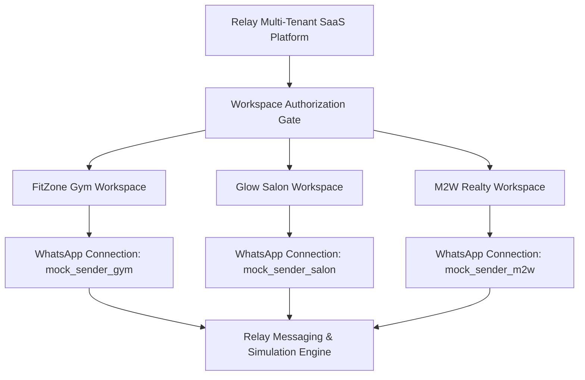

# Relay SaaS — WhatsApp Connection Manager Architecture (Phase 9 of 15)

## 1. Executive Summary & SaaS Business Model

Relay is a shared multi-tenant SaaS platform where:
- **Software Provider:** Relay provides the campaign management, queue dispatch, two-way inbox, auto-reply rules, and CRM analytics.
- **Messaging Provider:** Meta provides the WhatsApp Business Cloud API.
- **Sender Ownership:** Each authorized business provides and controls its own WhatsApp sender phone number.
- **Financial Responsibility:** Customers pay Meta messaging fees directly under an approved direct-billing arrangement. Relay charges an independent software subscription.

---

## 2. Core Architectural Components

| Component | File Reference | Responsibility |
|---|---|---|
| **`WhatsAppConnection`** | [`backend/src/models/WhatsAppConnection.js`](file:///c:/Users/Admin/Desktop/Relay-main/backend/src/models/WhatsAppConnection.js) | Canonical persistent model storing connection type, lifecycle state, phone numbers, and synthetic IDs. |
| **`WhatsAppOnboardingAttempt`** | [`backend/src/models/WhatsAppOnboardingAttempt.js`](file:///c:/Users/Admin/Desktop/Relay-main/backend/src/models/WhatsAppOnboardingAttempt.js) | Short-lived, state-hashed onboarding transaction tracking 7-step wizard progression. |
| **`WhatsAppConnectionService`** | [`backend/src/services/whatsAppConnectionService.js`](file:///c:/Users/Admin/Desktop/Relay-main/backend/src/services/whatsAppConnectionService.js) | Evaluates independent readiness criteria, safe disconnection, and system diagnostics. |
| **`WhatsAppOnboardingService`** | [`backend/src/services/whatsAppOnboardingService.js`](file:///c:/Users/Admin/Desktop/Relay-main/backend/src/services/whatsAppOnboardingService.js) | Drives wizard transitions, phone normalization, and deterministic scenario simulation. |
| **`WhatsAppBillingReadinessService`** | [`backend/src/services/whatsAppBillingReadinessService.js`](file:///c:/Users/Admin/Desktop/Relay-main/backend/src/services/whatsAppBillingReadinessService.js) | Enforces customer-direct Meta billing and blocks live activation if unverified. |
| **`WhatsAppCredentialService`** | [`backend/src/services/whatsAppCredentialService.js`](file:///c:/Users/Admin/Desktop/Relay-main/backend/src/services/whatsAppCredentialService.js) | Provides authenticated AES-256-GCM encryption-at-rest for access tokens and credentials. |
| **`WhatsAppWebhookRoutingService`** | [`backend/src/services/whatsAppWebhookRoutingService.js`](file:///c:/Users/Admin/Desktop/Relay-main/backend/src/services/whatsAppWebhookRoutingService.js) | Verifies HMAC-SHA256 signatures, maps senders to workspaces, and fails closed for unknown senders. |

---

## 3. Two Official Onboarding Paths

1. **Option A: Existing WhatsApp Business App (Coexistence Path):**
   - For businesses that already have active WhatsApp Business App chats on mobile.
   - Leverages Meta's official coexistence capabilities to allow Relay automation while preserving phone app usage.
2. **Option B: Dedicated Cloud API Number:**
   - For businesses connecting a new or dedicated clean phone number directly to the official Meta Cloud API.
   - Ideal for high-volume enterprise broadcast campaigns.

---

## 4. Phase 9 Boundary & Non-Negotiables

- **Strictly Mock Simulation:** All onboarding paths simulate Meta dialogs and phone verification without external Meta calls.
- **Zero Live Credentials:** Live Meta OAuth and Graph API calls are reserved for SaaS Prompt 14.
- **Zero Razorpay Payments:** Subscription billing integration is reserved for SaaS Prompt 10.
- **Data Preservation:** 100% preservation of M2W Luxury Realty historical data and contacts.
