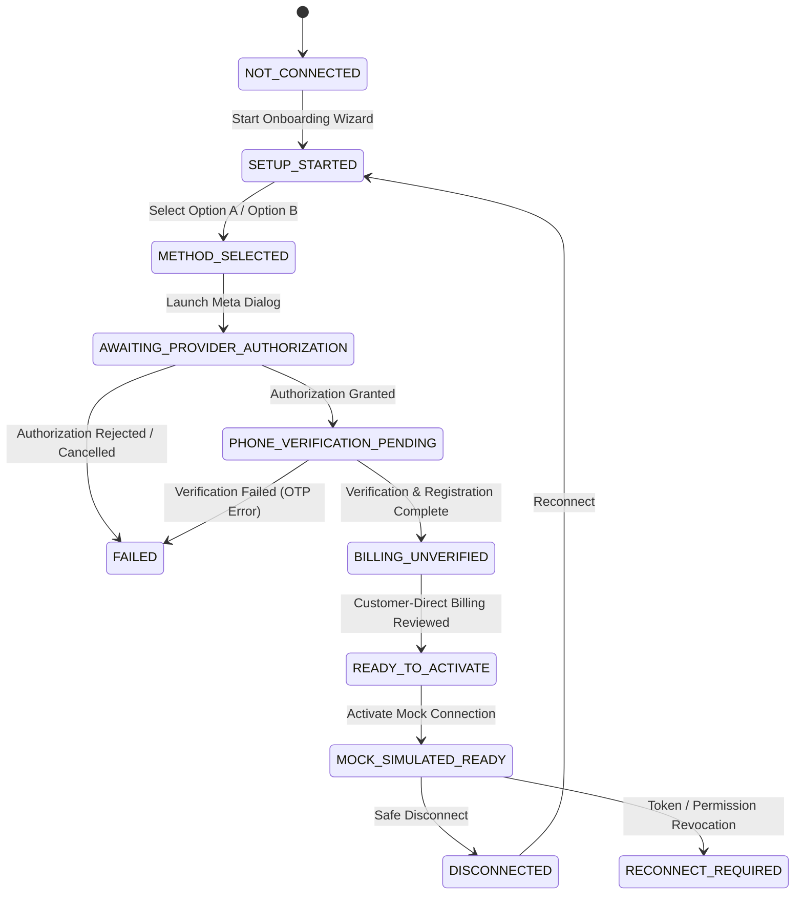

# Relay SaaS — WhatsApp Connection Lifecycle & State Machine (Phase 9 of 15)

## 1. Connection Lifecycle Overview

Relay enforces an explicit, validated state machine for WhatsApp connections across both simulation and live environments.

---

## 2. Complete Lifecycle Status Reference

| Status | Category | Semantics |
|---|---|---|
| `NOT_CONNECTED` | Initial | No connection record or wizard session exists for the workspace. |
| `SETUP_STARTED` | Onboarding | Phone number entered; onboarding transaction initiated. |
| `METHOD_SELECTED` | Onboarding | Connection type chosen (`EXISTING_APP_COEXISTENCE` or `NEW_CLOUD_API`). |
| `AWAITING_PROVIDER_AUTHORIZATION` | Onboarding | Meta Embedded Signup session launched. |
| `AUTHORIZATION_PENDING` | Onboarding | Token exchange in progress. |
| `PHONE_VERIFICATION_PENDING` | Onboarding | Awaiting 6-digit OTP verification code. |
| `REGISTRATION_PENDING` | Onboarding | Setting Cloud API two-step registration PIN. |
| `BILLING_UNVERIFIED` | Onboarding | Customer-direct Meta billing method under review. |
| `WEBHOOK_UNVERIFIED` | Onboarding | Verifying webhook callback subscription. |
| `READY_TO_ACTIVATE` | Onboarding | All independent readiness checks passed. |
| `MOCK_SIMULATED_READY` | Terminal (Mock) | Operational mock simulation context active for workspace. |
| `LIVE_READY` | Terminal (Live) | Reserved for Phase 14 (strictly blocked in Phase 9). |
| `SUSPENDED` | Operational | Workspace suspended by operator or policy violation. |
| `RECONNECT_REQUIRED` | Operational | Provider revoked token or changed number configuration. |
| `DISCONNECTING` | Teardown | Safe disconnect in progress. |
| `DISCONNECTED` | Terminal (Inactive) | Disconnected; historical data 100% preserved. |
| `FAILED` | Error | Unrecoverable setup or authorization error. |

---

## 3. Strict Mode Boundaries

- **Mock Connections:** Advance through steps 1 to 7 to achieve `MOCK_SIMULATED_READY`.
- **Live Readiness Boundary:** A mock connection can **NEVER** be promoted to `LIVE_READY`. Any attempt to trigger live sending returns HTTP 403 Forbidden.
- **Fail-Closed Transitions:** Transitions from `FAILED`, `DISCONNECTED`, or `SUSPENDED` directly into sending states without re-running authorization are rejected by `whatsAppConnectionService`.
