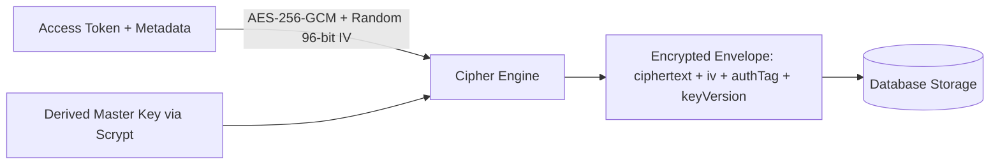

# Relay SaaS — Provider Credential Security & Encryption Architecture (Phase 9 of 15)

## 1. Security Directive & Threat Model

Provider credentials (Meta System User Access Tokens, WABA Secrets, and Registration PINs) represent high-value targets. Relay enforces a strict zero-plaintext policy across all tiers:

- ❌ Never store unencrypted access tokens in MongoDB documents.
- ❌ Never return provider tokens in frontend API responses.
- ❌ Never log tokens, headers, or authorization payloads in terminal outputs.
- ❌ Never pass raw tokens in queue jobs or background worker messages.
- ❌ Never store tokens in browser localStorage or sessionStorage.

---

## 2. AES-256-GCM Authenticated Encryption

Implemented in [`WhatsAppCredentialService`](file:///c:/Users/Admin/Desktop/Relay-main/backend/src/services/whatsAppCredentialService.js):



### Envelope Structure:
```json
{
  "ciphertext": "a1b2c3d4...",
  "iv": "e5f6071829...",
  "authTag": "98badcfe...",
  "keyVersion": 1,
  "encryptedAt": "2026-10-21T07:30:00.000Z"
}
```

---

## 3. Tamper Resistance & Key Rotation

- **Authentication Tag:** The 128-bit authentication tag guarantees ciphertext integrity. Any modification of the ciphertext or tag causes decryption to throw an immediate exception.
- **Key Versioning & Rotation:** The `rotateCredential(envelope, newKeyHex)` method allows zero-downtime re-encryption with incremented `keyVersion`.
- **Mock Sandbox Isolation:** Mock connections utilize synthetic references (`mock_waba_*`, `mock_phone_id_*`) and do not require live provider secrets, preventing credential pollution.
- **Production Roadmap (Phase 14):** Handoff will support AWS KMS or HashiCorp Vault for hardware-backed master key management.
