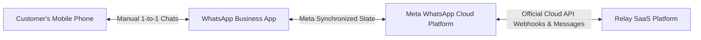

# Relay SaaS — WhatsApp Business App Coexistence Architecture (Option A)

## 1. Overview of Coexistence

Meta's official WhatsApp Business Platform coexistence capability allows small and medium businesses to continue using their mobile WhatsApp Business App while concurrently granting a Tech Provider (Relay) Cloud API access to run automated campaigns, durable queues, and keyword auto-replies.

---

## 2. Eligibility & Assessment Model

Coexistence is not universally guaranteed for all legacy phone numbers or regions. Relay models eligibility explicitly in [`WhatsAppOnboardingAttempt.eligibilityAssessment`](file:///c:/Users/Admin/Desktop/Relay-main/backend/src/models/WhatsAppOnboardingAttempt.js):

| Eligibility State | Semantics | UI Representation |
|---|---|---|
| `NOT_ASSESSED` | Phone number entered; no provider check performed. | Neutral gray badge |
| `INFORMATION_REQUIRED` | Business account details required before evaluation. | Amber alert |
| `POTENTIALLY_ELIGIBLE` | Number format and country match baseline criteria. | Blue info badge |
| `PROVIDER_VERIFICATION_REQUIRED` | Awaiting Meta Embedded Signup session. | Indigo badge |
| `ELIGIBLE_VERIFIED` | Meta confirmed coexistence authorization. | Green verified badge |
| `INELIGIBLE_VERIFIED` | Number or account does not meet Meta coexistence criteria. | Red warning card |

---

## 3. Simulated Scenarios in Phase 9

### Scenario A — `SCENARIO_A_APP_ELIGIBLE`
- Simulates successful coexistence assessment.
- Sets `eligibilityAssessment.status = 'ELIGIBLE_VERIFIED'`.
- Transitions connection to `PHONE_VERIFICATION_PENDING`.

### Scenario B — `SCENARIO_B_APP_INELIGIBLE`
- Simulates ineligibility under Meta's current rules.
- Sets `eligibilityAssessment.status = 'INELIGIBLE_VERIFIED'`.
- Halts wizard with clear guidance recommending Option B (Dedicated Cloud API Number) or updating mobile app credentials.
- Leaves existing mobile phone records unharmed.
