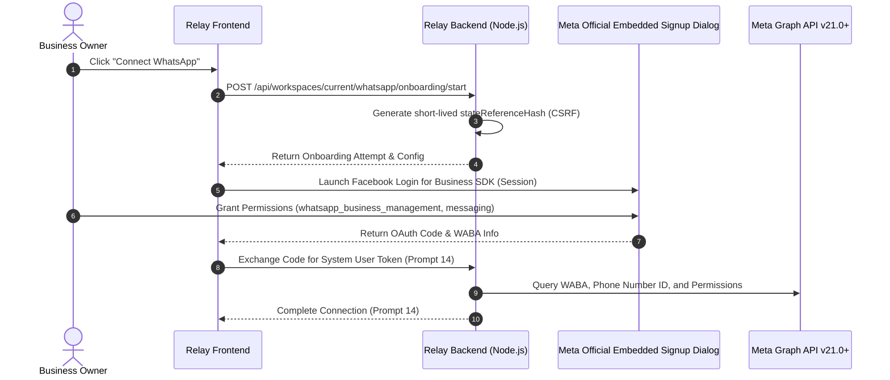

# Relay SaaS — Meta Embedded Signup Readiness (Phase 9 of 15)

## 1. Meta Embedded Signup Conceptual Architecture

Meta Embedded Signup allows third-party SaaS platforms (Tech Providers) to embed Meta's official onboarding flow directly inside their application UI via an authorized Facebook Login for Business dialog.

---

## 2. Environment Readiness Checklist

| Readiness Requirement | Description | Current Status | Handoff Target |
|---|---|---|---|
| **Meta Business Portfolio** | Verified business portfolio on Meta Business Manager. | `OPERATOR_CONFIGURED` | Phase 14 |
| **Meta App & Product** | App registered with WhatsApp product and Facebook Login for Business. | `OPERATOR_CONFIGURED` | Phase 14 |
| **Embedded Signup Configuration** | Config ID setup with System User and asset sharing rules. | `PREPARED` | Phase 14 |
| **Required Permissions** | `whatsapp_business_management`, `whatsapp_business_messaging`. | `DOCUMENTED` | Phase 14 |
| **Webhook Callback URL** | HTTPS endpoint with HMAC-SHA256 signature verification. | `VERIFIED` | Phase 9 (Current) |
| **OAuth State Reference Hash** | CSRF prevention via 32-byte cryptographic nonce. | `IMPLEMENTED` | Phase 9 (Current) |
| **No Password Collection** | Zero Facebook passwords or session cookies requested by Relay. | `ENFORCED` | Phase 9 (Current) |

---

## 3. Official Documentation Reviewed

In accordance with Section 14 of the master prompt:
- [Meta Partner Program Guidelines](https://whatsappbusiness.com/partners/become-a-partner/)
- [WhatsApp Business Platform Developer Hub](https://whatsappbusiness.com/developers/developer-hub/)
- [Meta WhatsApp Business Platform Postman Collection](https://www.postman.com/meta/whatsapp-business-platform/overview)

*Note: Phase 9 implements the complete transaction foundation and honest mock simulation. Live OAuth token exchange is scheduled for SaaS Prompt 14.*
