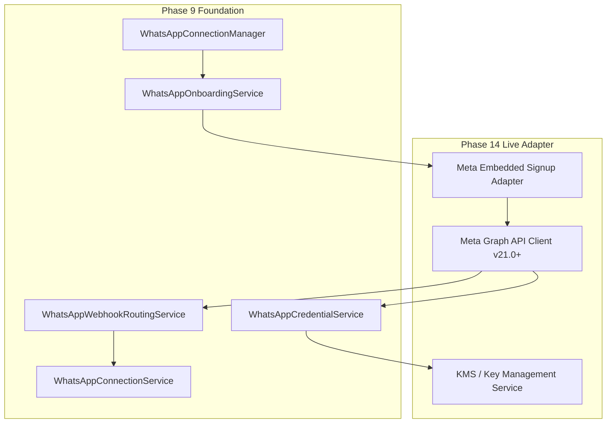

# Relay SaaS — Phase 14 Live Meta Integration Checklist & Interface Contract

## 1. Architectural Interface Contract

This document specifies the exact future integration contract between the components built in Phase 9 and the live Meta Cloud API integration scheduled for **SaaS Prompt 14**.



---

## 2. Live Provider Activation Prerequisites

A workspace connection can transition from `MOCK_SIMULATED_READY` or `READY_TO_ACTIVATE` to `LIVE_READY` **only** when all 10 independent conditions evaluate to true:

```javascript
canActivateLiveMessaging =
  officialProviderAuthorizationVerified &&  // 1. Meta OAuth token exchanged & valid
  authorizedSenderVerified &&                // 2. Phone Number ID verified on Meta Graph API
  providerPermissionsVerified &&             // 3. whatsapp_business_management & messaging granted
  requiredRegistrationVerified &&            // 4. Two-step verification PIN registered on Cloud API
  webhookReadinessVerified &&                // 5. Callback URL subscribed with HMAC-SHA256
  customerBillingResponsibilityVerified &&   // 6. Direct payment method confirmed on Meta
  workspaceActive &&                         // 7. Relay workspace in ACTIVE status
  relaySubscriptionEntitlementValid &&       // 8. ₹799/mo plan active via Razorpay (Prompt 10)
  noBlockingProviderRestrictions &&          // 9. Account not flagged for spam / template violations
  deploymentLiveGateEnabled;                 // 10. Global server deployment flag enabled
```

---

## 3. Component Handoff Matrix

| Component | Current State (Phase 9) | Future Implementation (Phase 14) |
|---|---|---|
| **`WhatsAppOnboardingAttempt`** | State hash and step transitions tracked. | Will accept raw authorization code from Facebook Login dialog. |
| **`WhatsAppCredentialService`** | AES-256-GCM authenticated encryption active. | Integrates AWS KMS / HashiCorp Vault for master key rotation. |
| **`WhatsAppWebhookRoutingService`** | Signature verification and fail-closed routing verified. | Subscribed to live Meta webhook callback URL. |
| **`MessagingProviderRegistry`** | Only `MOCK` mode enabled; `LIVE` returns 403. | Mounts `MetaCloudWhatsAppProvider` alongside `MockWhatsAppProvider`. |

---

## 4. Non-Negotiable Phase Boundaries

- **Phase 9 is complete.**
- **Do not connect live Meta credentials now.**
- **Do not attach partner lines of credit.**
- **Do not start SaaS Prompt 10 or 14.**
- **Await user instruction before proceeding to Prompt 10.**
