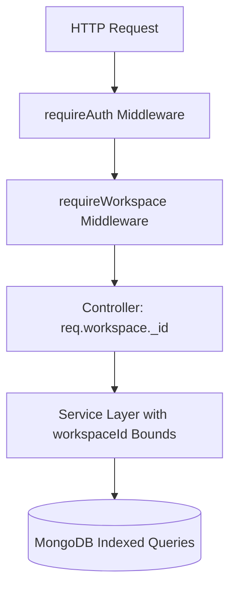

# Relay SaaS — Security & Attack Scenario Tests (Phase 9 of 15)

## 1. Security Architecture & Threat Mitigations

Relay enforces defense-in-depth isolation across all connection, onboarding, and webhook routing APIs.

---

## 2. Threat Vector Mitigations & Verification Evidence

| # | Attack Scenario | Vector | Defensive Control | Result |
|---|---|---|---|---|
| 1 | **Cross-Tenant Connection Read** | User A queries Workspace B's connection. | Controller binds strictly to `req.workspace._id` established by JWT. User A receives 0 records. | **PASS** |
| 2 | **Cross-Tenant Disconnect** | User A posts disconnect for Workspace B. | Middleware blocks unauthorized workspace access with HTTP 403/404. | **PASS** |
| 3 | **Partner Credit Line Sharing** | Client payload includes `partnerCredit` or `creditLineId`. | `whatsAppBillingReadinessService.assertZeroPartnerCreditSharing` throws `PARTNER_CREDIT_FORBIDDEN`. | **PASS (403)** |
| 4 | **Webhook Signature Forgery** | Attacker posts forged webhook payload without valid signature. | `whatsAppWebhookRoutingService.verifySignature` fails constant-time comparison. | **PASS (Rejected)** |
| 5 | **Unknown Sender Event Injection** | Webhook payload contains unassociated phone number. | `resolveSenderContext` fails closed with `UNKNOWN_SENDER_REJECTED` (404). | **PASS (404)** |
| 6 | **Ambiguous Sender Collision** | Two workspaces share identical phone without partner authorization. | `resolveSenderContext` detects multiple matches and fails closed (`AMBIGUOUS_SENDER_REJECTED`). | **PASS (409)** |
| 7 | **Inactive Connection Event** | Webhook event targeting disconnected or suspended connection. | `resolveSenderContext` rejects event with `CONNECTION_INACTIVE` (403). | **PASS (403)** |
| 8 | **Tampered Credential Envelope** | Ciphertext or authTag altered in database. | AES-256-GCM decipher throws authentication tag verification exception. | **PASS (Rejected)** |
| 9 | **Expired Onboarding Replay** | Attacker replays expired onboarding attempt. | `advanceMockStep` detects `expiresAt < now`, marks attempt `EXPIRED`, and returns 410. | **PASS (410)** |
| 10 | **Live Provider Bypass** | Client requests live dispatch. | Server-side gate strictly blocks live messaging in Phase 9. | **PASS (403)** |
