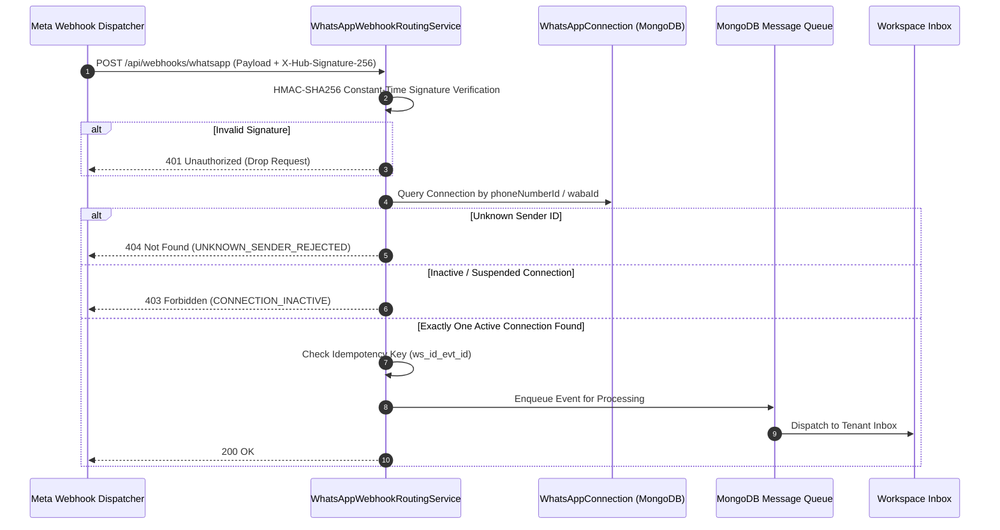

# Relay SaaS — Webhook Routing & Event Security Architecture (Phase 9 of 15)

## 1. Single Multi-Tenant Endpoint Architecture

Relay exposes a unified HTTPS webhook endpoint to receive incoming WhatsApp messages, status receipts (`SENT`, `DELIVERED`, `READ`, `FAILED`), and account updates.



---

## 2. Cryptographic Signature Verification

- **Algorithm:** HMAC-SHA256 using Meta App Secret.
- **Timing Attack Defense:** Utilizes `crypto.timingSafeEqual` over fixed-length binary buffers to prevent timing side-channel attacks:

```javascript
verifySignature(rawBody, signatureHeader, appSecret) {
  const parts = signatureHeader.split('=');
  if (parts.length !== 2 || parts[0] !== 'sha256') return false;

  const hmac = crypto.createHmac('sha256', appSecret).update(rawBody).digest('hex');
  const expectedBuf = Buffer.from(parts[1], 'hex');
  const calculatedBuf = Buffer.from(hmac, 'hex');

  return crypto.timingSafeEqual(expectedBuf, calculatedBuf);
}
```

---

## 3. Fail-Closed Routing Invariants

1. **Strict Tenant Mapping:** Webhook events are routed exclusively by trusted provider sender identifiers (`phoneNumberId` or `wabaId`). The client cannot supply arbitrary `workspaceId` headers or query params.
2. **Fail-Closed on Unknown Senders:** If an incoming message originates from an unregistered or deactivated phone number, the router halts with `UNKNOWN_SENDER_REJECTED` (404) without guessing.
3. **Collision Protection:** If multiple workspaces match the same sender identity without authorized sharing, routing halts with `AMBIGUOUS_SENDER_REJECTED` (409).
4. **Idempotent Deduplication:** Repeated provider callbacks are deduplicated using `idempotencyKey = ws_<workspaceId>_evt_<providerEventId>_<eventType>`.
