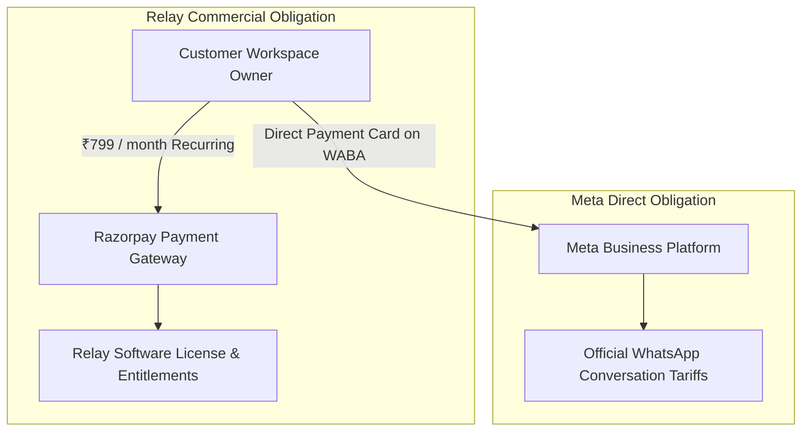

# SaaS 10 — Billing Architecture & Commercial Model

## 1. Executive Overview
Relay operates on a pure SaaS recurring software subscription model. A business pays Relay for access to the multi-industry CRM platform, audience segmentation, template studio, automation queue, and simulation engine.

Critically, **Meta WhatsApp Business messaging conversation fees remain strictly direct between the customer's business and Meta**. Relay never marks up message costs, does not absorb Meta charges into software fees, and does not attach a shared partner line of credit.

---

## 2. Commercial Independence

- **Relay Solo Subscription (₹799/month)**: Bills solely for software capabilities, local storage, contacts, and queue automation.
- **Meta Direct Conversation Tariffs**: Handled independently via the customer's WhatsApp Business Account (WABA) payment method, configured directly in Meta Business Manager.

---

## 3. High-Level Subsystems
1. **Plan Catalog Service**: Authoritative backend repository defining public-safe and active plans (`free_exploration` ₹0 trial, `relay_solo` ₹799/month launch plan).
2. **14-Day Free Mock Sandbox Trial**: Server-authoritative trial lifecycle enforcing one trial per workspace and per business owner.
3. **Razorpay Recurring Subscriptions**: Integration using Razorpay Subscriptions API with Test Mode by default (`RAZORPAY_MODE=test`, `RELAY_LIVE_BILLING_ENABLED=false`).
4. **Checkout Verification**: HMAC-SHA256 signature verification matching `${payment_id}|${subscription_id}`.
5. **Signed Webhook Ingestion**: Raw-body cryptographic HMAC verification with `X-Razorpay-Signature` and idempotency ledger.
6. **Workspace Entitlements Engine**: Centralized capability gatekeeper enforcing tenant subscription status on all sensitive actions.
7. **Monthly Usage Quotas**: Atomic counters (`UsageCounter`) tracking contacts, campaigns, simulated messages, templates, and automation rules.
8. **Customer Billing Portal**: Dedicated UI at `/app/settings/billing` displaying plan details, renewal countdowns, usage gauges, transaction history, and cancellation options.

---

## 4. Multi-Tenant Financial Security & Isolation
- Every subscription, payment transaction, and webhook event is strictly linked to a specific `workspaceId`.
- Workspace owners can only manage their own workspace's billing; cross-tenant query, modification, or cancellation attempts are blocked with 403 Forbidden.
- M2W Luxury Realty is granted an auditable `LEGACY_ENTITLED` status, ensuring zero unexpected charges or loss of reference access.
