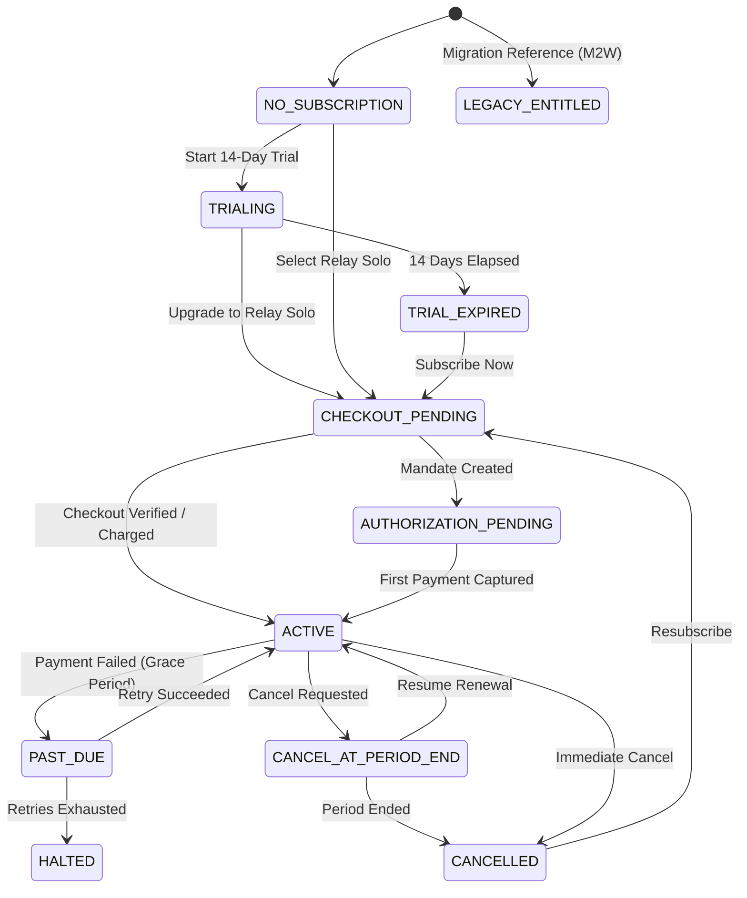

# SaaS 10 — Subscription State Machine & Lifecycle Management

## 1. Internal Billing State Machine
The Relay billing engine defines explicit, deterministic internal statuses:

---

## 2. Cancellation Policies
Relay supports two cancellation modes:
1. **Cancel at Period End (Default & Recommended)**:
   - Access to full CRM, segmentation, and templates continues until `currentPeriodEnd`.
   - Razorpay recurring mandate is cancelled at cycle boundary.
   - Preserves customer data indefinitely.
2. **Immediate Cancellation**:
   - For special customer support cases or explicit termination.
   - Deactivates subscription immediately while retaining all historical records.

---

## 3. Re-Subscription Flow
A business whose subscription is cancelled or trial is expired can resubscribe at any time:
- Calls `subscriptionService.createSubscription()`.
- Generates a fresh Razorpay recurring subscription.
- Preserves all existing contacts, templates, campaign records, and inbox interactions.
- Does not reset trial eligibility.
